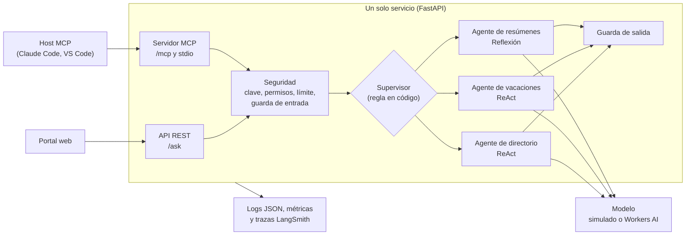

# HR Assistant multiagente en producción (Reto M4)

Asistente de Recursos Humanos que responde preguntas sobre empleados, calcula el
saldo de vacaciones según la Ley Federal del Trabajo y resume departamentos. Un
supervisor reparte cada pregunta a un agente LangGraph especializado. Las mismas
capacidades se ofrecen por una API REST, un portal web y un servidor MCP.

| Qué | Dónde |
| --- | --- |
| API REST y portal | `GET /`, `POST /ask`, `GET /health`, `GET /docs` (Swagger) |
| Métricas y tablero | `GET /metrics`, `GET /metrics/prometheus`, `GET /dashboard` |
| Servidor MCP | HTTP en `/mcp` y stdio con `python -m app.mcp_server` |
| Documentación | [`doc/`](doc/): arquitectura, ADR, observabilidad, costos, seguridad, despliegue |
| Evidencia | [`evidence/`](evidence/): salidas reales de pruebas, costos y carga |
| Video de demostración | <https://youtu.be/QCHlp6ceZJU> (4 minutos) |

**Publicado en Render:** <https://hr-assistant-albertorayon.onrender.com> (`/health`, `/docs`, `/dashboard`, `/mcp`). El plan
gratuito duerme el servicio tras 15 minutos sin uso: la primera petición tarda cerca
de un minuto.

## Arquitectura en una imagen



El detalle está en [`doc/architecture.md`](doc/architecture.md) y los grafos de cada
agente, generados desde el código, en [`doc/graphs.md`](doc/graphs.md).

## Requisitos

- Python 3.12 y [uv](https://docs.astral.sh/uv/).
- Docker, solo para construir el contenedor.
- Para el modelo real: cuenta gratuita de Cloudflare (Workers AI y AI Gateway).
- Para las trazas: cuenta gratuita de LangSmith.

Con el modelo simulado (`MODEL_PROVIDER=fake`, el valor por omisión) no hace falta
ninguna cuenta ni red.

## Instalar y correr

```bash
git clone https://github.com/AlbRayAden/NextGenCode-M4-Agentes.git
cd NextGenCode-M4-Agentes
git switch reto
cd AlbertoRayon_reto
uv venv --python 3.12
uv pip install -r requirements.txt -r requirements-dev.txt
cp .env.example .env && chmod 600 .env
```

En `.env`, define al menos una clave de acceso de 16 caracteres o más:

```bash
API_KEYS=portal:<una clave larga>
```

Arranca el servicio. `--env-file` carga `.env` sin que el código lo lea por su cuenta:

```bash
uv run --env-file .env uvicorn app.main:app --port 8000
```

Abre <http://127.0.0.1:8000>, escribe tu clave y pregunta, por ejemplo:

- `¿Quién es EMP-0004?`
- `¿Cuántas vacaciones le quedan a EMP-0001?`
- `Resume el departamento de Tecnología`
- `Mi correo es ana@ejemplo.test, ¿quién es EMP-0005?` (el correo se oculta)
- `Dame el teléfono de EMP-0001` (se bloquea)

### Variables de entorno

Todas están en [`.env.example`](.env.example) con su explicación. Las principales:

| Variable | Por omisión | Para qué |
| --- | --- | --- |
| `ENVIRONMENT` | `development` | `production` aplica las reglas de compliance |
| `MODEL_PROVIDER` | `fake` | `workers` usa Workers AI directo; `gateway`, a través de AI Gateway |
| `API_KEYS` | vacía | `cliente:clave,cliente2:clave2` (secreto) |
| `CLIENT_SCOPES` | todos | Permisos por cliente: `ask`, `mcp`, `metrics` |
| `CF_ACCOUNT_ID`, `CF_GATEWAY_ID`, `CF_API_TOKEN` | | Cuenta, gateway y token de Cloudflare |
| `LANGSMITH_TRACING`, `LANGSMITH_API_KEY` | `false`, vacía | Trazas en LangSmith |
| `ROUTING`, `HISTORY_WINDOW`, `COMPACT_PROMPT` | `true`, `6`, `true` | Palancas de costo |
| `CACHE_TTL_SECONDS`, `RESPONSE_CACHE_TTL_SECONDS` | `0`, `0` | Cachés del gateway y del servicio |

### Con el modelo real

```bash
MODEL_PROVIDER=workers
CF_ACCOUNT_ID=<tu account id>
CF_API_TOKEN=<token con permiso de Workers AI>
```

Con `MODEL_PROVIDER=gateway` las llamadas pasan por AI Gateway, que agrega caché y
analítica; requiere un gateway y permiso para usarlo (ver
[`doc/deployment.md`](doc/deployment.md)).

### Con Docker

```bash
docker build -t hr-assistant .
docker run --rm -p 8000:8000 --env-file .env hr-assistant
```

La construcción corre las pruebas y pylint: si fallan, la imagen no se crea.

## Usar el servidor MCP

Tres herramientas, y cada una ejecuta un agente LangGraph:

| Herramienta | Agente | Patrón |
| --- | --- | --- |
| `ask_hr(question)` | Supervisor que delega en los especialistas | Supervisor y ReAct |
| `vacation_balance(employee_id)` | Agente de vacaciones, con cifras verificadas en código | ReAct |
| `department_summary(department)` | Borrador, crítica en código y revisión con tope | Reflexión |

Además expone el recurso `hr://departments` y el prompt `vacation_review`.

Por stdio, desde esta carpeta (Claude Code lee [`.mcp.json`](.mcp.json) solo):

```bash
claude mcp add hr-assistant -- uv run python -m app.mcp_server
```

Por HTTP, contra el servicio corriendo o publicado, con una clave que tenga el
permiso `mcp`:

```bash
claude mcp add --transport http hr-assistant https://<servicio>.onrender.com/mcp \
  --header "X-API-Key: <clave con permiso mcp>"
```

Más detalle en [`doc/mcp.md`](doc/mcp.md).

## Pruebas y verificación

```bash
uv run pytest tests --cov=app --cov-fail-under=90   # unitarias, BDD y MCP
uv run pylint app tests --max-line-length=88 \
  --disable=missing-function-docstring,redefined-outer-name,too-few-public-methods
uv run playwright install chromium                  # una sola vez
uv run python scripts/run_e2e.py                    # portal en un navegador
uv run python scripts/evaluate.py                   # costos contra la línea base
```

Contra un servicio publicado, con las claves en variables de entorno:

```bash
SMOKE_API_KEY=... SMOKE_MCP_KEY=... SMOKE_METRICS_KEY=... \
  uv run python scripts/smoke.py https://<servicio>.onrender.com
```

## Resultados

| Aspecto | Resultado | Evidencia |
| --- | --- | --- |
| Pruebas | 158 unitarias, BDD y MCP con 99 % de cobertura; 6 de navegador; pylint 10/10 | [`evidence/tests.txt`](evidence/tests.txt) |
| Contrato del curso (`sesion04/verification`) | `unit`, `contract`, `qa`, `e2e` y `evaluate` en OK | [`evidence/course-verification.txt`](evidence/course-verification.txt) |
| Costos con el modelo real | 76.1 % menos que la línea base, con la misma calidad (100 %) | [`doc/costs.md`](doc/costs.md) |
| Trazas | Árbol completo en LangSmith, con tokens y costo, sin texto | [`evidence/langsmith.txt`](evidence/langsmith.txt) |
| Producción | Prueba de humo en OK y preguntas reales contra Render, por API y por MCP | [`evidence/production.txt`](evidence/production.txt) |
| Concurrencia | 400 peticiones, 40 en paralelo, todas con `200` | [`evidence/load.txt`](evidence/load.txt) |
| Seguridad | 20 controles, cada uno con su código y su prueba | [`doc/security.md`](doc/security.md) |

## Estructura

```
AlbertoRayon_reto/
  app/
    main.py          API FastAPI, middleware de seguridad y observabilidad, MCP montado
    service.py       Orquesta: guardas, enrutamiento, caché, agentes, métricas
    agents/          supervisor.py, react.py, summary.py (grafos LangGraph)
    mcp_server.py    Herramientas, recurso y prompt MCP; entrada por stdio
    llm.py           Interfaz del modelo, modelo simulado, Workers AI, precios, enrutador
    guards.py pii.py access.py   Seguridad
    logs.py metrics.py tracing.py   Observabilidad
    config.py preflight.py   Configuración y compliance
    directory.py vacations.py   Dominio: directorio y cálculo de la LFT
    static/          Portal y tablero
  data/              Empleados ficticios, vacaciones, precios, set de evaluación
  tests/  e2e/       Unitarias, BDD (Gherkin en español), MCP y Playwright
  scripts/           evaluate, smoke, load_test, run_e2e, export_graphs
  doc/  evidence/    Documentación y salidas reales
  Dockerfile  render.yaml  .mcp.json  .env.example
```

## Limitaciones conocidas

- Las métricas y el límite de peticiones viven en la memoria de cada proceso. Con
  varias copias, cada una lleva su cuenta; ver [`doc/architecture.md`](doc/architecture.md).
- El plan gratuito de Render duerme el servicio tras 15 minutos sin uso: la primera
  petición después tarda cerca de un minuto.
- Los datos de empleados son ficticios.
