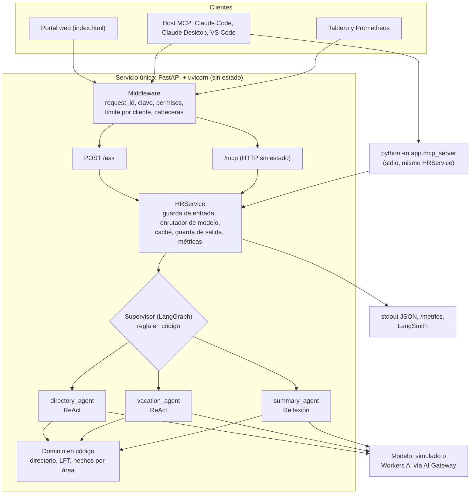

# Arquitectura

## Componentes

## Flujo de una petición

1. El middleware asigna el `request_id` (o conserva el del cliente), identifica al
   cliente por su clave, comprueba su permiso y su límite por minuto.
2. `HRService` pasa la pregunta y el historial por la guarda de entrada: bloquea
   inyecciones y solicitudes de datos protegidos, y enmascara los datos personales.
3. El enrutador elige el modelo chico o el grande con una regla en código. Solo
   viajan los últimos `HISTORY_WINDOW` mensajes.
4. Si la caché de respuestas está encendida y ya tiene la pregunta, responde sin
   llamar al modelo.
5. El supervisor elige al especialista con otra regla en código y lo ejecuta.
6. El agente razona en su grafo. Las herramientas son de solo lectura y solo ven
   los campos públicos del directorio.
7. La guarda de salida revisa la respuesta: datos personales, filtración del prompt
   de sistema y largo.
8. Se registran el evento `agent_run`, la auditoría, las métricas y la traza.

El servidor MCP llama al mismo `HRService`, así que un host MCP tiene exactamente
las mismas protecciones y mediciones que el portal.

## Los agentes y sus patrones

| Agente | Patrón | Nodos del grafo | Tope |
| --- | --- | --- | --- |
| Supervisor | Supervisor con especialistas | `supervisor` y un nodo por especialista | Una delegación |
| `directory_agent` | ReAct | `model`, `tools`, `cap` | `AGENT_MAX_STEPS` llamadas al modelo |
| `vacation_agent` | ReAct | `model`, `tools`, `cap` | `AGENT_MAX_STEPS` |
| `summary_agent` | Reflexión | `gather_facts`, `draft`, `critique`, `revise`, `finalize` | 2 revisiones |

Los diagramas exactos, generados desde el código, están en [`graphs.md`](graphs.md).

## Decisiones y sus motivos

Cada decisión tiene su ADR en [`adr/`](adr/). En corto:

- **Un solo servicio para API y MCP.** Una sola imagen, un solo despliegue y una sola
  capa de seguridad. El costo es que escalan juntos.
- **Sin estado.** El historial lo manda el cliente y el MCP por HTTP es sin estado:
  cualquier copia atiende cualquier petición, y escalar es correr más copias.
- **El código decide los números.** El modelo elige la herramienta y redacta; el
  saldo de vacaciones y las cifras de los resúmenes salen de funciones probadas.
- **Supervisor y enrutador como reglas en código.** No gastan tokens, son
  deterministas y se prueban con pruebas unitarias.
- **Modelo detrás de una interfaz.** El modelo simulado permite probar todo sin red
  ni costo; cambiar de proveedor no toca a los agentes.

## Concurrencia, escalabilidad y resiliencia

- Los endpoints síncronos corren en el grupo de hilos de FastAPI y las herramientas
  MCP en hilos de `anyio`, así que una llamada lenta al modelo no bloquea a las demás.
- `WEB_CONCURRENCY` define cuántos procesos de uvicorn corren en el contenedor.
- Cada llamada al modelo tiene tiempo límite (`MODEL_TIMEOUT_SECONDS`). Si el modelo
  falla, la API responde `502` con el `request_id`, sin tumbar el proceso.
- Todo bucle tiene tope: pasos del ReAct, revisiones de la reflexión y
  `recursion_limit` en cada grafo.
- `python -m app.preflight` valida la configuración antes de uvicorn: una
  configuración insegura termina con un mensaje claro, sin reinicios en bucle.
- `HEALTHCHECK` en el contenedor y `healthCheckPath` en Render.

### Lo que no escala todavía

Las métricas, el límite de peticiones y la caché de respuestas viven en la memoria de
cada proceso. Con varias copias, el límite efectivo se multiplica por el número de
copias y `/metrics` reporta solo el proceso que contesta (por eso incluye `pid`).
Para crecer, el siguiente paso es mover esos tres a un almacén compartido como Redis
y recolectar `/metrics/prometheus` de cada copia.

## Desarrollo y producción

| | Desarrollo | Producción |
| --- | --- | --- |
| `ENVIRONMENT` | `development` | `production` |
| Modelo | Simulado, sin red | Workers AI; el simulado impide arrancar |
| Claves | Opcionales para probar | Obligatorias, de 16 caracteres o más, con permisos explícitos |
| Trazas | Apagadas | Encendidas, sin texto de preguntas ni respuestas |
| Secretos | `.env` local con permisos 600 | Variables de Render con `sync: false` |
