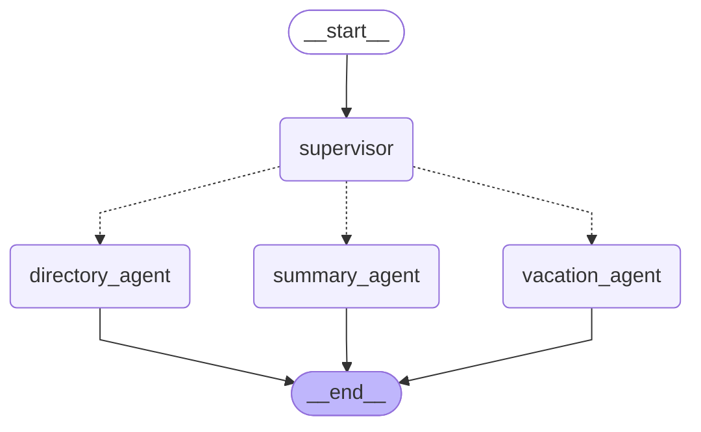
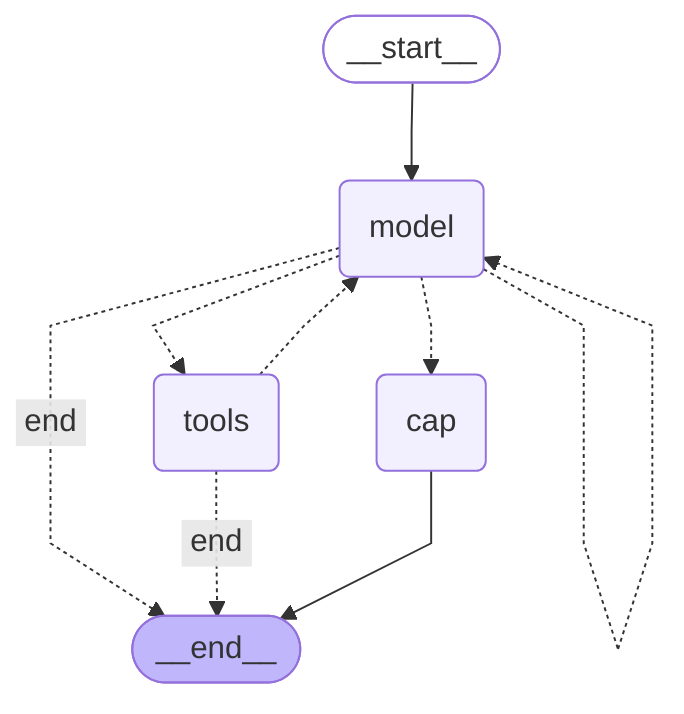
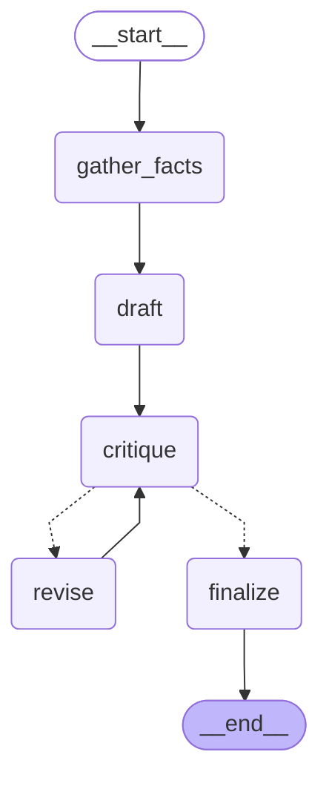

# Grafos de los agentes

Generado con `python scripts/export_graphs.py`. No editar a mano.

## Supervisor con especialistas

## Agente ReAct (directorio y vacaciones)

## Agente de reflexión (resúmenes)

