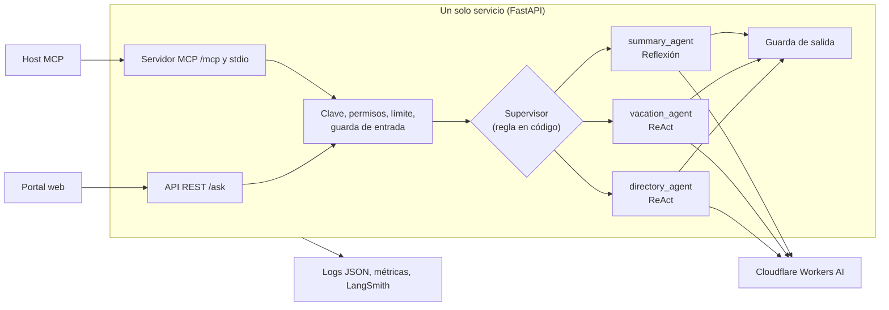

# feat: Sistema multiagente en producción con servidor MCP y agentes LangGraph (Alberto Rayón)

## Resumen de cambios

HR Assistant multiagente listo para producción: un supervisor reparte cada pregunta a
un agente LangGraph especializado (directorio, vacaciones según la LFT o resúmenes
por departamento). El mismo sistema se expone por una API REST con portal web y por
un servidor MCP con tres herramientas, con observabilidad, optimización de costos
medida contra una línea base y controles de seguridad con protección de datos
personales.

Todo el trabajo está en `AlbertoRayon_reto/`; `sesion01` a `sesion04` no se tocaron.

## Arquitectura del sistema



**Flujo de comunicación.** El portal y los hosts MCP entran por el mismo middleware,
que asigna un `request_id`, identifica al cliente por su clave y comprueba su permiso
y su límite. El servicio revisa la pregunta (inyección, datos protegidos y datos
personales), elige el modelo con una regla, y el supervisor delega en un especialista.
El agente razona en su grafo y usa herramientas de solo lectura. La respuesta pasa
por la guarda de salida, y todo queda en el log, las métricas y la traza.

**Decisiones y su justificación** (detalle en `doc/adr/`):

- Un solo servicio para la API y el MCP: una imagen, un despliegue y una sola capa de
  seguridad; un host MCP recibe las mismas protecciones que el portal.
- Sin estado: el historial lo manda el cliente y el MCP por HTTP no guarda sesión,
  así que escalar es correr más copias.
- El código decide los números: el modelo elige la herramienta y redacta, pero el
  saldo de vacaciones y las cifras de los resúmenes salen de funciones probadas.
- Supervisor y enrutador de modelo como reglas en código: no gastan tokens y son
  deterministas.
- Cada herramienta MCP ejecuta un agente LangGraph con un patrón explícito: ReAct
  (`vacation_balance`), reflexión (`department_summary`) y supervisor (`ask_hr`).

## Cumplimiento de la rúbrica

| Criterio | Qué se entrega | Dónde verlo |
| --- | --- | --- |
| Arquitectura y despliegue | Contenedor con compuerta de pruebas, Blueprint de Render, `/health`, Swagger en `/docs`, prueba de carga | `doc/architecture.md`, `doc/deployment.md`, `evidence/load.txt` |
| Observabilidad | `request_id` de punta a punta, log JSON, métricas técnicas y de negocio, tablero, formato Prometheus, trazas LangSmith | `doc/observability.md`, `evidence/logs.txt`, `evidence/langsmith.txt` |
| Costos | Seis palancas y una ablación contra la línea base | `doc/costs.md`, `evidence/costs-workers.md` |
| Seguridad | 20 controles, cada uno con su código y su prueba; compliance como código | `doc/security.md`, `doc/compliance-checklist.md` |
| Documentación | README, arquitectura, 6 ADR, guías por tema y evidencia real | `README.md`, `doc/`, `evidence/` |

## Resultados medidos

- Pruebas: 156 unitarias, BDD y MCP con 98 % de cobertura; 6 de navegador; pylint
  10/10 (`evidence/tests.txt`).
- Verificaciones del curso (`sesion04/verification`): `unit`, `contract` (22
  pruebas), `qa`, `e2e` y `evaluate` en OK (`evidence/course-verification.txt`).
- Costos con el modelo real (Workers AI): misma calidad (100 %) y 76.1 % menos costo
  sin cachés; 88.1 % menos con la caché de respuestas, con 1 de 15 casos fallado en
  esa corrida (`doc/costs.md`, `evidence/costs-workers.md`).
- Trazas en LangSmith con el árbol completo, tokens y costo por llamada, sin texto de
  preguntas ni respuestas (`evidence/langsmith.txt`).
- Carga: 400 peticiones con 40 en paralelo contra el contenedor, todas con `200`
  (`evidence/load.txt`).

## Instalación y ejecución

El `README.md` de la carpeta trae requisitos, instalación paso a paso, variables de
entorno y comandos. En corto:

```bash
cd AlbertoRayon_reto
uv venv --python 3.12
uv pip install -r requirements.txt -r requirements-dev.txt
cp .env.example .env && chmod 600 .env    # define API_KEYS
uv run --env-file .env uvicorn app.main:app --port 8000
```

## Sistema publicado

- URL: PENDIENTE
- Health check: PENDIENTE (`/health`)
- API: PENDIENTE (`/docs`)

## Video de demostración

PENDIENTE (enlace al video de 3 a 5 minutos).

## Notas adicionales

**Limitaciones conocidas**

- Las métricas, el límite de peticiones y la caché de respuestas viven en la memoria
  de cada proceso; con varias copias haría falta un almacén compartido.
- Las guardas de entrada son patrones: son una capa más, no la única.
- El servicio llama a Workers AI directo; la caché de AI Gateway está implementada
  y probada con respuestas simuladas, pero no medida contra el servicio real.
- El pipeline de CI queda dentro de la carpeta y GitHub no lo ejecuta desde ahí; la
  compuerta de pruebas es la etapa `test` del `Dockerfile`.
- Los datos de empleados son ficticios.

**Posibles mejoras**

- Almacén compartido (Redis) para límite, caché y métricas.
- Un RAG de políticas como una herramienta más del agente de directorio.
- Evaluación continua de calidad con el modelo real en cada cambio de prompt.

## Archivos en este PR

```
AlbertoRayon_reto/
  app/          main.py, service.py, agents/, mcp_server.py, llm.py, guards.py,
                pii.py, access.py, logs.py, metrics.py, tracing.py, config.py,
                preflight.py, directory.py, vacations.py, static/
  data/         employees.json, vacations.json, model_prices.json, eval_set.json
  tests/ e2e/   Unitarias, BDD, MCP y Playwright
  scripts/      evaluate.py, smoke.py, load_test.py, run_e2e.py, export_graphs.py
  doc/          architecture.md, adr/, observability.md, costs.md, security.md,
                compliance-checklist.md, deployment.md, mcp.md, graphs.md
  evidence/     Salidas reales de pruebas, costos, carga, logs y contenedor
  Dockerfile  render.yaml  .mcp.json  .env.example  README.md
```

Componentes clave: los grafos de los agentes están en `app/agents/`, las
herramientas MCP en `app/mcp_server.py` y la orquestación en `app/service.py`.
