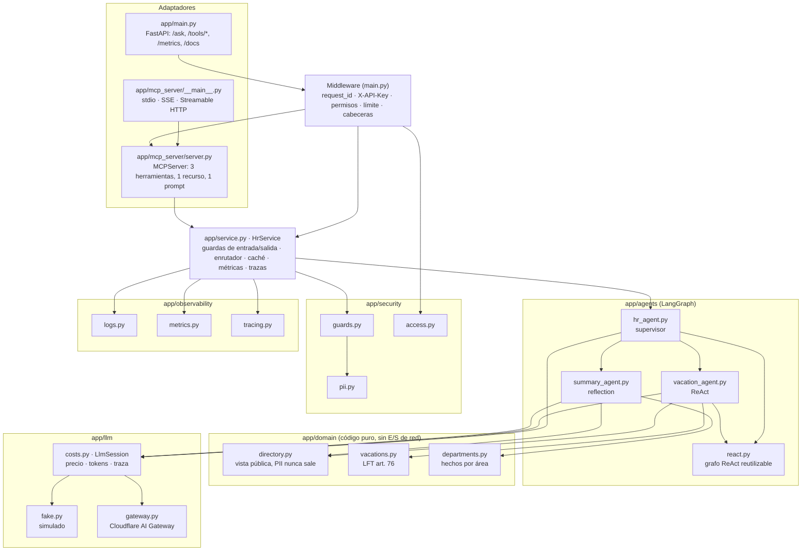
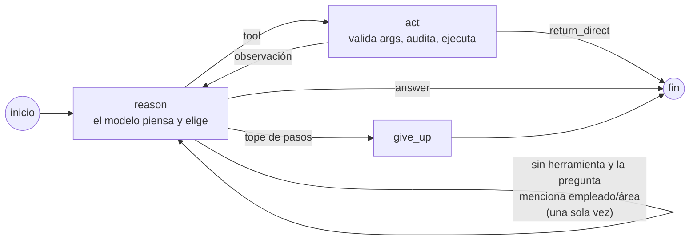
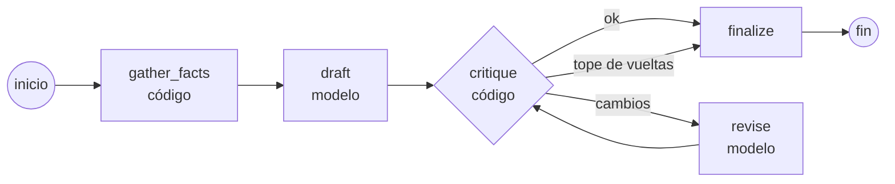

# Arquitectura

## Objetivo

El HR Assistant responde preguntas de Recursos Humanos sobre empleados, áreas y
vacaciones. Lo usan dos tipos de cliente:

- **Personas de RH**, desde una página web o la API REST.
- **Hosts MCP** (Claude Code, VS Code, Claude Desktop), que usan sus capacidades como
  herramientas dentro de su propio agente.

Tres reglas guían el diseño:

1. **El modelo propone y el código decide.** Ningún número (días de vacaciones,
   plantilla, antigüedad) lo calcula un modelo. Los agentes razonan y explican; el código
   calcula y verifica.
2. **Adaptadores delgados.** MCP y REST son dos puertas al mismo servicio. Agregar otra
   puerta (gRPC, Slack) no toca a los agentes.
3. **Sin estado.** El proceso no guarda conversaciones: el historial lo manda el cliente.
   Escalar es correr más copias.

## Componentes



| Módulo | Responsabilidad | No sabe de |
| --- | --- | --- |
| `mcp_server/` | Protocolo MCP: esquemas, anotaciones, transporte, errores `ToolError`, correlation id | Cómo razonan los agentes |
| `main.py` | HTTP: rutas, middleware de seguridad, montaje de `/mcp`, OpenAPI | Agentes y prompts |
| `service.py` | Casos de uso: guardas, enrutador, caché, métricas, trazas | HTTP o MCP |
| `agents/` | Razonamiento: grafos LangGraph, prompts, herramientas internas | Quién los llama |
| `domain/` | Reglas de negocio deterministas | Modelos de lenguaje |
| `llm/` | Proveedor intercambiable, costos y enrutamiento | Agentes concretos |

## Los agentes

### Supervisor (`hr_agent`): ReAct con delegación

Un único grafo ReAct (`react.py`) reutilizado por dos agentes. El supervisor tiene cuatro
herramientas: dos de consulta directa (`get_employee`, `search_by_department`) y dos que
**delegan en especialistas** (`vacation_balance`, `department_summary`). Estas últimas
son `return_direct`: su respuesta ya la verificó el código y se entrega tal cual, sin
que el modelo la reescriba (así se eliminó una alucinación real, ver
[costos](costs.md#hallazgos)).



### Vacaciones (`vacation_agent`): ReAct

Herramientas de solo lectura y **acotadas al empleado pedido** (mínimo privilegio):

1. `get_employee`: ¿existe y está activo?
2. `compute_entitlement`: años completos, días según la LFT y periodo vigente.
3. `get_taken_days`: días tomados dentro del periodo.

El reporte final (`entitled_days`, `taken_days`, `balance_days`) lo arma el código a
partir de los datos. Si la explicación del modelo no cita el saldo correcto, se reemplaza
por una plantilla y se audita `output_corrected`.

### Resumen por área (`summary_agent`): reflection



El crítico es **código**: comprueba que el borrador cite el total, los activos y la
antigüedad promedio correctos, que no nombre a personas de otras áreas, que no traiga PII
y que no sea largo. Es determinista y no cuesta tokens. Si tras `REFLECTION_MAX_ROUNDS`
vueltas sigue mal, `finalize` usa una plantilla segura (`fallback: true`).

Los diagramas que genera LangGraph a partir del código están en
[`evidence/graphs/`](../evidence/graphs/).

## Flujos de comunicación

### Pregunta por la API

```mermaid
sequenceDiagram
    autonumber
    participant U as Página / cliente
    participant M as Middleware
    participant S as HrService
    participant H as hr_agent
    participant V as vacation_agent
    participant C as Cloudflare AI Gateway
    participant L as LangSmith
    U->>M: POST /ask + X-API-Key + X-Request-ID
    M->>M: request_id, clave (hmac), permiso "ask", límite
    M->>S: ask(question, history)
    S->>S: guardas: control, inyección, PII (enmascara), dato protegido
    S->>S: enrutador (8B o 70B), ventana de historial, caché
    S->>H: run (traza con request_id y cliente)
    H->>C: reason (JSON: thought + tool)
    H->>V: vacation_balance(EMP-0004)
    loop ReAct (máx. SUBAGENT_MAX_STEPS)
        V->>C: reason
        V->>V: act: herramienta acotada + auditoría
    end
    V->>V: verificación por código del saldo
    V-->>H: answer verificada (return_direct)
    S->>S: guarda de salida (PII, fuga de prompt, largo)
    S-->>L: trazas (sin texto en producción)
    S-->>M: respuesta + costo + tokens
    M-->>U: 200 + X-Request-ID; log "request"
```

### Herramienta MCP por stdio

El host lanza `python -m app.mcp_server` como subproceso. La salida estándar es del
protocolo, así que **todos los logs van a stderr**. Cada llamada recibe un `request_id`
propio, queda en la auditoría (`mcp_tool_call`) y sus errores llegan al host como
`isError` con un mensaje en español (nunca una traza interna).

### Herramienta MCP por HTTP (remoto)

El mismo `MCPServer` está montado en la API en `/mcp` (Streamable HTTP, sin estado, con
respuestas JSON). Antes de llegar a él, el middleware exige una clave con el permiso
`mcp`, aplica el límite y registra la auditoría. El `request_id` de la petición HTTP se
conserva dentro de la herramienta: una sola correlación de punta a punta.

## Concurrencia, escalabilidad y resiliencia

| Necesidad | Cómo se resuelve |
| --- | --- |
| Muchas peticiones a la vez | Todo es `async`: el proceso no se bloquea mientras espera al modelo. El cliente HTTP del gateway reutiliza conexiones (hasta 50) |
| Más capacidad | Sin estado: `WEB_CONCURRENCY` workers por contenedor y N contenedores detrás del balanceador de Render |
| Medido | 1 000 peticiones con 50 concurrentes: 339 req/s, p95 301 ms y 0 errores con 2 workers ([evidencia](../evidence/load/)) |
| Fallas del modelo | Tiempo límite, 2 reintentos con espera exponencial ante 429/5xx/red y reintentos del gateway; si se agotan, `502 model unavailable` sin tumbar el proceso |
| Respuestas raras del modelo | Analizador tolerante, autocorrección con tope, tope de pasos, plantillas verificadas |
| Abuso | Límite por cliente (`429` + `Retry-After`) y límite del gateway |
| Arranque inseguro | `preflight` antes de uvicorn: con compliance roto el contenedor termina con código 1 |
| Salud | `/health` (vida) para Render y el `HEALTHCHECK` del contenedor; `/ready` (datos cargados, proveedor) |

## Decisiones de arquitectura (ADR)

| ADR | Decisión |
| --- | --- |
| [0001](adr/0001-mcp-adaptador-delgado.md) | MCP como adaptador delgado sobre un servicio compartido con la API |
| [0002](adr/0002-grafo-react-reutilizable.md) | Un grafo ReAct reutilizable con tope, validación de argumentos y autocorrección |
| [0003](adr/0003-reflection-con-critico-por-codigo.md) | Reflection con un crítico determinista en lugar de otro modelo |
| [0004](adr/0004-el-codigo-decide-los-numeros.md) | El código calcula y verifica; `return_direct` para respuestas verificadas |
| [0005](adr/0005-cloudflare-ai-gateway.md) | Cloudflare Workers AI a través de AI Gateway autenticado |
| [0006](adr/0006-transportes-mcp.md) | stdio para hosts locales y Streamable HTTP sin estado montado en la API |
| [0007](adr/0007-seguridad-en-capas.md) | Seguridad en capas y compliance como código |
| [0008](adr/0008-despliegue-render-con-compuerta.md) | Render con Docker y compuerta de calidad dentro de la imagen |
