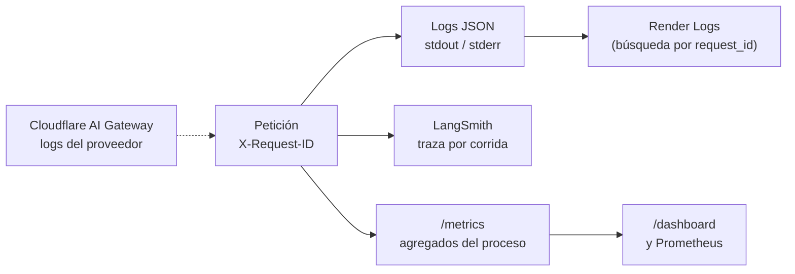

# Observabilidad

La pregunta que guía todo: **«¿qué pasó con la petición X?»**. Para contestarla hay tres
fuentes, unidas por el mismo `request_id`.



## 1. Correlation id

- Si el cliente manda `X-Request-ID` se usa; si no, se genera un UUID.
- Toda respuesta lo devuelve en `X-Request-ID`, y `/ask` y las herramientas también en el
  cuerpo. La página lo muestra debajo de cada respuesta para que la persona lo pase a
  soporte.
- Viaja en una `ContextVar`: cada evento de la API, los agentes, las herramientas, el
  modelo y el MCP lo lleva sin pasarlo a mano.
- Dentro de una herramienta MCP llamada por HTTP se conserva el de la petición; por stdio
  se genera uno por llamada.

## 2. Logs estructurados

Una línea JSON por evento. Campos comunes: `ts` (UTC, reloj inyectado), `service`,
`event`, `request_id`, `client` (nombre del cliente, **nunca su clave**) y `channel`
(`api` o `mcp`).

| Evento | Campos propios |
| --- | --- |
| `request` | `method`, `path`, `status`, `latency_ms` |
| `agent_run` | `intent`, `model`, `route`, `steps`, `tools`, `model_calls`, `cached_calls`, `input_tokens`, `output_tokens`, `cost_usd`, `latency_ms`, `parse_errors`, `question_chars`, `history_messages`, `pii_in_question` |
| `audit` | `action`: `tool_call`, `tool_rejected`, `auth_failed`, `forbidden`, `rate_limited`, `input_rejected`, `pii_detected`, `protected_data_request`, `output_corrected`, `output_blocked`, `agent_self_correction`, `mcp_tool_call` |
| `error` | `error_type` (sin el mensaje, que podría traer datos) |
| `startup` | `environment`, `provider`, `tracing`, `clients` |

Reglas:

- **Nunca** se registra el texto de la pregunta ni de la respuesta: solo su largo.
- Todo campo de texto pasa por el enmascarado de PII antes de escribirse (defensa en
  profundidad).
- `AUDIT_LOG_PATH` escribe además la auditoría en un archivo JSONL aparte.

Ejemplo real del contenedor en modo producción
([`evidence/logs/container-production.jsonl`](../evidence/logs/container-production.jsonl)):

```json
{"ts": "2026-11-24T22:35:00.323288Z", "service": "hr-assistant", "event": "audit", "request_id": "demo-pii-001", "client": "local-dev", "channel": "api", "action": "pii_detected", "where": "input", "kinds": ["email", "phone"]}
{"ts": "2026-11-24T22:35:00.832085Z", "service": "hr-assistant", "event": "agent_run", "request_id": "demo-pii-001", "client": "local-dev", "model": "@cf/meta/llama-3.1-8b-instruct-fast", "route": "simple_question", "input_tokens": 403, "output_tokens": 23, "cost_usd": 2.7e-05, "...": "..."}
{"ts": "2026-11-24T22:35:00.832368Z", "service": "hr-assistant", "event": "request", "request_id": "demo-pii-001", "client": "local-dev", "method": "POST", "path": "/ask", "status": 200, "latency_ms": 509.69}
```

## 3. Trazas en LangSmith

- Se encienden con `LANGSMITH_TRACING=true` y `LANGSMITH_API_KEY`. Sin la clave no se
  intenta ninguna conexión.
- Cada corrida es una traza raíz (`hr_agent`, `vacation_agent` o `summary_agent`) con
  metadatos `request_id`, `client`, `channel`, `use_case` y `environment`, y una etiqueta
  con el caso de uso.
- Dentro aparecen los nodos de LangGraph (`reason`, `act`, `gather_facts`, `draft`,
  `critique`, `revise`), cada llamada al modelo (`model.complete`, tipo `llm`, con
  `usage_metadata` para que LangSmith muestre tokens) y los subagentes anidados en la
  traza del supervisor.
- **Privacidad**: con `HIDE_INPUTS`/`HIDE_OUTPUTS=true` (obligatorio en producción) no se
  manda ningún texto, solo estructura, tiempos y tokens. En desarrollo, con ellos en
  `false`, el texto viaja con la PII enmascarada.

Buscar una petición: en LangSmith, proyecto `hr-assistant`, filtro
`metadata.request_id = "<id>"`.

## 4. Métricas

`GET /metrics` (requiere permiso `metrics`) y `GET /metrics/prometheus`:

| Grupo | Métricas |
| --- | --- |
| Técnicas | `requests`, `error_rate`, `latency_ms.p50/p95`, `agent_latency_ms.p50/p95/p99`, `slo` (meta p95 y si se cumple), contadores `status_<código>` |
| Costo | `tokens.input/output`, `cost_usd`, `model_calls`, `cached_calls`, `answer_cache_hits`, contadores `model_<nombre>` |
| Negocio | `intent_employee`, `intent_department`, `intent_vacation`, `intent_department_summary`, `intent_protected_data`, `tool_<nombre>`, `mcp_<herramienta>_<estado>` |
| Seguridad | `auth_failed`, `forbidden`, `rate_limited`, `guard_prompt_injection`, `pii_masked_input`, `pii_masked_output`, `guard_prompt_leak` |

Son de **este proceso** (incluyen el `pid`). Con varias copias, cada una reporta lo suyo;
para agregarlas, Prometheus raspa `/metrics/prometheus` de cada instancia.

## 5. Tablero

`/dashboard` muestra las métricas en vivo (cada 5 s): latencia contra el SLO, tasa de
error, costo acumulado, tokens, cachés y los contadores de negocio y seguridad. Pide una
clave con permiso `metrics` que se guarda solo en `sessionStorage`.

Además se pueden usar los tableros de **LangSmith** (latencia, tokens y errores por
proyecto) y los de **Cloudflare AI Gateway** (peticiones, caché, costo, errores por
modelo).

## 6. Receta: depurar una petición en producción

1. La persona reporta el `request_id` que ve en la página (por ejemplo `1c7350cb-...`).
2. En **Render > Logs** se busca ese id: aparece la secuencia `audit` → `agent_run` →
   `request`, con el cliente, el modelo, los pasos y la latencia.
3. Si hubo `tool_rejected` u `output_corrected`, el modelo se equivocó y el código lo
   corrigió. En el ejemplo real, el 8B mandó argumentos mal formados a `get_taken_days` y
   la respuesta salió bien gracias a la verificación.
4. En **LangSmith** se filtra por `metadata.request_id` para ver el grafo paso a paso.
5. En **Cloudflare AI Gateway > Logs** se ve cada llamada al modelo, si fue `HIT` de
   caché y su costo.
