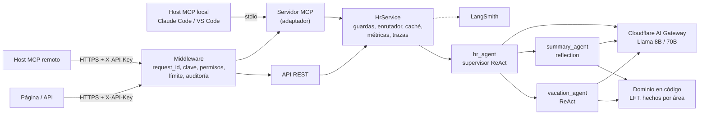

# feat: Sistema multiagente en producción con servidor MCP y agentes LangGraph

## Resumen de cambios

Extiendo el HR Assistant con dos capacidades nuevas, **saldo de vacaciones** (LFT art. 76)
y **resumen por área**, más **protección de datos personales**. Cada capacidad es un
agente LangGraph: vacaciones con **ReAct** y resumen con **reflection**, coordinados por
un supervisor ReAct. Los expongo como **servidor MCP** (stdio, SSE y Streamable HTTP) y
como **API REST** publicada en Render, con observabilidad en LangSmith, costos medidos
contra una línea base (−89 % con el modelo real y la misma calidad) y 20 controles de
seguridad.

## Arquitectura del sistema



**Flujo de comunicación.** Un host MCP (o la página) llama una herramienta. El adaptador
MCP valida el esquema, asigna un correlation id y llama al servicio. El servicio revisa
la entrada (inyección, PII, datos protegidos), elige el modelo con una regla, abre la
traza y corre el agente. El supervisor razona y delega. El especialista consulta
herramientas de solo lectura acotadas al caso, el código calcula y verifica los números,
y la respuesta verificada vuelve directa (`return_direct`). Antes de salir pasa por la
guarda de salida, y todo queda en logs JSON, métricas y LangSmith con el mismo
`request_id`.

**Justificación de las decisiones** (detalle en `doc/adr/`):

- **MCP como adaptador delgado.** MCP y REST comparten el mismo servicio: los agentes no
  saben quién los llama y no hay lógica duplicada.
- **El código decide los números.** El modelo razona y redacta, el código calcula y
  verifica. Medir con el modelo real mostró que el 8B inventaba datos al reescribir; con
  `return_direct` la calidad volvió a 100 % y se ahorró una llamada.
- **Reflection con crítico por código.** Es determinista, no cuesta tokens y no aprueba
  números incorrectos.
- **Un grafo ReAct reutilizable.** Tiene tope de pasos, validación de argumentos y
  autocorrección acotada; lo usan el supervisor y el especialista.
- **Streamable HTTP sin estado montado en la API.** Escala como la API y hereda su
  seguridad.
- **Compliance como código.** En producción, el sistema no arranca si la configuración es
  insegura.

## Instalación y ejecución

Todo está en [`EberSilvaGarcia_reto/README.md`](EberSilvaGarcia_reto/README.md): requisitos
previos (Python 3.12, uv, opcionalmente Docker y las cuentas de Cloudflare y LangSmith),
cómo clonar e instalar, variables de entorno (`.env.example`), cómo correr la API, el
servidor MCP por stdio, SSE y HTTP y el contenedor, cómo conectar Claude Code, VS Code y
Claude Desktop, y cómo desplegar en Render.

## Video de demostración

**https://youtu.be/FoUmllzK0Rs** (3 min 08 s): Claude Code como host MCP usando las
herramientas `vacation_balance` (ReAct, con su razonamiento paso a paso) y
`department_summary` (reflection), un error controlado, la página publicada en Render
(datos protegidos, PII enmascarada, clave inválida), la traza en LangSmith buscada por
`request_id`, los logs de Cloudflare AI Gateway, el tablero de métricas y el análisis de
costos.

Sistema publicado: https://hr-assistant-ebersilva.onrender.com (`/docs` para la API,
`/dashboard` para el tablero, `/mcp` para hosts MCP remotos con clave).

## Notas adicionales

**Resultados**

- 127 pruebas (unitarias, BDD en Gherkin, MCP en proceso y por stdio) más 7 e2e con
  Playwright. Cobertura de 96 % y pylint de 10/10.
- Las verificaciones de `sesion04` contra este producto pasan: `contract` 22/22,
  `e2e`, `evaluate` (−85.5 %) y `qa`.
- Costo con Cloudflare: −89.2 % con la misma calidad (100 %) y latencia de 3.0 s a
  1.3 s.
- Carga: 339 req/s y p95 de 301 ms con 50 concurrentes, sin errores.

**Problemas encontrados y soluciones**

1. El 8B no seguía el protocolo JSON (2/5). Con ejemplos en el prompt pasó a 5/5.
2. Con enrutamiento, el supervisor inventó «7 días» para una empleada de baja. Se
   resolvió con `return_direct` para respuestas verificadas por código.
3. La PII enmascarada (`[EMAIL]`) hacía que el 8B se negara a contestar. Se resolvió con
   una aclaración en el prompt y autocorrección con tope.
4. Con `--workers`, una configuración inválida dejaba a uvicorn reiniciando procesos sin
   fin. Se agregó `preflight`, que termina con código 1.
5. `KeyError` es un `LookupError` y filtraba mensajes internos como «no encontrado». Se
   creó `NotFoundError`.
6. La caché del gateway inflaba el ahorro entre corridas. Se agregó `cf-aig-skip-cache`
   y la tabla separa los casos.

**Limitaciones conocidas**: el límite y las métricas son por proceso; la PII se detecta
con expresiones regulares; los datos son un JSON de ejemplo con PII ficticia; el plan
gratuito de Render duerme el servicio.

**Mejoras futuras**: límite global con Redis, clasificador de PII dedicado, crítico con
modelo para el estilo, OAuth para el MCP remoto y caché semántica con llave por entidad.

## Archivos en este PR

Solo se agrega la carpeta `EberSilvaGarcia_reto/`; no se modifica `sesion01` a `sesion04`.

```
EberSilvaGarcia_reto/
  README.md                 instalación, ejecución, hosts MCP, ejemplos, despliegue
  app/mcp_server/           servidor MCP: herramientas, recurso, prompt, transportes
  app/agents/               hr_agent, vacation_agent (ReAct), summary_agent (reflection),
                            react.py (grafo reutilizable), protocol.py
  app/domain/               reglas de negocio en código (LFT, hechos por área, directorio)
  app/llm/                  modelo simulado, Cloudflare AI Gateway, costos y enrutador
  app/security/             PII, guardas, claves, permisos y límite
  app/observability/        logs JSON, métricas, trazas LangSmith
  app/service.py, main.py   casos de uso compartidos y API REST con /mcp montado
  tests/, e2e/              127 pruebas (incluye BDD y MCP por stdio) y 7 e2e
  scripts/                  evaluate (costos), load_test, smoke, mcp_demo
  doc/                      arquitectura, 8 ADR, MCP, observabilidad, costos, seguridad,
                            compliance, despliegue, guion del video
  evidence/                 costos, carga, logs y métricas del contenedor, pruebas, grafos
  Dockerfile, render.yaml, .github/workflows/ci.yml, .mcp.json, .vscode/mcp.json
```

## Etiquetas

Share-OK
