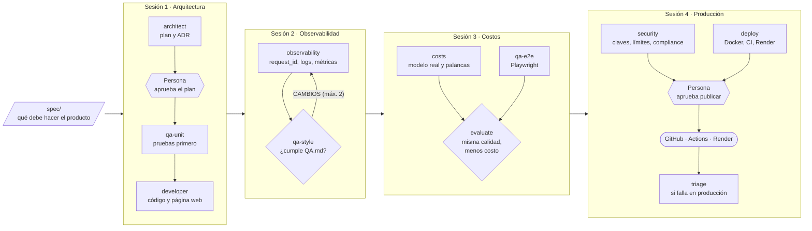
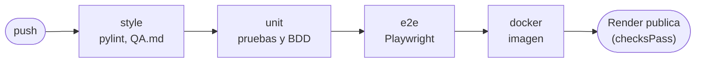

# Módulo 4 · Agentes en producción

**Certificado Next-Gen Coding: Desarrollo de Software con IA Generativa**

> En este módulo nadie programa el producto. Una **fábrica de agentes** de Claude Code lo construye a partir de una
> especificación, lo prueba, lo revisa contra `QA.md` y, cuando una persona lo aprueba, lo publica en internet.
> Tú diriges, apruebas y compruebas.

El producto es el **HR Assistant**: un asistente de Recursos Humanos con página web que responde preguntas sobre
empleados. Es pequeño a propósito. Lo que se aprende es lo que lo rodea:

- Una arquitectura simple que escala.
- Observabilidad para responder «¿qué pasó con la petición X?».
- Costos medidos sin perder calidad.
- Una publicación segura.

Todo lo hacen agentes que siguen patrones de razonamiento, de flujo y de arquitectura multiagente, y unos hooks que
no los dejan salirse de su papel.

| | |
| --- | --- |
| **Duración** | 10 horas: 4 sesiones de 2 h 30 min, con tiempos pesimistas |
| **Sistemas** | Windows, macOS y Linux |
| **Cuentas** | Claude Code (plan Pro o Max) y cuentas gratuitas de GitHub, Cloudflare, LangSmith y Render |
| **Lenguaje** | Python 3.12 con `uv`. El código va en inglés; comentarios, documentos y mensajes, en español |

## La fábrica



Los rombos son verificaciones que hace **el código**, no un modelo. Los hexágonos son decisiones de **una persona**.
Todo bucle tiene un tope: al llegar a él, la fábrica se detiene y escala a una persona.

## Las cuatro sesiones

| Carpeta | Tema del producto | Agentes que se suman | Patrón | Hook |
| --- | --- | --- | --- | --- |
| [`sesion01/`](sesion01/) | API sin estado, un agente con tope de pasos, modelo simulado y página web | `architect`, `qa-unit`, `developer` | Razonamiento: plan y ejecución, con reflexión | `permissions.py`: cada agente escribe solo en sus carpetas |
| [`sesion02/`](sesion02/) | `request_id`, log JSON, auditoría, `/metrics` con SLO y LangSmith | `observability`, `qa-style` | Flujo: encadenamiento con compuertas y evaluador-optimizador | `activity_log.py`: la fábrica también se observa |
| [`sesion03/`](sesion03/) | Cloudflare Workers AI, enrutamiento, ventana, tope de salida y caché | `costs` y `qa-e2e`, en paralelo | Multiagente: supervisor con especialistas | |
| [`sesion04/`](sesion04/) | Claves por cliente, límite de peticiones, compliance, contenedor, CI y Render | `security`, `deploy`, `triage` | Humano en el lazo y triage | Nadie lee `.env` y nadie publica sin aprobación |

Cada carpeta es un proyecto completo e independiente. Contiene:

- `spec/`: la especificación.
- `.claude/agents/`: los agentes.
- `.claude/skills/factory/`: el orquestador `/factory`.
- `hooks/`.
- `verification/`: las pruebas de contrato.
- Su `README.md` con los comandos para cada sistema.

Lo que generan los agentes queda en `product/` y `output/`, que no se suben a git.

## Lo que verás al correr la fábrica

**El pipeline de la fábrica.** El hook de bitácora registra cada herramienta de cada agente. Con esa bitácora,
`scripts/pipeline.py` dibuja la corrida en `output/pipeline.md`: qué agente trabajó, cuánto tardó, qué verificación
falló y quién la corrigió.

**El pipeline del producto.** En la sesión 4 el producto se publica en un repositorio con GitHub Actions. Ahí los
ingenieros ven cada etapa, y Render solo publica cuando todas pasan:



## Las reglas de la fábrica

1. **El modelo propone y el código decide.** Un agente nunca dice si su trabajo está bien. Lo deciden `pytest`,
   pylint y las pruebas de contrato, con su código de salida.
2. **Quien escribe el código no escribe sus pruebas.** El hook bloquea a `developer` si intenta tocar `tests/`, y a
   los agentes de QA si intentan tocar `app/`.
3. **Todo bucle tiene tope.** Hay como máximo 2 rechazos del plan, 2 correcciones, 2 vueltas de revisión y 2 ciclos de
   triage. Después decide una persona.
4. **Una persona aprueba lo irreversible.** La fábrica pregunta antes de escribir código y antes de publicar.
5. **Los secretos no pasan por la fábrica.** Nadie lee `.env`. Las claves de producción se escriben en Render, nunca
   en el chat ni en el código.

## Cómo se usa este repositorio

Este repositorio es del docente: tiene las cuatro fábricas terminadas y probadas, los manuales y las
presentaciones. **Los alumnos no lo clonan.** Reproducen la fábrica paso a paso desde el manual de práctica de
cada sesión, como en el Módulo 3: la sesión 1 parte de una carpeta vacía y cada sesión copia la anterior y le
agrega piezas.

| Carpeta | Qué es |
| --- | --- |
| `sesion01/` a `sesion04/` | Las fábricas terminadas: lo que el alumno debe tener al final de cada sesión |
| `receta_estudiantes/` | Manuales del alumno en PDF y Markdown (el código se copia del `.md`) |
| `recetas_docente/` | Manuales del docente, presentaciones, productos de referencia (plan B) y generadores |
| `QA.md` | Las reglas de calidad que siguen la fábrica y el producto |

## Correr una sesión (docente)

Necesitas Git, [uv](https://docs.astral.sh/uv/) y [Claude Code](https://docs.claude.com/en/docs/claude-code) con
plan Pro o Max. Desde la sesión 2, copia antes el producto de la sesión anterior a `product/`.

macOS / Linux:

```bash
cd sesion01
uv venv --python 3.12
uv pip install -r requirements.txt
uv run python scripts/verify.py
claude
```

Windows (PowerShell):

```powershell
cd sesion01
uv venv --python 3.12
uv pip install -r requirements.txt
uv run python scripts/verify.py
claude
```

La primera vez, Claude Code pregunta **«Do you trust the files in this folder?»**: responde que sí. Sin esa
confianza, ignora los permisos del proyecto y los agentes no pueden correr las verificaciones. Dentro de Claude
Code, escribe `/factory`.

## Regenerar el material

Los manuales y las presentaciones se generan del código de `sesion01` a `sesion04` y de salidas reales de la
fábrica, así que nunca muestran algo que no existe. Ver `recetas_docente/generador/README.md`.

## Preguntas frecuentes

**¿Por qué el producto no viene en las carpetas de las sesiones?** Porque lo construyen los agentes en clase. Si
una corrida falla, el docente tiene el producto de referencia de cada sesión en `recetas_docente/referencia/`.

**¿Gasta dinero?** No hay cobros aparte. La fábrica usa tu suscripción de Claude Code. El producto usa el plan
gratuito de Cloudflare Workers AI, y con el modelo simulado no usa red ni cuota.

**¿Y si un agente se equivoca?** Para eso están las verificaciones, los topes y las aprobaciones. Una falla que la
fábrica no puede resolver termina en «ESCALAR A UNA PERSONA», con un reporte de lo que pasó.
