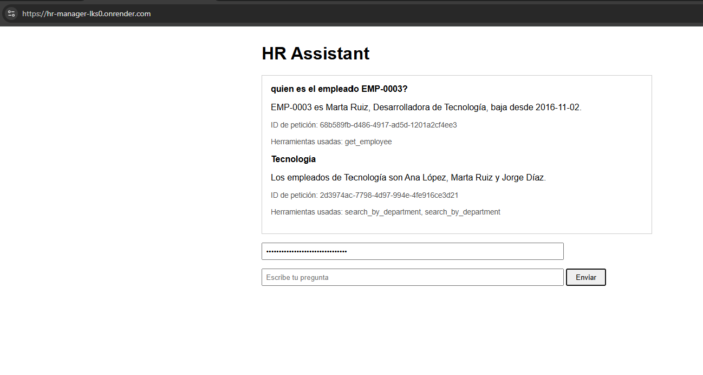
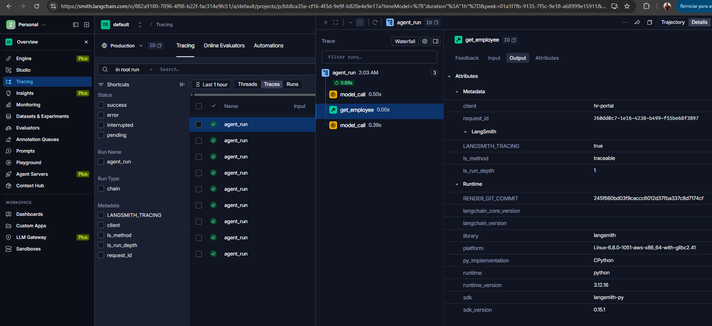
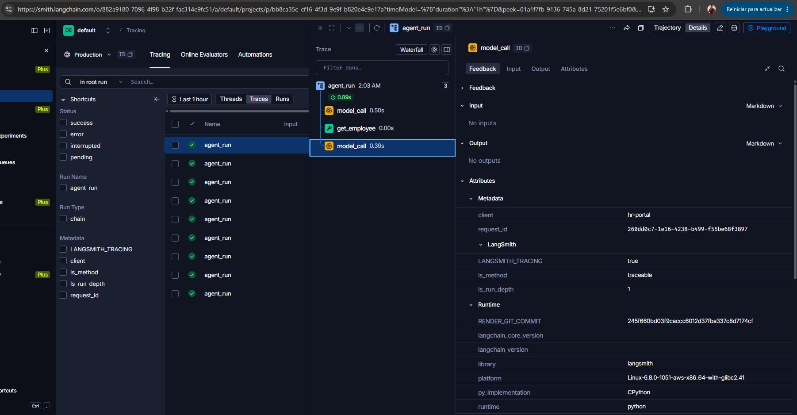
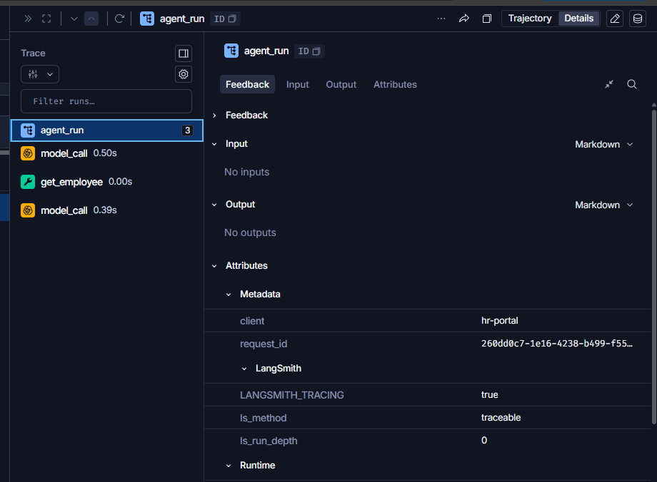
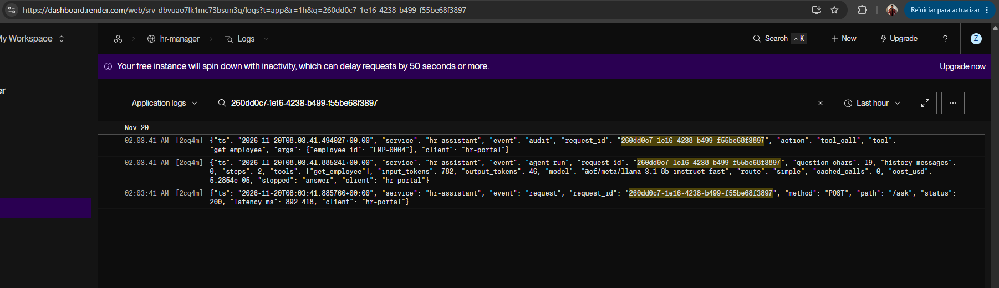

# Reporte final: HR Assistant y la fábrica que lo construye

Este reporte evalúa el producto (`sesion05/product`) y la fábrica que lo construyó contra la rúbrica de entrega:
arquitectura y despliegue, observabilidad, optimización de costos y seguridad. Cada requisito lleva su estado y su
evidencia. Lo que no se cumple o no se pudo comprobar se dice tal cual, y al final hay una lista de brechas.

Documentos relacionados: `desiciones.md` (el problema del modelo de Cloudflare y cómo se resolvió) y `sesion05.md`
(cómo se construyó la fábrica de iteración).

<a href="video_evidencia.mp4" target="_blank" rel="noopener">Video de evidencia con el sistema funcionando en render</a>

## 0. Qué es el sistema y cómo se obtuvo

**El producto** es el HR Assistant: un asistente de Recursos Humanos que responde preguntas sobre empleados. Es una API
web (FastAPI) sin estado, con **un solo agente** que trabaja en un bucle con tope y dos herramientas de solo lectura
sobre `data/employees.json`: `get_employee` y `search_by_department`. Lo usa el personal de RH desde una página web.

**La fábrica** es el sistema multi-agente. Las personas dirigen, aprueban y comprueban; no programan. Los agentes
construyen el producto a partir de la especificación de `spec/`:

| Agente | Qué hace | Dónde puede escribir |
| --- | --- | --- |
| `architect` | Plan y ADR | `output/plan.md`, `product/doc/` |
| `qa-unit` | Pruebas antes del código (TDD) | `product/tests/` |
| `developer` | Bucle del agente y código base | `product/app/`, `product/data/`, `requirements.txt` |
| `observability` | Log, métricas y trazas | `product/app/`, `requirements.txt` y `README.md` del producto |
| `costs` | Modelo real y palancas de costo | `product/app/`, `product/data/`, `.env.example` |
| `security` | Claves, límite, compliance | `product/app/`, checklist de compliance |
| `deploy` | Dockerfile, CI y Render | `Dockerfile`, `render.yaml`, `.github/` |
| `qa-e2e` | Pruebas de punta a punta | `product/e2e/` |
| `qa-style` | Revisión contra QA.md | `output/qa-review.md` |
| `triage` | Diagnóstico si falla producción | `output/triage.md` |

Las sesiones son incrementos acumulativos, cada una con su especificación:

| Sesión | Especificación | Aporta | Rúbrica |
| --- | --- | --- | --- |
| 1 | `01-architecture.md` | API sin estado, agente con herramientas, página web | 1 |
| 2 | `02-observability.md` | Log JSON, ids de correlación, métricas, trazas | 2 |
| 3 | `03-costs.md` | Modelo real, enrutamiento, ventana, caché, costo por respuesta | 3 |
| 4 | `04-production.md` | Claves, límite, compliance, Docker, CI y Render | 1 y 4 |
| 5 | `05-model-protocol.md` | El modelo real entiende al agente (`/iterate`) | 1 |

**Patrones de la fábrica** (los mismos de `/factory`, que `/iterate` conserva): un supervisor que reparte el trabajo y
decide solo con códigos de salida; especialistas en paralelo; compuertas de verificación (`unit`, `contract`, `qa`,
`e2e`, `evaluate`) que decide el código y no el agente; un evaluador-optimizador (`qa-style`, máximo 2 vueltas); humano
en el lazo (aprobar el plan y aprobar publicar); y un enrutamiento de fallas (`triage`, máximo 2 ciclos).

## 1. Arquitectura y despliegue

| Requisito | Estado | Evidencia |
| --- | --- | --- |
| Sistema multi-agente desplegable y funcional | Cumple, con un matiz | La fábrica es el sistema multi-agente (diez agentes y un supervisor). El producto desplegado tiene un solo agente, como pide la especificación. Está en https://hr-manager-lks0.onrender.com/ (ver 1.4) |
| API REST con endpoint de health check | Cumple | `GET /health` devuelve `{"status": "ok", "pid": ...}`; Render lo usa como `healthCheckPath` |
| Documentación de API (OpenAPI / Swagger) | Cumple | `/docs` responde 200 y `/openapi.json` publica `/`, `/ask`, `/health` y `/metrics` |
| Múltiples requests concurrentes | Cumple (comprobado con una medición puntual) | Ver 1.3 |

### 1.1. Despliegue

- **Contenedor.** `python:3.12-slim`, usuario sin privilegios (`appuser`, uid 10001), `uvicorn app.main:app` en el
  puerto que define Render. `.dockerignore` deja fuera `.env`, `tests/` y `e2e/`.
- **Pipeline de CI** (`.github/workflows/ci.yml`), cuatro trabajos encadenados con `needs`: `style` (pylint, 88
  columnas), `unit` (pruebas y BDD con cobertura mínima de 80 %), `e2e` (Playwright con el modelo simulado) y `docker`
  (`docker build`).
- **Render.** `render.yaml` es un Blueprint con el servicio `hr-manager`, `autoDeployTrigger: checksPass` (publica solo
  si el pipeline pasa) y `ENVIRONMENT=production`, `MODEL_PROVIDER=gateway`, `HIDE_INPUTS=true`, `HIDE_OUTPUTS=true`.
  Los secretos (`API_KEYS`, `CF_ACCOUNT_ID`, `CF_API_TOKEN`) van con `sync: false`.
- **Publicación.** Una persona aprueba y solo entonces `scripts/publish.py` hace el push. El hook de la fábrica bloquea
  publicar sin `output/approved.txt`. En esta iteración la aprobación quedó registrada el 2026-11-20 a las 01:22:24
  (-06:00) y el commit `245f660` salió dos segundos después.
- **URL pública:** https://hr-manager-lks0.onrender.com/ (servicio `hr-manager` en Render). La evidencia está en 1.4.
- **Plan gratuito.** El panel de Render avisa que la instancia gratuita se apaga por inactividad y que una petición
  puede tardar 50 segundos o más en despertarla. Es aceptable para una entrega; no para un servicio en uso.
- **Prueba de humo.** `uv run python -m verification production https://hr-manager-lks0.onrender.com` pasó 3 de 3
  (la clave se leyó de `SMOKE_API_KEY`, no se pasó como argumento):

  | Comprobación | Esperado | Resultado |
  | --- | --- | --- |
  | `GET /health` | 200 | 200 |
  | `POST /ask` sin clave | 401 | 401 |
  | `POST /ask` con clave | 200 | 200 |

  Alcance: la prueba de humo comprueba códigos HTTP. **No verifica que el agente use las herramientas**, así que no
  habría detectado el problema original; por eso la evidencia del arreglo es la captura de 1.4.
- **Lo que no consta:** un `output/report.md` de la corrida de `/iterate`.

### 1.2. Un solo agente, a propósito

La especificación pide «un solo agente con dos herramientas de solo lectura» y un bucle con tope (`AGENT_MAX_STEPS`,
3 por omisión). Al llegar al tope responde exactamente «No pude completar la respuesta. Intenta con una pregunta más
concreta.» El modelo se usa a través de una interfaz (ADR 0002), con un modelo simulado y uno real. Si la rúbrica
exige varios agentes dentro del producto, hoy no los hay; ver las brechas.

### 1.3. Concurrencia

La API no guarda estado entre peticiones (ADR 0001): cada petición crea su propio agente y escalar es correr más
copias. Las estructuras compartidas (`Metrics`, `RateLimiter`) usan un candado.

**Medición** hecha al preparar este reporte, con el modelo simulado: 100 peticiones con 25 hilos a la vez.

| Resultado | Valor |
| --- | --- |
| Respuestas `200` | 100 de 100 |
| `X-Request-ID` propio devuelto en la cabecera | 100 de 100 |
| `request_id` propio devuelto en el cuerpo | 100 de 100 |
| Respuesta con el empleado correcto | 100 de 100 |
| `error_rate` según `/metrics` | 0 |
| Latencia p95 según `/metrics` | 47 ms (meta: 2000 ms) |

Qué demuestra: bajo carga concurrente, ninguna petición mezcló ids ni respuestas. Qué no demuestra: el rendimiento con
el modelo real, donde la latencia depende de Cloudflare. Es una medición puntual, no una prueba del repositorio; el
plan de mejora la incluye como prueba automática. `uvicorn` corre con un solo proceso; las métricas y el límite de
peticiones son por proceso (ADR 0005 y 0011).

### 1.4. Evidencia en producción

La aplicación desplegada en https://hr-manager-lks0.onrender.com/ con dos consultas reales al modelo de Cloudflare:



| Consulta | Respuesta | Herramientas usadas | ¿Coincide con los datos? |
| --- | --- | --- | --- |
| «quien es el empleado EMP-0003?» | «EMP-0003 es Marta Ruiz, Desarrolladora de Tecnología, baja desde 2016-11-02.» | `get_employee` | Sí: Marta Ruiz, Desarrolladora, Tecnología, ingreso 2016-11-02, estado «baja» (con una reserva, abajo) |
| «Tecnología» | «Los empleados de Tecnología son Ana López, Marta Ruiz y Jorge Díaz.» | `search_by_department` (dos veces) | Sí: son los tres empleados de ese departamento en `spec/employees.json` |

Qué demuestra la captura:

- **El servicio está activo en Render** y sirve la página, con el campo de clave de tipo contraseña. Las preguntas se
  contestaron, así que el acceso por clave funciona.
- **Cierra el problema original.** El log de Cloudflare de `desiciones.md` (sección 2.6) fallaba con «empleado
  EMP-0003». La misma consulta, ahora, devuelve el empleado correcto con la herramienta `get_employee`.
- **Es el modelo pequeño.** Por la regla del enrutador, las dos preguntas (menos de 80 caracteres y sin palabras
  clave) van a `llama-3.1-8b-instruct-fast`. La captura no muestra el campo `route` ni `model`, así que esto se infiere
  de la regla y de que el Blueprint no apaga el enrutamiento. El log de 2.2 lo confirma para una petición: `model` es
  `llama-3.1-8b-instruct-fast` y `route` es `simple`.
- **La trazabilidad llega al usuario:** cada respuesta muestra su ID de petición y las herramientas usadas.

Dos observaciones que la captura deja ver y que conviene revisar:

1. **La segunda consulta ejecutó la herramienta dos veces.** Con una vez bastaba; la segunda llamada gasta una vuelta
   del bucle y tokens. No se puede saber la causa desde la captura: puede ser el modelo pidiéndola de nuevo tras recibir
   el resultado. El log `agent_run` de esa petición (`steps`, `tools`) y las trazas lo dirían.
2. **«baja desde 2016-11-02» es una imprecisión.** Esa fecha es la de **ingreso** (`start_date`) y «baja» es el estado;
   los datos no tienen fecha de baja. Es probable que el origen sea el texto que el agente le entrega al modelo, que
   dice «..., desde 2016-11-02, baja»: el «desde» sin etiqueta se pega al estado. Un modelo con instrucciones y datos
   ambiguos puede leerlo así. `verification evaluate` no lo detecta, porque usa modelos simulados.

## 2. Observabilidad

| Requisito | Estado | Evidencia |
| --- | --- | --- |
| Integración funcional con LangSmith | Cumple (comprobada en producción) | `app/tracing.py` y la captura de LangSmith; ver 2.1 |
| Trazabilidad completa de ejecuciones de agentes | Cumple con una reserva | Árbol de trazas por petición, visto en LangSmith (`agent_run`, `model_call`, herramienta); las entradas y salidas van ocultas por diseño |
| Logging estructurado con contexto y correlation IDs | Cumple (comprobado en producción) | Una línea JSON por evento con `request_id`; el mismo id aparece en el log de Render y en la traza de LangSmith; ver 2.2 |
| Métricas de latencia, errores y costos por request | Cumple | Log por petición, `/metrics` agregado y costo en cada respuesta; ver 2.3 |

### 2.1. LangSmith

Las trazas son **opcionales y privadas por omisión** (ADR 0006). Se encienden con `LANGSMITH_TRACING=true` y
`LANGSMITH_API_KEY`; sin la clave, o si la librería no está, se usa un rastreador que no hace nada y nunca intenta
conectar. La clave solo se comprueba, nunca se copia ni se escribe.

Cada petición produce un árbol de trazas con el `request_id` y el nombre del cliente como metadatos:

```text
agent_run   (chain)   una por pregunta
  model_call (llm)    una por vuelta del bucle
  <herramienta> (tool) get_employee o search_by_department
```

`HIDE_INPUTS` y `HIDE_OUTPUTS` valen `true` por omisión: la traza conserva la estructura, los tiempos y los metadatos,
pero no el texto de la pregunta ni de la respuesta. Es una decisión de privacidad, y tiene un precio: en producción no
se puede reconstruir el contenido de una conversación desde LangSmith. Con trazas encendidas en producción, la
configuración que no oculte ambos campos **impide arrancar** (compliance como código, ADR 0012).

`LANGSMITH_API_KEY` no va en el Blueprint: se agrega en Render si se encienden las trazas. Las pruebas
(`tests/test_tracing.py`) usan un decorador simulado; la comprobación contra el servicio real es la siguiente.

**Comprobación en producción.** Captura de LangSmith del servicio desplegado (proyecto `default`, entorno Production,
pestaña Tracing):



| Qué se ve en la captura | Qué demuestra |
| --- | --- |
| Nueve ejecuciones `agent_run` en la última hora, todas con estado `success` y tipo `chain` | Las trazas llegan a LangSmith desde producción, una por pregunta |
| Una traza de 0,89 s con el árbol `agent_run` > `model_call` (0,50 s) > `get_employee` (0,00 s) > `model_call` (0,39 s) | El bucle de dos vueltas: el modelo pide la herramienta, el agente la ejecuta y el modelo responde. Es el árbol descrito arriba, con la herramienta como un tramo propio |
| Metadatos `client = hr-portal` y `request_id = 260dd0c7-1e16-4238-b499-f55be68f3897` | El id de correlación y el cliente autenticado viajan a la traza, y no la clave |
| `LANGSMITH_TRACING = true`, `library = langsmith`, `sdk_version = 0.15.1` | La integración está encendida y usa el SDK oficial |
| `RENDER_GIT_COMMIT` empieza con `245f660` | Las trazas vienen del commit que publicó la iteración de la sesión 5, no de una versión anterior |
| La columna `Input` de la lista aparece vacía | Es coherente con `HIDE_INPUTS=true` |

**Las entradas y salidas están ocultas.** Una segunda captura abre la misma traza (mismo `request_id`, `260dd0c7-...`)
en la llamada al modelo (`model_call`, 0,39 s) con `Input` y `Output` desplegados:



LangSmith muestra «No inputs» en `Input` y «No outputs» en `Output`. Es la comprobación de que `HIDE_INPUTS=true` y
`HIDE_OUTPUTS=true` funcionan en producción: la traza conserva la estructura, los tiempos y los metadatos (`client`,
`request_id`), pero ni el texto de la pregunta ni el de la respuesta ni el del modelo salen del servicio.

**Tampoco la traza raíz muestra contenido.** Una tercera captura abre el `agent_run` (la raíz, `ls_run_depth = 0`, con
sus tres tramos hijos) en la misma traza:



También dice «No inputs» y «No outputs», y conserva los metadatos `client = hr-portal` y `request_id = 260dd0c7-...`.
El ocultamiento está comprobado, entonces, en la raíz y en la llamada al modelo.

Lo que aún no se hizo: abrir `Input` y `Output` del tramo `get_employee` (el código aplica el mismo ocultamiento a los
tres tipos de traza, pero esa pestaña no se ha visto). El cruce del `request_id` con el log de Render ya está hecho,
en 2.2.

### 2.2. Log estructurado y correlation IDs

Cada evento es una línea JSON en la salida estándar (ADR 0004), con hora UTC, servicio, evento e id de la petición. El
log **no lleva el texto de las preguntas ni de las respuestas**, solo su largo. Muestras capturadas al correr las
verificaciones de la fábrica, con el Cloudflare simulado (la captura de producción está más abajo):

```json
{"ts": "2026-11-20T06:55:25.193860+00:00", "service": "hr-assistant", "event": "agent_run", "request_id": "0bde37fb-096a-4d72-a2ae-d1d18d2fc3ae", "question_chars": 19, "history_messages": 0, "steps": 2, "tools": ["get_employee"], "input_tokens": 20, "output_tokens": 19, "model": "@cf/meta/llama-3.1-8b-instruct-fast", "route": "simple", "cached_calls": 0, "cost_usd": 8.196e-06, "stopped": "answer", "client": "factory"}
{"ts": "2026-11-20T06:55:24.922047+00:00", "service": "hr-assistant", "event": "audit", "request_id": "0bde37fb-096a-4d72-a2ae-d1d18d2fc3ae", "action": "tool_call", "tool": "get_employee", "args": {"employee_id": "EMP-0001"}, "client": "factory"}
{"ts": "2026-11-20T06:55:25.195860+00:00", "service": "hr-assistant", "event": "request", "request_id": "0bde37fb-096a-4d72-a2ae-d1d18d2fc3ae", "method": "POST", "path": "/ask", "status": 200, "latency_ms": 625.0, "client": "factory"}
```

**Correlation ID.** El cliente puede mandar `X-Request-ID` (se recorta a 128 caracteres); si no, se genera un UUID. El
id viaja en la cabecera de la respuesta, en el cuerpo de `/ask`, en los cuerpos de error (`500` y `502`), en cada línea
de log de esa petición y en los metadatos de la traza. La medición de concurrencia confirmó que no se mezclan entre
peticiones simultáneas (100 de 100).

#### Comprobación en producción: el mismo id en el log y en la traza

Captura de los logs de la aplicación en Render, filtrados por el `request_id` de la traza de LangSmith de 2.1:



| Evento (02:03:41 a. m.) | Qué registra |
| --- | --- |
| `audit` | Acción `tool_call`, herramienta `get_employee`, argumentos `{"employee_id": "EMP-0004"}`, cliente `hr-portal` |
| `agent_run` | 2 pasos, herramienta `get_employee`, 782 tokens de entrada y 46 de salida, modelo `@cf/meta/llama-3.1-8b-instruct-fast`, ruta `simple`, 0 llamadas cacheadas, `cost_usd` 5,2854e-05, `stopped: answer` |
| `request` | `POST /ask`, estado 200, `latency_ms` 892,418 |

Qué demuestra:

- **Correlación completa.** El mismo `request_id` (`260dd0c7-...`) aparece en tres líneas del log y en la traza de
  LangSmith. La latencia coincide: 892,4 ms en el log y 0,89 s en la traza.
- **Los pasos cuadran.** `steps: 2` es la suma de los dos `model_call` que muestra el árbol de la traza.
- **Es el modelo pequeño en producción.** `model` es `llama-3.1-8b-instruct-fast` y `route` es `simple`, para esta
  petición.
- **El costo por petición es verificable.** 782 x 0,045 + 46 x 0,384, por millón de tokens, da exactamente USD 5,2854e-05,
  el valor del log.
- **El log no guarda texto de personas.** Trae `question_chars: 19`, no la pregunta. Sí aparece el id de empleado
  consultado, dentro de los argumentos de la auditoría. El cliente autenticado va en todas las líneas; la clave, en
  ninguna.

### 2.3. Métricas

| Dónde | Qué mide |
| --- | --- |
| Log `request` | Método, ruta, estado y `latency_ms` de cada petición |
| Log `agent_run` | Pasos, herramientas, tokens de entrada y salida, modelo, motivo del enrutador, llamadas cacheadas y `cost_usd` de esa petición |
| `POST /ask` | Devuelve `model`, `route`, `cached_calls` y `cost_usd` en cada respuesta |
| `GET /metrics` | Peticiones, `error_rate`, latencia p50 y p95, tokens, `cost_usd` acumulado y si se cumple la meta de p95 (SLO) |

Un error es una respuesta con estado 500 o más. Limitaciones: las métricas viven en memoria de cada proceso (ADR 0005),
se pierden al reiniciar y no se agregan entre copias; y la lista de latencias crece sin límite mientras el proceso
vive.

## 3. Optimización de costos

| Requisito | Estado | Evidencia |
| --- | --- | --- |
| Al menos una estrategia de optimización | Cumple (cuatro) | Enrutamiento, ventana de historial, tope de salida y caché del gateway |
| Evidencia de reducción frente a un baseline | Cumple, con una reserva de método | `verification evaluate`; ver 3.2 |
| Estrategias y trade-offs documentados | Cumple | ADR 0008 y 0009, `spec/03-costs.md`; ver 3.3 |

### 3.1. Estrategias

1. **Enrutamiento por regla en código** (ADR 0008), no otro modelo. Va al modelo capaz (`MODEL_LARGE`) si el
   enrutamiento está apagado, si la pregunta pasa de `ROUTER_MAX_CHARS` (80) o si contiene «compara», «resume»,
   «explica», «por qué», «analiza» o «todos». En cualquier otro caso va al barato (`MODEL_SMALL`).
2. **Ventana de historial.** Al modelo solo se mandan los últimos `HISTORY_WINDOW` (6) mensajes.
3. **Tope de salida.** `MODEL_MAX_TOKENS` (300) en cada llamada.
4. **Caché de AI Gateway.** Con `CACHE_TTL_SECONDS` mayor que 0 se manda `cf-aig-cache-ttl`; una respuesta `HIT` cuenta
   como llamada cacheada y no cuesta.

El costo se calcula con una tabla de precios local (`data/model_prices.json`, USD por millón de tokens; ADR 0009).

### 3.2. Evidencia frente al baseline

`uv run python -m verification evaluate` corre un conjunto de 8 casos dos veces, cada uno con un historial de relleno
de 10 mensajes. La línea base es `ROUTING=false` y sin ventana; «con palancas» es la configuración por omisión. Pasa
solo si la calidad no baja y el costo sí baja. Resultado de esta corrida:

| Configuración | Calidad | Costo (USD) | Tokens de entrada |
| --- | --- | --- | --- |
| Línea base | 100 % | 0,000801 | 1604 |
| Con palancas | 100 % | 0,000103 | 1034 |
| **Reducción** | sin cambio | **-87,1 %** | **-35,5 %** |

Reserva de método: la evaluación usa los **modelos simulados**, que responden igual pero se cobran con el precio de su
nombre. Mide el efecto de las palancas sobre el costo sin gastar cuota, pero no es una medición con tráfico real, y
**no incluye el mensaje `system` de la sesión 5**: el modelo simulado no lo recibe. La medición con el modelo real, en
3.3, muestra cuánto cambia el costo.

### 3.3. Trade-offs

| Palanca | Ganancia | Riesgo o costo |
| --- | --- | --- |
| Enrutamiento por regla | Las preguntas simples usan el modelo barato | Una regla fija puede mandar mal una pregunta; el modelo pequeño se sale del formato más a menudo (ver sesión 5) |
| Ventana de historial | Menos tokens por llamada | Se pierde contexto de turnos viejos |
| Tope de salida | Costo acotado | Una respuesta puede cortarse a la mitad; si ocurre en un JSON, el agente lo trata como salida inválida y gasta otra vuelta |
| Caché del gateway | Una llamada repetida no cuesta | Puede devolver una respuesta vieja hasta que expire el TTL (apagada por omisión) |
| Mensaje `system` (sesión 5) | Un modelo real puede usar las herramientas | Suma tokens de entrada en cada llamada |

**El costo del `system`, ya medido en producción.** En el log de Cloudflare, una pregunta corta con la primera versión
del prompt gastó 256 `prompt_tokens` en una llamada (unos USD 0,0000115 a precio del modelo pequeño). Con el prompt de
la fábrica, más largo porque incluye un ejemplo, el log de producción de 2.2 muestra una consulta de dos llamadas con
**782 tokens de entrada** y 46 de salida: USD 0,0000529. La mayor parte de esa entrada es el mensaje `system`, que
viaja en cada llamada.

Frente al costo medio por pregunta que estima `evaluate` (unos USD 0,000013), el costo real de esta consulta es unas
cuatro veces mayor. Es una sola muestra, pero indica que la evaluación subestima el costo con el modelo real, porque el
modelo simulado no recibe el `system`. Sigue siendo un prefijo estable, lo que favorece la caché del gateway (apagada por
omisión), y es el precio de que el modelo conozca las herramientas.

## 4. Seguridad

| Requisito | Estado | Evidencia |
| --- | --- | --- |
| Validación de inputs y outputs | Cumple parcialmente | Inputs con pydantic y reglas propias; outputs del modelo validados; ver 4.1 |
| Gestión segura de secretos | Cumple | Ver 4.2 |
| Registro de auditoría de acciones relevantes | Cumple parcialmente | Ver 4.3 |
| Detección de PII o información sensible | **No cumple** | No hay detección; ver 4.4 |
| Mínimo privilegio | Cumple | Ver 4.5 |

### 4.1. Validación de inputs y outputs

**Inputs.**

- `POST /ask` valida el cuerpo con pydantic: `question` es texto y cada turno del historial tiene `role` de `user` o
  `assistant` y `content` de texto.
- Una pregunta vacía o de más de `MAX_QUESTION_CHARS` (2000) devuelve `422`.
- `X-API-Key` es obligatoria en `/ask` y `/metrics`: `401` sin clave o con una inválida.
- `X-Request-ID` se recorta a 128 caracteres.
- Un valor de configuración inválido impide arrancar, con un mensaje que no muestra secretos.

**Outputs.**

- La salida del modelo se valida antes de usarse: solo se aceptan `get_employee` y `search_by_department`, con
  argumentos de tipo texto. Una herramienta desconocida o con argumentos inválidos se rechaza, se le explica al modelo
  y no se ejecuta (ADR 0014 y 0015).
- La página pinta las respuestas con `textContent`, nunca con `innerHTML`, para que una respuesta no pueda inyectar
  código.
- Los errores del servidor devuelven cuerpos fijos (`internal error`, `model unavailable`) sin detalles internos.

**Reservas.** El historial no tiene tope de cantidad de turnos ni de largo de cada uno (solo se recorta lo que se manda
al modelo). Las respuestas de la API no se validan con un esquema de respuesta.

### 4.2. Gestión de secretos

- `.env` está en `.gitignore` y en `.dockerignore` (junto con `.env.*`), y `publish.py` se niega a publicar si
  `.gitignore` no lo excluye.
- `.env.example` lista todas las variables del producto. Trae los valores por omisión que no son secretos y deja
  **vacíos** `API_KEYS`, `LANGSMITH_API_KEY`, `CF_ACCOUNT_ID` y `CF_API_TOKEN`.
- En Render, los secretos van con `sync: false`: se escriben en el panel y nunca en el repositorio.
- En producción el producto **se niega a arrancar** si `API_KEYS` está vacía o tiene claves de menos de 16 caracteres,
  y los mensajes de error nombran la variable y la regla, nunca un valor.
- Las claves se comparan en tiempo constante (`hmac.compare_digest`) y nunca se escriben en el log, la traza ni un
  error. `api_keys` y `cf_api_token` se excluyen de la representación de la configuración.
- En la fábrica, el hook `hooks/permissions.py` **impide que cualquier agente lea `.env`**.

Reserva: la revisión de credenciales fue manual y no se ejecutó un escáner de secretos. Las únicas claves escritas en
el repositorio son de prueba y están marcadas así: la del pipeline de CI («no es una clave real») y la de las
verificaciones de la fábrica.

### 4.3. Auditoría

Cada herramienta ejecutada deja un evento `audit` con la acción, la herramienta, sus argumentos, el nombre del cliente
y el `request_id`. Una respuesta sin consultar datos deja `answer_without_tools`. Las peticiones rechazadas (`401`,
`422`, `429`) quedan en el log de peticiones con su estado.

En la fábrica, `hooks/activity_log.py` registra cada herramienta de cada agente en `output/activity.jsonl` (114 eventos
en esta iteración), y `scripts/pipeline.py` dibuja el pipeline a partir de esa bitácora. La aprobación humana queda
escrita en `output/approved.txt`.

Reservas: los intentos de autenticación fallidos no generan un evento `audit` propio (solo la línea de petición), y el
registro es la salida estándar del contenedor, sin almacenamiento inalterable.

### 4.4. PII e información sensible: lo que hay y lo que no

**No hay detección ni enmascarado de PII en prompts ni respuestas.** Es la principal brecha frente a la rúbrica.

Lo que sí reduce la exposición, sin llegar a ser detección:

- El log no incluye el texto de las preguntas ni de las respuestas, solo su largo (ADR 0004).
- Las trazas de LangSmith ocultan entradas y salidas por omisión, y en producción es obligatorio (ADR 0012). Se
  comprobó en producción con una traza abierta: en `agent_run` y en `model_call`, `Input` y `Output` muestran
  «No inputs» y «No outputs» (2.1).
- Las claves y los secretos nunca se escriben.
- El acceso exige clave por cliente y hay límite de peticiones.

Lo que debe tenerse presente: el resultado de una herramienta, con nombre, puesto y fecha de ingreso del empleado, **se
envía a Cloudflare Workers AI** como parte de la conversación. Es el diseño del producto, pero significa que datos de
personas salen a un proveedor externo sin pasar por ningún filtro. El evento `audit` guarda el id de empleado consultado.

### 4.5. Mínimo privilegio

**En el producto.**

- El agente solo tiene dos herramientas, de solo lectura, con nombres en lista cerrada. El directorio devuelve copias,
  no sus datos internos.
- Una clave por cliente, con límite de peticiones por cliente y por minuto (`429` con `Retry-After`).
- El contenedor corre con un usuario sin privilegios.
- `/`, `/health` y `/docs` son abiertas; `/ask` y `/metrics` exigen clave.

**En la fábrica** (`hooks/permissions.py`, que corre antes de cada herramienta y bloquea con el código 2): cada agente
escribe solo en sus carpetas, y quien escribe el código no escribe sus pruebas.

- `qa-unit` solo escribe en `product/tests/`; `developer` en `product/app/`, `product/data/` y `requirements.txt`.
- `architect` solo en `output/plan.md` y `product/doc/`; `qa-style` y `triage` solo en un archivo de `output/`.
- `deploy` solo en Dockerfile, `.dockerignore`, `render.yaml`, `.github/`, `scripts/` y `.gitignore` del producto.
- Los agentes de solo revisión no tienen `Edit`; las herramientas de cada agente están listadas en su definición.
- **Nadie lee `.env`** y **nadie publica sin `output/approved.txt`**, regla que aplica también al supervisor.
- El supervisor delega y nunca escribe en `product/`.

## 5. Resultado de la iteración de la sesión 5

El problema que motivó la iteración: con el modelo real de Cloudflare, el agente respondía siempre «No pude completar la
respuesta». Detalle en `desiciones.md`. En resumen:

- **Causa.** `GatewayModel` mandaba solo la conversación: el modelo no recibía las herramientas. Y el modelo pequeño,
  aun con instrucciones, mezclaba texto con JSON, y el agente repetía la misma petición hasta agotar el tope.
- **Por qué no se vio antes.** Todas las verificaciones corrían con el modelo simulado.
- **Cómo lo corrigió la fábrica**, sin tocar `product/` a mano y sin cambiar la URL fija del gateway: mensaje `system`
  con las herramientas, los departamentos y un ejemplo (ADR 0013); lectura tolerante de la salida (ADR 0014); mensaje de
  corrección en el reintento (ADR 0015).
- **Cómo se verifica ahora.** `verification contract` arranca el producto con Cloudflare simulado dentro del proceso del
  producto (`verification/gateway_harness.py`) y comprueba cuatro casos. Antes de lanzar la fábrica se comprobó que
  fallaban por el motivo correcto (tres en rojo, uno de guarda).

Resultados al preparar este reporte:

| Verificación | Resultado |
| --- | --- |
| `unit` (producto) | 147 pruebas (sin las de e2e), cobertura de 97,7 % (mínimo exigido: 80 %) |
| `contract`, casos del modelo real | 4 de 4 |
| `evaluate` | Calidad 100 % en ambas configuraciones, costo -87,1 % |
| `qa-style` | `APROBADO`, pylint 10,00/10 |
| `production` (humo en Render) | 3 de 3: `/health` 200, `/ask` sin clave 401, `/ask` con clave 200 |
| LangSmith (producción) | Nueve trazas `agent_run` con estado `success`; commit desplegado `245f660`; `Input` y `Output` de `agent_run` y `model_call` vacíos (ver 2.1) |
| Correlación traza-log (producción) | El mismo `request_id` en tres líneas del log de Render y en LangSmith; latencia de 892,4 ms en el log y 0,89 s en la traza; costo de 5,2854e-05 USD verificable con la tabla de precios (ver 2.2) |
| Producción en Render | La captura de 1.4 muestra respuestas correctas con `get_employee` y `search_by_department` |
| Pruebas de la fábrica (`scripts/verify.py`) | 60 pruebas, cobertura de 88 %, pylint 9,99, sin emojis |

No se volvió a correr `e2e` (Playwright) ni el resto del contrato al preparar este reporte.

## 6. Resumen frente a la rúbrica

| Área | Cumple | Parcial | No cumple |
| --- | --- | --- | --- |
| 1. Arquitectura y despliegue | Health check, OpenAPI, concurrencia, contenedor, CI, Render | Multi-agente: lo es la fábrica, no el producto; despliegue comprobado con la prueba de humo (3 de 3) y una captura; el humo no verifica el uso de herramientas | |
| 2. Observabilidad | Log estructurado, ids de correlación, métricas y costo por petición, LangSmith comprobado en producción | Entradas y salidas de las trazas ocultas por diseño | |
| 3. Costos | Cuatro estrategias, baseline y trade-offs | Evidencia con modelos simulados; el costo real medido en producción (una muestra) es unas cuatro veces el estimado | |
| 4. Seguridad | Secretos, mínimo privilegio | Validación de inputs y outputs; auditoría | Detección de PII |

## 7. Brechas y siguientes pasos

Las cuatro primeras son las que más pesan frente a la rúbrica; el resto mejora la calidad y la operación. Cada una puede
entrar como una sesión nueva de la fábrica (`spec/06-...` y `/iterate`), con sus pruebas y su verificación.

1. **Detección de PII.** Detectar y enmascarar datos sensibles (por ejemplo, correos, teléfonos y claves de
   identificación) en la pregunta y el historial antes de enviarlos al modelo, y en la respuesta antes de devolverla.
   Emitir un evento `audit` cuando se detecte. Decidir si los datos de empleados deben salir a un proveedor externo.
2. **Tope para el historial.** Limitar el número de turnos y el largo de cada uno en `AskRequest`.
3. **Cerrar la comprobación de las trazas.** La integración, el ocultamiento de entradas y salidas y el cruce con el log
   ya están comprobados en producción (2.1 y 2.2). Falta ver `Input` y `Output` del tramo `get_employee`.
4. **Que `evaluate` refleje el costo con el `system`.** Ya hay una muestra real (3.3). Falta que `evaluate` use un
   modelo simulado que reciba el mensaje `system`, o mida con el modelo real, para que el baseline refleje el costo
   verdadero.
5. **Prueba de concurrencia automática.** Convertir la medición de 1.3 en una prueba del repositorio.
6. **Reforzar la prueba de humo.** La URL, la captura con el modelo pequeño y el humo (3 de 3) ya están registrados.
   Lo que falta es que `verification production` pregunte algo que exija una herramienta y compruebe que `tools_used`
   no venga vacío, para que un fallo como el original se detecte solo. Sigue pendiente un `output/report.md` de la
   corrida.
7. **Producto con varios agentes,** si la rúbrica lo exige dentro del producto y no solo en la fábrica: por ejemplo,
   separar un agente de consulta y otro de revisión de la respuesta.
8. **Detalles menores.** Pasar a `Config` el timeout de 30 segundos de `GatewayModel`; acotar la lista de latencias de
   `Metrics`; reemplazar el ejemplo del prompt, que usa datos que no están en el directorio real; auditar los intentos
   de autenticación fallidos.
9. **Calidad de las respuestas con el modelo real.** Dos hallazgos de la captura de 1.4: la herramienta se ejecutó dos
   veces en una consulta, y «baja desde 2016-11-02» confunde la fecha de ingreso con una fecha de baja. Revisar el log
   de esa petición y etiquetar los campos en el texto que recibe el modelo (por ejemplo, «ingreso: 2016-11-02, estado:
   baja»). Agregar casos de evaluación que cubran estos datos.

## 8. Cómo comprobar todo

```bash
uv run python scripts/verify.py                         # QA de la fábrica
uv run python -m verification unit                      # pruebas del producto, cobertura >= 80 %
uv run python -m verification contract                  # contrato, incluye el modelo real simulado
uv run python -m verification qa                        # parte mecánica de QA.md
uv run python -m verification e2e                       # Playwright
uv run python -m verification evaluate                  # costo y calidad frente al baseline
uv run python -m verification production <url>          # prueba de humo contra Render
```

Para repetir la iteración de la sesión 5: dejar `product/` con su `.git`, borrar `output/approved.txt` si existe y
correr `/iterate hr-assistant`.
