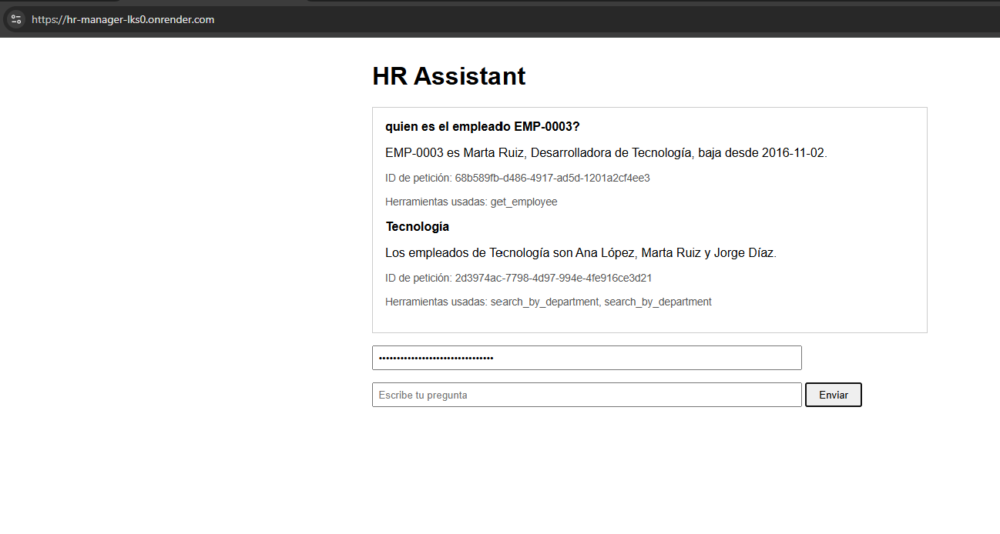

# Sesión 5: construcción de la fábrica de iteración

Este documento recoge cómo se construyó, en `sesion05/`, la parte de la fábrica que corrige desde la fuente el problema
descrito en `desiciones.md`: que un modelo real de Cloudflare no recibía las instrucciones del agente. Los prompts
están copiados tal como se escribieron, con sus erratas.

## 1. Objetivo y resultado

**Objetivo.** Que la fábrica, partiendo del `product/` con el que terminó la sesión 4, produzca por sí sola un producto
que funcione con un modelo real, también con el pequeño. Nadie edita `product/` a mano.

**Resultado.**

| Qué | Dato |
| --- | --- |
| Producto de partida | Commit `6082a23` de `sesion04/product` (repositorio `zelski/hr-manager`) |
| Producto resultante | Commit `245f660`, 11 archivos, 429 líneas agregadas y 23 quitadas |
| Cambios de código | `app/agent.py` (parser tolerante y corrección) y `app/llm.py` (prompt `system`) |
| Documentos | `doc/adr/0013`, `0014` y `0015`, y `doc/architecture.md` actualizado |
| Pruebas nuevas | `tests/test_model_protocol.py`, `tests/test_model_protocol_steps.py`, `tests/features/model_protocol.feature` |
| Verificación `unit` | 147 pruebas pasan, cobertura de 97,7 % (comprobado al preparar este documento) |
| Verificación `contract` | 4 de 4 pasan (comprobado al preparar este documento) |
| Revisión de `qa-style` | `APROBADO`, pylint 10,00/10 |
| Aprobaciones | `output/approved.txt`: «2026-11-20T01:22:24-06:00 Aprobado por la persona» |
| Producción | https://hr-manager-lks0.onrender.com/ (captura en `evidencia-produccion.png`, sección 7) |
| Prueba de humo | `verification production`: 3 de 3 (`/health` 200, `/ask` sin clave 401, `/ask` con clave 200) |
| Correlación traza-log | El mismo `request_id` en el log de Render (`audit`, `agent_run` y `request`) y en LangSmith; modelo `llama-3.1-8b-instruct-fast`, 2 pasos, 782 tokens de entrada, 892 ms (captura `evidencia-render-log.png`, `reporte.md` 2.2) |
| LangSmith | Trazas del producto desplegado con el commit `245f660`: árbol `agent_run` > `model_call` > `get_employee` > `model_call` (captura en `evidencia-langsmith.png`, ver `reporte.md` 2.1); `Input` y `Output` de `model_call` y de `agent_run` vacíos (`evidencia-langsmith-privacidad.png` y `evidencia-langsmith-agent-run.png`) |

## 2. Punto de partida y restricciones

### 2.1. Crear `sesion05`

**Prompt**

> hagamos los cambios de la siguiente forma
> - crea una nueva carpeta llamada sesion05
> - copia todos los archivos que hay en sesion04
> - haz los cambios sobre los archivos que haya en sesion05

**Decisión.** Copiar `sesion04` sin `.venv`, `__pycache__`, `.pytest_cache`, `.git` anidado, `.coverage` ni
`product/.env` (126 archivos). `.env` se dejó fuera para no duplicar un archivo con secretos, que el proyecto prohíbe
leer. Es la primera versión de `sesion05`; después se reemplazó `product/` (sección 2.3).

### 2.2. Planes y restricciones

**Prompt**

> ya se pudieron ejecutar las pruebas para el modelo pequeño y funcionó bien, ahora vamos a corregir desde las especificaciones de la fábrica en la carpeta sesion05, haz un plan y especifica que cambios se harán, no modifiques archivos todavia

**Plan v1** (propuesto): editar `spec/01` y `spec/03`, ajustar los agentes y agregar una verificación contra un
gateway simulado. Para poder apuntar el producto a ese simulado proponía una variable nueva, `CF_GATEWAY_BASE_URL`.

**Prompt**

> haz el plan nuevamente considerando estos puntos
> * los cambios a la fabrica se hacen en sesion05
> * el codigo de product/ en sesion04/ estará sin los cambios que aplicaste directo
> * no modifques la url fija de GatewayModel
> * los cambios van en la fabrica, no se toca directamente el código en product/
> * la nueva ejecución tiene que ser iterativa con el contenido de product/ que se obtuvo en sesion04

**Plan v2.** Cambió cinco cosas:

| Plan v1 | Plan v2 | Motivo |
| --- | --- | --- |
| `CF_GATEWAY_BASE_URL` para apuntar al simulado | Simular Cloudflare a nivel de `httpx`, dentro del proceso del producto | La URL fija de `GatewayModel` no se toca |
| Arreglar `product/` a mano | Que lo cambien los agentes | El arreglo debe salir de la fábrica |
| Validar contra el código de `HEAD` | La propia corrida es la validación | Parte del `product/` real de la sesión 4 |
| Editar `spec/01` y `spec/03` | Un spec nuevo (ver 3.1) | Las sesiones son incrementos acumulativos |
| `/factory` | Un skill nuevo, `iterate` | `/factory` está fijo a la sesión 4 |

### 2.3. Reemplazar `product/`

**Prompt**

> antes de proceder pretendo borrar la carpeta sesion05/product/ y copiar la carpeta product/ desde sesion04/ para que la fabrica haga los cambios desde el punto en que terminamos sesion04, eso cambia tus planes?

**Respuesta.** Simplifica el plan: el paso de preparar `product/` queda hecho. Se advirtió revertir antes los arreglos
manuales en `sesion04/product`, decidir qué hacer con `product/.git` (con él, `publish.py` hace `git push` al
repositorio existente; sin él intentaría `gh repo create`) y tratar `.env` y las cachés con cuidado.

**Prompt**

> ya terminé la copia, verifica que product/ en sesiono5/ tenga lo necesario para trabajar con el mismo repositorio de git

**Verificación hecha** (solo lectura):

| Comprobación | Resultado |
| --- | --- |
| `.git` propio | Sí; su raíz es `sesion05/product` |
| Remoto | `origin` es `https://github.com/zelski/hr-manager.git`, igual que en `sesion04` |
| Rama | `main`, siguiendo a `origin/main` |
| Último commit | `6082a23`, igual que `sesion04` |
| Estado | Limpio |
| `git fsck` | Sin errores |
| Diferencias con `sesion04/product` | Ninguna, sin contar `.git` ni cachés |
| Arreglo manual presente | No (`app/llm.py` sin `SYSTEM_PROMPT` en ambas) |
| `.env` | Existe, está en `.gitignore` y no está versionado |

Consecuencia: `publish.py` hará `git push` y Render redespliega. `sesion04` y `sesion05` comparten remoto y rama.

## 3. Dónde falló la fábrica

El análisis se hizo con la pregunta «¿en qué parte de la fábrica podría ir esa especificación?». La causa de fondo:
**ninguna verificación usa un modelo real**, así que ninguna puede notar que no se le explicó nada.

| Agente o pieza | ¿Podía detectarlo? | Motivo |
| --- | --- | --- |
| Especificación `01` | No | Define el protocolo de salida, no que el modelo reciba instrucciones |
| Especificación `03` | No | Fija el cuerpo `{"model", "messages", "max_tokens", "temperature"}` sin un `system`; un agente literal lo respeta |
| `architect` | Parcialmente | Su plan sigue la spec; nada le obliga a preguntar qué ve el modelo real |
| `qa-unit` | No | Escribe las pruebas desde la spec |
| `developer` | No | Implementa spec, plan y pruebas |
| `costs` | Sí, pero no | Escribe `GatewayModel`; su prompt dice «implementa lo que pide la especificación» |
| `qa-e2e` | No | Solo prueba la página con el modelo simulado |
| `verification` | No | `unit`, `contract`, `qa`, `e2e` y `evaluate` corren con `MODEL_PROVIDER=fake` |

Hallazgos de estructura que condicionaron el plan:

- `developer` escribe `agent.py` y `costs` escribe `GatewayModel`: cada requisito debe llegar a su dueño.
- Según `verification/server.py`, la verificación arranca `uvicorn` y habla por HTTP, sin importar el código del
  producto. No hay forma de inyectar un transporte desde afuera.
- Según `hooks/permissions.py`, ningún agente escribe en `verification/`; esa parte no sale de la fábrica: la construyó la persona con el asistente.
- `/factory` tiene pasos fijos «para spec/04-production.md» y exige un `product/` de la sesión 3.

## 4. Decisiones de diseño

**Prompt**

> 1.- dejalo en el spec/05-model-protocol.md
> 2.- crea el nuevo skill iterate, asegurate que tenga/pida las mismas garantias que factory

### 4.1. Un spec nuevo y no editar `01` y `03`

Se creó `spec/05-model-protocol.md`; `spec/01` y `spec/03` se revirtieron y quedaron idénticas a las de `sesion04`
(comprobado con `diff`). Así las sesiones siguen siendo incrementos acumulativos y el requisito vive en un solo lugar.

Contenido del spec: (1) el mensaje `system` como primer mensaje de cada llamada, sin citar el prefijo, con una sola
acción por respuesta y un ejemplo; (2) lectura tolerante de la salida; (3) corrección de la salida inválida;
(4) lo que no cambia: la URL, el cuerpo, `GatewayModel(config, transport=None)`, las llamadas con `httpx` y la API;
más las pruebas unitarias exigidas y cómo se comprueba.

### 4.2. No modificar la URL fija: simular Cloudflare dentro del proceso

Se creó `verification/gateway_harness.py`. Se ejecuta como script dentro del proceso del producto: antes de importar
la aplicación, reemplaza el transporte de `httpx` para las llamadas a `gateway.ai.cloudflare.com`, de modo que las
contesta el propio arnés y deja pasar las demás. Comprueba la URL y el encabezado `Authorization` exactos: si no
coinciden, responde 404 o 401 y el producto contesta 502. Guarda cada petición en un archivo de líneas JSON para que
las pruebas afirmen sobre lo que el producto mandó. Esto mantiene la regla de `server.py`: se habla con el producto
por HTTP, sin importar su código.

Para que las pruebas de contrato no necesiten varios procesos, el modelo simulado decide según el id de empleado de la
pregunta:

| Id | Comportamiento simulado |
| --- | --- |
| `EMP-0004` | Respuesta mezclada idéntica a la que dio el 8B real: prefijo, petición de herramienta y respuesta inventada |
| `EMP-0002` | Primero texto sin JSON; después responde bien |
| `EMP-0003` | Nunca responde algo válido |
| Otro | Se comporta bien |

### 4.3. Pruebas de contrato nuevas

`verification/contract/test_contract_model.py` tiene cuatro casos: (1) la primera petición lleva `system` primero con
las dos herramientas y los departamentos de `spec/employees.json`, sin el prefijo; (2) una salida desordenada termina
con Jorge Díaz y `get_employee` usada; (3) una salida inválida se corrige y la segunda petición no repite la primera;
(4) un modelo que nunca responde bien termina con el mensaje del tope.

### 4.4. Un skill nuevo, `iterate`

Se creó `.claude/skills/iterate/SKILL.md` en lugar de parametrizar `factory`, para no romper el flujo de la sesión 4.
Mantiene las mismas garantías:

| Garantía de `factory` | En `iterate` |
| --- | --- |
| El supervisor delega y nunca escribe en `product/` | Igual |
| Una persona aprueba el plan | Paso 2, máximo 2 rechazos |
| Una persona aprueba publicar | Paso 7; solo entonces se escribe `output/approved.txt` |
| El hook bloquea publicar sin esa aprobación | Igual (`hooks/permissions.py`) |
| Bucles con tope | 2 correcciones y 2 vueltas de `qa-style`, 2 ciclos de triage |
| Nunca leer `.env` ni pedir claves | Igual |
| Cada comando corre solo, sin encadenarlo con `;`, `&&` ni una tubería | Igual |
| Bitácora y reporte | `activity.jsonl` desde cero y pipeline al final |

Garantías adicionales, porque el producto ya existe:

1. `product/app/` debe existir.
2. `product/.git` debe existir, para publicar sobre el repositorio que ya existe.
3. `spec/05-model-protocol.md` debe existir.
4. `output/approved.txt` **no** debe existir al empezar: una aprobación vieja dejaría pasar el hook sin que se pida
   la nueva.
5. Rojo obligatorio: tras `qa-unit`, `unit` y `contract` deben fallar. Si pasan, las pruebas no detectan el problema y
   se escala.

### 4.5. Otras decisiones

| Decisión | Motivo |
| --- | --- |
| `developer` y luego `costs`, no en paralelo | Ambos corren `unit` sobre los mismos archivos de cobertura y podrían pisarse |
| `developer.md`: lectura tolerante y corrección van en el bucle (`agent.py`) | Es su archivo; un modelo real no siempre respeta el formato |
| `costs.md`: el `system` lo agrega la clase del modelo, sin tocar la URL ni el contrato | Respeta la restricción de la persona |
| `qa-unit.md`: las pruebas del modelo real no cuentan para su tope de 15 a 25 | Sin esto, el tope choca con los requisitos nuevos |
| `triage.md` puede apuntar a `developer` y `costs` | Antes solo conocía `security` y `deploy` |
| Pedir una comprobación manual con «¿Quién es EMP-0004?» al final | La prueba de humo solo mira que `/ask` responda 200 y no habría detectado este fallo |
| No agregar la comprobación de herramientas a `verification production` | Depende de un modelo real y puede fallar por causas ajenas. Ya en producción se vio que el humo no detecta este fallo; reforzarlo queda como mejora en `reporte.md`, brecha 6 |

## 5. Qué se construyó

| Archivo | Cambio |
| --- | --- |
| `spec/05-model-protocol.md` | Nuevo |
| `spec/01-architecture.md`, `spec/03-costs.md` | Sin cambios respecto a `sesion04` |
| `.claude/skills/iterate/SKILL.md` | Nuevo |
| `.claude/agents/developer.md`, `costs.md`, `qa-unit.md`, `triage.md` | Una regla cada uno |
| `verification/gateway_harness.py` | Nuevo: Cloudflare simulado dentro del proceso del producto |
| `verification/server.py` | `running_product` acepta `command`; nuevo `running_gateway_product` |
| `verification/contract/conftest.py` | Fixture `gateway_product` |
| `verification/contract/test_contract_model.py` | Nuevo: cuatro casos |
| `tests/test_gateway_harness.py` | Nuevo: pruebas del propio arnés (9) |
| `CLAUDE.md`, `README.md` | Documentan `/iterate` |

## 6. Verificación previa a la corrida

La lista de QA de la fábrica (`scripts/verify.py`) pasa: 60 pruebas, cobertura de 88 %, pylint 9,99 y sin emojis.

**El rojo se comprobó contra el `product/` sin arreglos**, antes de lanzar la fábrica, y falló por los motivos
correctos:

| Caso del contrato | Resultado | Por qué |
| --- | --- | --- |
| Primer mensaje `system` con herramientas y departamentos | Rojo | El producto no manda `system` |
| Salida desordenada termina con Jorge Díaz | Rojo | Responde «No pude completar la respuesta» |
| Salida inválida se corrige, no se repite | Rojo | Manda la misma petición dos veces |
| Un modelo que nunca acierta termina con el tope | Verde | Ya funcionaba; queda como guarda de regresión |

El producto arrancó con `MODEL_PROVIDER=gateway` y la URL exacta llegó al arnés, así que el rojo no era un fallo de
arranque.

Pylint avisó de tres cosas en el código nuevo (demasiados `return` en `respond`, finales de línea mezclados que
introdujo anexar con `cat` y una línea de 90 columnas). Se corrigieron: `respond` pasó a un diccionario de guiones y
se normalizaron los finales de línea.

## 7. Ejecución de `/iterate`

La persona lanzó `/iterate` sobre este `product/`. El comando exacto no pasó por esta conversación; lo que sigue sale
de `output/` y del repositorio.

**Bitácora** (`output/activity.jsonl`, 114 eventos de herramientas):

| Agente | Eventos |
| --- | --- |
| orchestrator | 22 |
| architect | 20 |
| qa-unit | 29 |
| developer | 10 |
| costs | 18 |
| qa-style | 15 |

**Plan del `architect`** (`output/plan.md`). Planeó solo lo que cambia: `llm.py` (prompt `system` y `build_model` con
el directorio), `agent.py` (parser tolerante y corrección) y una línea en `main.py`, que al final no hizo falta: el commit no tocó ese archivo. Escribió tres ADR:

| ADR | Decisión |
| --- | --- |
| 0013 | Las instrucciones del modelo viven en `GatewayModel` |
| 0014 | Lectura tolerante de la salida del modelo |
| 0015 | Corrección de la salida inválida dentro del bucle |

Riesgos que identificó el plan: el prefijo del resultado (la spec dice que lo agrega `GatewayModel`, pero `FakeModel`
y las pruebas lo leen en el último mensaje, así que conservó el prefijo en el agente y pidió confirmación si se quería
cambiar); un mensaje de corrección con un id haría que `FakeModel` pida una herramienta (se evita con texto fijo sin
datos de la pregunta); y que el extractor tomara un objeto que no es del protocolo (solo acepta uno con `tool` o
`answer`).

**Revisión de `qa-style`:** `APROBADO`. Mejora opcional y no bloqueante: pasar a `Config` el timeout de 30 segundos de
`GatewayModel.complete`.

**Publicación.** `output/approved.txt` se escribió a las 01:22:24 y el commit `245f660`, con el mensaje que usa
`publish.py`, a las 01:22:26. Al preparar este documento, `main` estaba al día con `origin/main`.

**Producción.** El servicio quedó publicado en https://hr-manager-lks0.onrender.com/. La persona compartió una captura
([evidencia-produccion.png](evidencia-produccion.png)) con dos consultas contestadas con el modelo real:
«quien es el empleado EMP-0003?» (la misma consulta que fallaba en el log de Cloudflare de `desiciones.md`) con
`get_employee`, y «Tecnología» con `search_by_department`. Ambas respuestas coinciden con los datos.

**Prueba de humo.** `uv run python -m verification production https://hr-manager-lks0.onrender.com` pasó 3 de 3:
`GET /health` 200, `POST /ask` sin clave 401 y `POST /ask` con clave 200. Solo comprueba códigos HTTP: no habría
detectado el problema original, por eso la captura sigue siendo la evidencia del arreglo. Eso es lo que justifica
el refuerzo propuesto en el punto 6 de las brechas de `reporte.md`.

**No consta** en `output/` un `report.md` de la corrida. Tampoco se sabe cuántas vueltas ni qué modelo usó cada
consulta: la segunda ejecutó `search_by_department` dos veces y la primera dice «baja desde 2016-11-02», donde esa fecha
es la de ingreso. Ambas observaciones están en el punto 9 de las brechas de `reporte.md`.

### 7.1. Qué produjo la fábrica

Convergió casi exactamente a lo que se había hecho a mano en el arreglo previo:

- **Parser** (`agent.py`): `json.loads` del texto completo; si no es un objeto, recorre cada `{` con
  `JSONDecoder.raw_decode` y devuelve el primero con `tool` o `answer`.
- **Corrección** (`agent.py`): dos avisos fijos, uno para salida ilegible y otro para herramienta inválida, ambos con
  un recordatorio del formato. Se agregan como mensaje `user` y no contienen datos de la pregunta.
- **Prompt** (`llm.py`): `build_system_prompt(departments)` con las dos herramientas, los departamentos exactos, un
  solo objeto JSON, una sola acción, no inventar datos, pedir el dato que falta y un ejemplo completo. No cita el
  prefijo.

Diferencia con el arreglo manual: la fábrica agregó pruebas BDD y unitarias nuevas (`model_protocol`) y ADR, y su
mensaje de corrección incluye el recordatorio del formato.

**Observación.** El ejemplo del prompt de la fábrica usa datos que no están en el directorio real (`Ana Pérez,
Ingeniera, Ingeniería`). Conviene un ejemplo que no se pueda confundir con datos reales.

## 8. Cómo repetirlo

1. Dejar `sesion05/product` como copia de `sesion04/product`, con su `.git`, sin arreglos manuales.
2. Borrar `sesion05/output/approved.txt` si existe.
3. Crear el entorno de `sesion05` (`uv venv` y `uv pip install -r requirements.txt`).
4. `/iterate hr-assistant` y responder a las dos preguntas (plan y publicar).
5. Tras el redespliegue, definir `SMOKE_API_KEY` en la terminal y correr
   `uv run python -m verification production <url>`.
6. Abrir la página, escribir la clave y preguntar «¿Quién es EMP-0004?» con el modelo pequeño: debe contestar con
   Jorge Díaz.

## 9. Lecciones

- **Un modelo simulado esconde los problemas del real.** Si todas las compuertas usan el simulado, ninguna puede
  detectar que al modelo real no se le dieron las instrucciones. Ahora hay una compuerta que simula a Cloudflare sin
  tocar el producto.
- **Probar el rojo antes de construir.** Correr el contrato contra el producto sin arreglos demostró que la verificación
  habría atrapado el fallo original.
- **La especificación manda.** El mismo agente que escribió `GatewayModel` replicó el cuerpo literal de la spec 03.
  Corregir la fuente es lo que evita que vuelva a pasar.
- **Los modelos pequeños necesitan un agente tolerante.** Instrucciones mejores ayudan, pero el agente debe leer con
  tolerancia y corregir, y no repetir la misma petición.
- **Separar «funciona» de «la fábrica lo produce».** Primero se arregló a mano para confirmarlo con el modelo real y
  luego se descartó ese código para que la fábrica lo reconstruyera.
