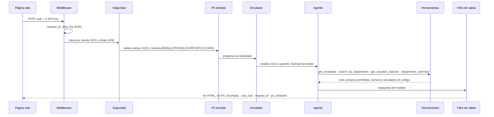

# Entrega del reto M4 · Sistema multiagente en producción

## Resumen

El HR Assistant es una API FastAPI sin estado, con página web, que responde preguntas de Recursos Humanos mediante
un agente con herramientas de solo lectura. Lo construye, prueba, revisa y publica una fábrica de agentes de Claude
Code con compuertas verificadas por código y dos aprobaciones humanas. El reto le agrega dos herramientas que
calculan en código (saldo de vacaciones y resumen por área), mínimo privilegio sobre los datos y una capa de
protección de datos personales en la entrada y en la salida. El resultado corre en Render, con CI obligatorio,
trazas en LangSmith y un costo por respuesta 86 % menor que la línea base, con la misma calidad.

## 1. Arquitectura

### Dos sistemas multiagente

1. **La fábrica (tiempo de construcción).** Un supervisor reparte el trabajo entre especialistas con permisos
   mínimos. Patrones: plan y ejecución con aprobación humana, especialistas en paralelo, flujo con compuertas,
   evaluador-optimizador (qa-style) y enrutamiento de fallas (triage). Todo bucle tiene tope; al llegar a él la
   fábrica escala a una persona.
2. **El producto (tiempo de ejecución).** Un enrutador elige el modelo por pregunta y un agente con tope de pasos
   usa cuatro herramientas deterministas. El modelo solo elige la herramienta y redacta.

```mermaid
flowchart LR
    SPEC[/"spec/05-reto.md"/] --> A["architect<br/>plan + ADR"]
    A --> H1{{"Persona aprueba el plan"}}
    H1 --> QU["qa-unit<br/>pruebas en rojo"]
    QU --> P
    subgraph P["Especialistas en paralelo"]
        D["developer<br/>datos y herramientas"]
        S["security<br/>PII, salida, compliance"]
        E["qa-e2e<br/>Playwright"]
        DE["deploy<br/>render.yaml"]
    end
    P --> G{"Compuertas por código<br/>unit · contract · qa · e2e · evaluate<br/>(máx. 2 correcciones)"}
    G --> QS{"qa-style contra QA.md<br/>(máx. 2 vueltas)"}
    QS --> H2{{"Persona aprueba publicar<br/>output/approved.txt"}}
    H2 --> PUB["publish.py → GitHub hr-as"]
    PUB --> CI["GitHub Actions<br/>style → unit → e2e → docker"]
    CI -- "checksPass" --> R["Render (Docker, free)"]
    R --> SM{"Prueba de humo"}
    SM -- "falla" --> T["triage (máx. 2)"]
```

### Flujo de una pregunta en producción

El diagrama detallado de componentes está en
[`product/doc/architecture.md`](../product/doc/architecture.md).

### Decisiones y su justificación

| Decisión | Por qué | ADR |
| --- | --- | --- |
| API sin estado; el historial lo manda la página | Escala horizontalmente sin sesión compartida; cualquier instancia atiende cualquier petición | 0001 |
| Modelo detrás de una interfaz (`fake` y `gateway`) | Pruebas y CI sin costo ni red; cambiar de proveedor es configuración | 0002, 0007 |
| Bucle del agente con tope de pasos | Un modelo que se cicla no consume tokens sin límite | 0003 |
| Herramientas que calculan en código y con campos permitidos | Menos tokens, respuestas exactas y ningún dato personal sale por accidente | 0014 |
| Enrutamiento por reglas y palabras completas | Gratis, determinista y explicable; «resumen» ya no manda la pregunta al modelo grande | 0008 |
| Redactar la PII en lugar de rechazar la pregunta | El usuario recibe respuesta y el dato nunca llega al modelo, la caché, el log ni la traza | 0013 |
| Filtro de salida (HTML → PII → largo → respaldo) | La salida del modelo no es confiable; la página nunca pinta HTML del modelo | 0015 |
| Compliance como código al arrancar | Una configuración insegura no llega a producción: Render conserva la versión anterior | 0012 |
| Publicar solo con aprobación humana y CI en verde | Ningún agente publica por su cuenta; Render despliega con `checksPass` | 0012 |

### Concurrencia, escalabilidad y resiliencia

- **Concurrencia:** FastAPI/uvicorn atiende peticiones en paralelo; la API no guarda estado entre peticiones.
- **Escalabilidad:** al no tener estado, se escala agregando instancias. Límites conocidos: el límite de peticiones
  y `/metrics` son por proceso (ADR 0005 y 0011); con varias instancias se moverían a Redis o a Prometheus.
- **Resiliencia:** si el modelo no responde, `/ask` devuelve `502` controlado; `/health` permite que Render
  reinicie; un deploy que no arranca (por compliance) deja viva la versión anterior; el CI bloquea código roto.

## 2. Observabilidad

| Requisito de la rúbrica | Implementación | Evidencia |
| --- | --- | --- |
| Integración con LangSmith | Proyecto `hr-as-reto`; una traza por `agent_run` con cada llamada `llm` y cada herramienta | `evidencia/04-langsmith-traza.png` |
| Trazabilidad completa | Metadatos `request_id`, `client` y `RENDER_GIT_COMMIT` en cada traza | ídem |
| Logging estructurado con correlation IDs | Log JSON con eventos `request`, `agent_run`, `audit`, `error` y `pii_detected`; el mismo `request_id` está en el log, la traza y el encabezado `X-Request-ID` | `evidencia/03-logs-json-request-id.png` |
| Latencia, errores y costo por request | Cada respuesta trae `cost_usd`, tokens, modelo y ruta; `GET /metrics` da p50/p95, `error_rate`, tokens, costo acumulado, SLO y `pii_detections` | `/metrics` |
| Privacidad de las trazas | `HIDE_INPUTS` y `HIDE_OUTPUTS` en `true`: LangSmith ve la estructura y los tiempos, no las preguntas | captura 04 («No inputs») |

**Ejemplo de depuración real.** Las trazas mostraron que el modelo real de 8B llamaba herramientas de más y
llegaba al tope de pasos. Con los `request_id` de la página se encontró cada traza, se identificó la causa en el
prompt y se corrigió con la fábrica en el mismo día (sección 7).

## 3. Optimización de costos

### Línea base contra palancas (`verification evaluate`)

| Corrida | Calidad | Costo (USD) | Tokens de entrada |
| --- | --- | --- | --- |
| Línea base (`ROUTING=false`, historial completo) | 100 % | 0.001912 | 4603 |
| Palancas (configuración de producción) | 100 % | 0.000267 | 3805 |
| **Diferencia** | **igual** | **−86.0 %** | **−17.3 %** |

Cifras después de la corrección del prompt (sección 7). Antes de ella eran 0.001635 → 0.000225 (−86.2 %): las
cuatro reglas nuevas del prompt suben ~19 % el costo por pregunta, a cambio de que el modelo real deje de llegar
al tope de pasos. Es un trade-off costo/calidad medido: unos tokens más por pregunta valen menos que respuestas
fallidas que el usuario repite.

La calidad la decide código: cada pregunta del conjunto de evaluación (11 casos, incluidos los tres del reto) tiene
textos que deben aparecer o que nunca deben aparecer. La evaluación usa los modelos simulados con los precios
reales de Workers AI (`data/model_prices.json`); los tokens son aproximados. Sirve para comparar configuraciones,
no para facturar.

### Estrategias y trade-offs

| Estrategia | Efecto | Trade-off |
| --- | --- | --- |
| **Enrutamiento de modelos** (8B por omisión; 70B solo para preguntas largas o de análisis) | El 8B cuesta ~6.5× menos por token de entrada. Es la mayor parte del ahorro | Una regla mal puesta manda preguntas al modelo caro (el caso de «resumen», corregido en el reto) o deja una pregunta difícil al chico |
| **Ventana de historial** (`HISTORY_WINDOW=6`) | Menos tokens de entrada en conversaciones largas | Con una ventana muy corta el modelo pierde contexto |
| **Tope de salida** (`MODEL_MAX_TOKENS=300`) y temperatura 0 | Respuestas cortas y repetibles | Una respuesta larga se corta |
| **Herramientas que calculan en código** (reto) | El modelo no suma ni filtra: menos tokens y respuestas exactas | Cada cálculo nuevo es código y pruebas |
| **Caché del AI Gateway** (`CACHE_TTL_SECONDS`) | Preguntas repetidas cuestan 0 | Apagada por omisión: con datos que cambian, la caché puede responder con información vieja |
| **Mínimo privilegio en herramientas** (reto) | Las herramientas devuelven menos campos, así que el modelo lee menos tokens | Agregar un campo es un cambio explícito |

## 4. Seguridad

| # | Control | Capa | Dónde | Cómo se comprueba |
| --- | --- | --- | --- | --- |
| 1 | Clave por cliente (`X-API-Key`), comparación en tiempo constante, 401 | Acceso | `app/security.py` | `security.feature`, contrato 04, prueba de humo |
| 2 | Límite de peticiones por cliente, 429 + `Retry-After` | Acceso / abuso | `app/security.py` | `test_security.py`, contrato 04 |
| 3 | Validación de entrada: largo máximo, no vacía, esquema Pydantic (422) | Entrada | `app/main.py` | pruebas unitarias |
| 4 | **Detección y redacción de PII** en pregunta e historial (correo, teléfono, CURP, RFC, tarjeta con Luhn) antes del modelo, la caché, el log y la traza | Entrada | `app/pii.py` | `pii.feature`, `test_pii*.py`, contrato 05, evaluación |
| 5 | **Validación y filtro de salida**: quita HTML, redacta PII, recorta y da un texto de respaldo | Salida | `app/output_filter.py` | `test_output_filter.py` |
| 6 | **Mínimo privilegio en datos**: cada herramienta tiene lista de campos permitidos; los datos personales nunca salen | Datos | `app/directory.py` | `test_least_privilege_tools.py`, contrato 05 |
| 7 | Gestión de secretos: variables de entorno, tipo `Secret` sin `repr`, `sync: false` en Render, `.env` en `.gitignore`; la clave nunca va al log ni a un error | Secretos | `app/config.py`, `render.yaml` | `test_config.py` |
| 8 | Auditoría: evento `audit` por herramienta (cliente, herramienta, argumentos) y `pii_detected` (tipos, nunca valores) | Auditoría | `app/main.py`, `app/logs.py` | `pii.feature`, logs de Render |
| 9 | Compliance como código: en producción no arranca con modelo simulado, claves débiles, trazas sin ocultar o sin `PII_REDACTION` | Configuración | `app/compliance.py` | `compliance.feature`, contrato 05 |
| 10 | Trazas sin contenido (`HIDE_INPUTS`/`HIDE_OUTPUTS`) | Observabilidad | `app/tracing.py` | captura de LangSmith |
| 11 | Contenedor con usuario no root; `.dockerignore` excluye `.env` y pruebas | Plataforma | `Dockerfile` | etapa `docker` del CI |
| 12 | Despliegue con compuertas: CI obligatorio y aprobación humana (el hook bloquea `git push` y `publish.py` sin `output/approved.txt`) | Proceso | `hooks/permissions.py`, `render.yaml` | `tests/test_permissions.py` |
| 13 | Mínimo privilegio de los agentes: cada uno escribe solo en sus carpetas y nadie lee `.env` | Proceso | `hooks/permissions.py` | `tests/test_permissions.py` |

La tabla completa de reglas de compliance, con su ubicación y prueba, está en
[`product/doc/compliance-checklist.md`](../product/doc/compliance-checklist.md).

## 5. Evidencia

| Archivo | Qué muestra |
| --- | --- |
| `evidencia/01-ci-pipeline-verde.png` | Las cuatro etapas del CI en verde para el commit desplegado |
| `evidencia/02-render-deploy-live.png` | El servicio en Render, Live con el commit `ad673a8` |
| `evidencia/03-logs-json-request-id.png` | Logs JSON con `request_id`, latencia y estado |
| `evidencia/04-langsmith-traza.png` | Traza del agente con herramientas, `request_id`, cliente y commit |
| `evidencia/05-fabrica-lista.png` | La fábrica terminada en LISTA, con la tabla de costos |
| `evidencia/06-pregunta-vacaciones.png` | Producción: «A Jorge Díaz le quedan 12 días», con una sola herramienta e id de la petición |
| `evidencia/07-pii-redactada.png` | Producción: la pregunta con un correo se reemplaza por el aviso «se ocultaron: EMAIL» y el correo no aparece |
| `evidencia/08-swagger-docs.png` | OpenAPI en `/docs`: `POST /ask` con clave, respuesta con `cost_usd` y `pii_redacted`, y 422 de validación |
| `evidencia/09-correccion-prompt.png` | Producción tras corregir el prompt: vacaciones, resumen y pregunta con correo, cada una con una sola herramienta |
| `evidencia/10-traza-antes-correccion.png` | LangSmith, **antes** (commit `ad673a8`, `request_id` f8cd6a5e): la pregunta con correo prueba las cuatro herramientas, 1.40 s y tope de pasos |
| `evidencia/11-traza-despues-correccion.png` | LangSmith, **después** (commit `52d5703`, `request_id` 793b5a47): la misma pregunta con una sola herramienta, 0.82 s |
| [`reporte-fabrica.md`](reporte-fabrica.md) | Bitácora completa de la corrida: ciclos, correcciones y compuertas |
| [`pipeline-fabrica.md`](pipeline-fabrica.md) | Diagrama del pipeline que registró la fábrica |
| [`plan-reto.md`](plan-reto.md) | El plan que aprobó la persona |

## 6. Limitaciones conocidas y mejoras futuras

- **Las pruebas usan el modelo simulado.** Las compuertas no detectaron que el modelo real de 8B llamaba
  herramientas de más ni arrastraba el tema del historial; se descubrió en producción con trazas (sección 7, ya
  corregido). Mejora: una evaluación periódica contra el modelo real con preguntas encadenadas, en un entorno de
  staging, antes de publicar.
- **Límite de peticiones y métricas por proceso.** Con varias instancias habría que llevarlos a Redis o a Prometheus.
- **La detección de PII es por expresiones regulares.** Puede tener falsos positivos (un número de 10 dígitos que no
  es teléfono) y no detecta nombres propios ni direcciones. Una mejora es un clasificador como Presidio.
- **Los precios de la evaluación son reales, pero los tokens del modelo simulado son aproximados.** Para una cifra
  exacta hay que medir con el gateway real; `/metrics` ya acumula el costo real en producción.
- **Plan gratuito de Render:** el servicio se apaga cuando no tiene tráfico y tarda unos 50 s en despertar.
- Los ADR siguen con estado «propuesto»; falta marcarlos como aceptados.

## 7. Problemas encontrados y soluciones

| Problema | Solución |
| --- | --- |
| El producto vive en `product/` con su propio `.git` (para Render) y git lo trataría como submódulo en el fork | `publish.py` guarda el historial del producto en `output/product.git`; `product/` se versiona como carpeta normal |
| `/ask` respondía 502 en la sesión 4 (Cloudflare) | Configuración de Cloudflare y de Render corregida; la prueba de humo del reto pasó a la primera |
| «resumen» contiene «resume» y mandaba la pregunta al modelo grande | El enrutador compara palabras completas, con prueba unitaria |
| La fábrica no veía `SMOKE_API_KEY` porque se definió después de abrir Claude Code | La persona corrió la prueba de humo en su terminal; la clave nunca pasó por el chat |
| `get_employee` devolvía el registro completo, con los datos personales | Listas de campos permitidos por herramienta |
| **En producción, con el modelo real, el agente llegaba al tope de pasos.** Tras recibir el resultado de una herramienta volvía a pedir otras (`department_summary` → `get_employee` → tope), seguía el tema de la pregunta anterior y, con `[EMAIL]` en la pregunta, probaba las cuatro herramientas. Se detectó con las trazas de LangSmith (`request_id` 36da9f90, e42baa20, f5196cb5 y 2beef4a4) | Causa: el prompt explicaba cómo pedir herramientas pero no cuándo dejar de pedirlas. Un intento de mitigación por configuración (`HISTORY_WINDOW=0`) **empeoró** el resultado, porque el historial le daba al modelo ejemplos de respuestas; se revirtió. La corrección pasó por la fábrica: qa-unit escribió la prueba en rojo, developer agregó cuatro reglas a `SYSTEM_PROMPT` (una herramienta, responder tras el resultado, solo la última pregunta, marcadores de PII son datos ocultos), pasaron las 5 compuertas, architect lo registró en el ADR 0003 y, con aprobación, se publicó `52d5703`. Además `AGENT_MAX_STEPS=4` en Render como margen. Verificado en producción: las tres preguntas se responden con una sola herramienta (`evidencia/09-correccion-prompt.png`) |
