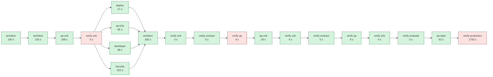

# Pipeline de la fábrica

| # | Paso | Resultado | Segundos |
| --- | --- | --- | --- |
| 1 | architect | pasó | 190 |
| 2 | architect | pasó | 235 |
| 3 | qa-unit | pasó | 298 |
| 4 | verify unit | falló | 5 |
| 5 | deploy | pasó | 27 |
| 6 | qa-e2e | pasó | 86 |
| 7 | developer | pasó | 98 |
| 8 | security | pasó | 320 |
| 9 | architect | pasó | 382 |
| 10 | verify unit | pasó | 4 |
| 11 | verify contract | pasó | 5 |
| 12 | verify qa | falló | 9 |
| 13 | qa-unit | pasó | 28 |
| 14 | verify unit | pasó | 4 |
| 15 | verify contract | pasó | 5 |
| 16 | verify qa | pasó | 9 |
| 17 | verify e2e | pasó | 4 |
| 18 | verify evaluate | pasó | 3 |
| 19 | qa-style | pasó | 92 |
| 20 | verify production | falló | 1750 |
