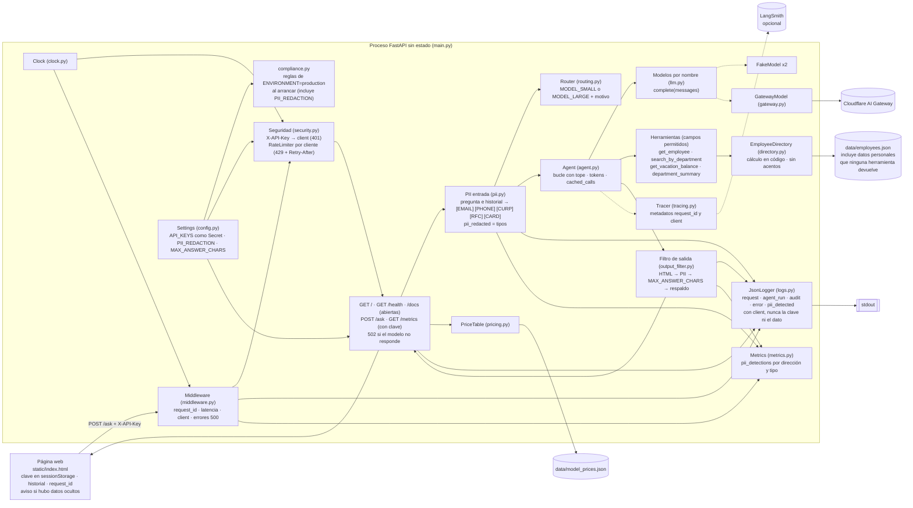
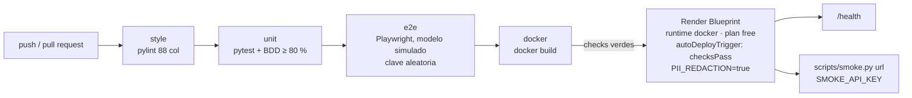

# Arquitectura del HR Assistant

Asistente de Recursos Humanos que responde preguntas sobre empleados desde una página web. Es una API FastAPI
sin estado con un solo agente que usa herramientas de solo lectura y un modelo detrás de una interfaz.
Desde la sesión 2 cada petición se puede rastrear (id, log JSON, auditoría, trazas) y medir (`GET /metrics`).
Desde la sesión 3 usa un modelo real (Workers AI vía AI Gateway) o dos modelos simulados con nombre y precio,
elige el modelo por pregunta y dice cuánto costó cada respuesta.
Desde la sesión 4 pide una clave por cliente, limita las peticiones por minuto, se niega a arrancar en producción
con una configuración insegura y se publica en Render como contenedor solo si el pipeline de CI pasa.
Desde el reto tiene cuatro herramientas con campos permitidos y cálculo en código (saldo de vacaciones y resumen por
área), y una capa de protección de datos personales que redacta la entrada y filtra la salida.

## Componentes



## Entrega



## Secuencia de una pregunta

```mermaid
sequenceDiagram
    participant W as Página web
    participant MW as Middleware
    participant S as Seguridad
    participant A as API /ask
    participant P as pii.py
    participant G as Agent
    participant F as output_filter.py
    participant L as JsonLogger
    W->>MW: POST /ask {question, history} + X-API-Key
    MW->>S: petición con request_id
    alt sin clave o inválida
        S-->>MW: 401 invalid or missing API key
    else cliente pasó el límite
        S-->>MW: 429 rate limit exceeded + Retry-After
    else válida y con cupo
        S->>A: request.state.client
        A->>A: valida cuerpo (422)
        A->>P: redact(pregunta), redact(cada turno)
        P-->>A: texto con marcadores + tipos
        A->>L: pii_detected {client, direction: input, types} si hubo
        A->>A: enruta y recorta historial (ya redactados)
        A->>G: run(...) dentro de request_scope(request_id, client)
        G->>L: audit {client, tool, args}
        G-->>A: AgentResult
        A->>F: clean_answer(respuesta)
        F-->>A: sin HTML, sin PII, recortada o respaldo
        A->>L: pii_detected {direction: output, types} si hubo
        A->>L: agent_run {client, números, nunca textos}
        A-->>MW: 200 {answer, ..., cost_usd, request_id, pii_redacted}
    end
    MW->>L: request {client, method, path, status, latency_ms}
    MW-->>W: respuesta con X-Request-ID
    Note over W: 401 → «Clave inválida» · 429 → «Demasiadas preguntas; espera N segundos»<br/>pii_redacted no vacío → aviso en lugar del texto de la pregunta
```

## Principios

- Sin estado entre peticiones: el historial viaja con el cliente (ADR 0001). Las métricas y el límite de
  peticiones son del proceso y no cambian el contenido de las respuestas (ADR 0005, ADR 0011).
- El agente depende de `complete(messages)`, no de un proveedor (ADR 0002); el modelo real es una implementación
  más, con `502` si falla (ADR 0007).
- El bucle tiene tope y respuesta de respaldo exacta (ADR 0003).
- Cada petición tiene un `request_id`; el log nunca lleva preguntas, respuestas, el token de Cloudflare, claves
  de cliente ni datos personales detectados (ADR 0004, ADR 0010, ADR 0013).
- Trazas opcionales, con contenido oculto por omisión y obligatoriamente oculto en producción (ADR 0006, ADR 0012).
- Enrutamiento por regla y costo por respuesta medido (ADR 0008, ADR 0009).
- Una clave por cliente, comparada en tiempo constante; solo `/ask` y `/metrics` la piden (ADR 0010).
- En producción, una configuración insegura impide arrancar, incluida `PII_REDACTION` distinta de `true`; solo se
  publica si el CI pasa (ADR 0012, ADR 0013).
- La PII se redacta antes de llegar al modelo, la caché, la traza y el log, y se filtra a la salida (ADR 0013,
  ADR 0015).
- Cada herramienta devuelve solo sus campos permitidos y los números ya calculados en código (ADR 0014).
- La hora siempre llega por un `Clock` inyectado, también para el límite de peticiones.
- La página pinta todo con `textContent` y guarda la clave solo en `sessionStorage`.
