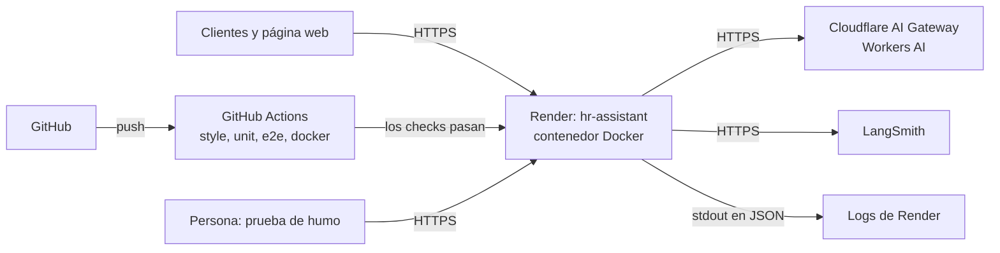

# Reto M4: HR Assistant multi-agente en producción (Esteban Agustín Soto)

Entrega del reto *Sistema Multi-Agente en Producción*. El HR Assistant lo construyó la fábrica de agentes del
módulo (diez agentes de Claude Code con hooks que limitan lo que cada uno puede escribir) y está publicado en
Render. Una persona dirigió, aprobó el plan y aprobó cada publicación; ninguna persona programó el producto.

- **Servicio publicado:** https://hr-assistant-lhob.onrender.com (la página y `/docs` son públicas; `/ask` y
  `/metrics` piden clave de cliente).
- **Código del producto:** carpeta [`product/`](product/) de esta entrega. El producto también vive en un
  repositorio privado de GitHub, desde el que Render despliega.
- **Video de demostración (máximo 5 minutos):** pendiente de enlazar en esta descripción.

Lo que todavía falta está en la sección «Qué falta», al final.

## Cómo está organizada la entrega

| Carpeta o archivo | Qué contiene |
| --- | --- |
| `product/` | El HR Assistant: `app/` (FastAPI), `tests/` (unitarias y BDD), `e2e/` (Playwright), `doc/` (arquitectura y ADR 0001 a 0014), `Dockerfile`, `render.yaml` y el CI de GitHub Actions |
| `spec/` | Lo que debe hacer el producto, una especificación por sesión (`01` a `06`) |
| `.claude/`, `hooks/` | Los agentes de la fábrica y los hooks que los controlan (`permissions.py`, `activity_log.py`) |
| `verification/`, `scripts/`, `tests/` | Las compuertas que decide el código: `unit`, `contract`, `qa`, `e2e`, `evaluate`, `production`, y la prueba de carga |
| `output/` | Lo que dejó la fábrica: `report.md`, `plan.md`, `qa-review.md`, `triage.md`, `pipeline.md` y las mediciones |
| `evidencias/` | Logs reales de Render que respaldan la verificación en producción |
| `propuesta_solucion181126.md` | La propuesta de solución: requisitos del reto, decisiones, riesgos y evidencia |

## Arquitectura



Dentro del servicio, cada petición pasa por la autenticación y el límite por cliente, se enmascaran la CURP y
el correo, el agente razona con un bucle acotado (modelo pequeño o grande según la pregunta) y llama a dos
herramientas del directorio. El detalle y los diagramas por módulo están en
[`product/doc/architecture.md`](product/doc/architecture.md); el flujo de la fábrica, en
[`output/pipeline.md`](output/pipeline.md).

## Los requisitos del reto y dónde se comprueban

| Requisito | Estado | Evidencia |
| --- | --- | --- |
| Despliegue y API con health check | Cumple | Servicio en Render; `GET /health`; `render.yaml`; CI de cuatro etapas; prueba de humo de seis comprobaciones |
| Documentación de la API | Cumple | `/docs`, `/redoc` y `/openapi.json` públicos, con las cuatro rutas y los errores 401, 422, 429 y 502 |
| Concurrencia | Cumple con límite | [`output/load-local.md`](output/load-local.md) y [`output/load-render.md`](output/load-render.md) |
| Observabilidad | Cumple | Log JSON con `request_id` y `client`, auditoría de herramientas, `/metrics` con p95 y SLO, trazas de LangSmith, `cost_usd` por petición |
| Costos con baseline | Cumple | [`output/evaluate-real.md`](output/evaluate-real.md), medido con el modelo real |
| Seguridad | Cumple | Clave por cliente, límite de peticiones, compliance como código, enmascarado de CURP y correo |
| Mínimo privilegio | Parcial | Contenedor sin root y claves por cliente; el token de Cloudflare tiene un permiso de más (ver «Qué falta») |
| Validación de salidas | Parcial | Se valida la forma de la respuesta del modelo y se enmascara la PII; no se limita el tamaño |

## Resultados

**Costo, con el modelo real** (8 preguntas con historial de relleno, 3 repeticiones por configuración,
0 errores y calidad del 100 % en las tres):

| Configuración | Costo por corrida (USD) | Ahorro |
| --- | --- | --- |
| Baseline (sin enrutamiento ni ventana) | 0,002842 | |
| Con palancas | 0,000464 | 83,7 % |
| Con palancas y caché del gateway | 0,000153 | 94,6 % |

Los tokens de entrada solo bajan un 5,3 %, así que el ahorro viene sobre todo del enrutamiento al modelo
pequeño. El panel de AI Gateway de Cloudflare mostró para el modelo grande 0,0085 USD, igual a las tres
corridas del baseline. Con 8 preguntas, el 100 % de calidad no demuestra calidad en general.

**Carga.** En local, con el modelo simulado, el rendimiento crece en línea recta hasta 50 usuarios y a 100 se
aplana (207 peticiones por segundo, p95 de 320 ms, sin errores). En Render `free` con el modelo real, de 1 a 3
usuarios el p95 queda entre 1,1 y 1,2 s; al superar a propósito el límite por cliente el servicio rechazó 107
peticiones con `429`, sin ningún `502`. La rodilla local puede ser del generador de carga, que corre en la misma
máquina.

**PII.** La CURP y el correo electrónico (México) se enmascaran como `[CURP]` y `[EMAIL]` en la entrada, la
respuesta y el log, y nunca se escriben en la auditoría. En los logs de Render hay cero coincidencias de los
valores de prueba y un evento `pii_masked` solo con conteos
([`evidencias/render-log-sesion5-pii.txt`](evidencias/render-log-sesion5-pii.txt)). Límites aceptados: variantes
ofuscadas y una CURP pegada a otras letras no se detectan.

**Pruebas.** 282 unitarias (95,31 % de cobertura), 28 de contrato, 7 de punta a punta, pylint 10,00/10 y 94
pruebas de las herramientas de la fábrica.

## Cómo se construyó, por sesión

1. Arquitectura: plan y ADR, pruebas primero, API sin estado con un agente de bucle acotado.
2. Observabilidad: `request_id`, log JSON, auditoría, `/metrics` con SLO y LangSmith.
3. Costos: Workers AI, enrutamiento, ventana de historial, tope de salida y caché.
4. Producción: claves por cliente, límite de peticiones, compliance, Docker, CI y Render con aprobación humana.
5. PII: enmascarado de CURP y correo (`spec/05-pii.md`).
6. Costo por petición en el log y documentación pública (`spec/06-cost-and-docs.md`), más la medición con el
   modelo real y la prueba de carga.

Todo bucle tiene tope (2 rechazos del plan, 2 correcciones, 2 vueltas de `qa-style`) y la bitácora completa está
en [`output/report.md`](output/report.md), con los defectos que el modelo real destapó y cómo se diagnosticaron
con los logs.

## Cómo reproducirlo

Desde esta carpeta, con `uv`:

```
uv run python -m verification unit        # pruebas del producto
uv run python -m verification contract    # pruebas contra el producto corriendo
uv run python -m verification qa          # QA.md
uv run python -m verification e2e         # Playwright
uv run python -m verification evaluate    # costo y calidad, modelo simulado
uv run python scripts/verify.py           # las herramientas de la fábrica
```

La prueba de humo contra el servicio publicado y la medición con el modelo real piden credenciales en la
terminal (variables `SMOKE_API_KEY`, `CF_ACCOUNT_ID` y `CF_API_TOKEN`); nunca van en el repositorio.

## Qué falta

Se entrega como borrador y se completa en este mismo PR:

- **Video de demostración** de 5 minutos como máximo.
- **Prueba de humo automática** en GitHub Actions (`smoke.yml`): hoy se corre a mano.
- **Recorte del token de Cloudflare** a `AI Gateway: Run` y `Workers AI: Read`; hoy tiene además `Workers AI: Edit`.
- **Validación del tamaño de la respuesta** del modelo.
- **Captura del panel de AI Gateway** (se agrega a `evidencias/`).

## Límites conocidos

- Plan `free` de Render: el servicio se duerme y la primera petición tarda hasta un minuto; sirve para
  demostrar, no para producción.
- El límite por cliente y las métricas viven en la memoria de un proceso. Con varias instancias habría que
  compartirlos (ADR 0005 y 0011). La ventana del límite es fija, así que en el cambio de minuto puede pasar
  hasta el doble.
- La calidad se midió con un conjunto pequeño; la caché del gateway favorece una medición con preguntas repetidas.
- No se probó un plan de pago ni varias instancias.
