# Pipeline de la fábrica

```mermaid
flowchart LR
  s0["qa-unit<br/>115 s"]:::ok
  s1["verify unit<br/>5 s"]:::fail
  s2["deploy<br/>471 s"]:::ok
  s3["security<br/>261 s"]:::ok
  s4["qa-e2e<br/>145 s"]:::ok
  s5["verify unit<br/>9 s"]:::ok
  s6["verify contract<br/>14 s"]:::ok
  s7["verify qa<br/>15 s"]:::fail
  s8["qa-unit<br/>1001 s"]:::ok
  s9["verify unit<br/>7 s"]:::ok
  s10["verify contract<br/>25 s"]:::ok
  s11["verify qa<br/>19 s"]:::ok
  s12["verify e2e<br/>8 s"]:::ok
  s13["verify evaluate<br/>7 s"]:::ok
  s14["qa-style<br/>70 s"]:::ok
  s15["security<br/>31 s"]:::ok
  s16["verify unit<br/>7 s"]:::ok
  s17["verify contract<br/>14 s"]:::ok
  s18["verify qa<br/>15 s"]:::ok
  s19["verify e2e<br/>8 s"]:::ok
  s20["verify evaluate<br/>6 s"]:::ok
  s21["qa-style<br/>46 s"]:::ok
  s22["qa-style<br/>128 s"]:::ok
  s23["qa-style<br/>260 s"]:::ok
  s24["security<br/>156 s"]:::ok
  s25["qa-e2e<br/>94 s"]:::ok
  s26["verify unit<br/>10 s"]:::ok
  s27["verify contract<br/>16 s"]:::ok
  s28["verify qa<br/>14 s"]:::ok
  s29["verify e2e<br/>11 s"]:::ok
  s30["verify evaluate<br/>7 s"]:::ok
  s31["qa-style<br/>56 s"]:::ok
  s32["deploy<br/>25 s"]:::ok
  s33["verify production<br/>178703 s"]:::fail
  s34["verify production<br/>1443 s"]:::fail
  s35["triage<br/>276 s"]:::ok
  s36["qa-unit<br/>128 s"]:::ok
  s37["security<br/>9757 s"]:::ok
  s38["qa-unit<br/>89 s"]:::ok
  s39["developer<br/>138 s"]:::ok
  s40["qa-unit<br/>112 s"]:::ok
  s41["architect<br/>36 s"]:::ok
  s42["architect<br/>42 s"]:::ok
  s43["qa-unit<br/>98 s"]:::ok
  s44["developer<br/>141 s"]:::ok
  s45["security<br/>20 s"]:::ok
  s46["architect<br/>18 s"]:::ok
  s47["qa-unit<br/>162 s"]:::ok
  s48["developer<br/>205 s"]:::ok
  s49["security<br/>68 s"]:::ok
  s50["architect<br/>19 s"]:::ok
  s51["architect<br/>2284 s"]:::ok
  s52["qa-unit<br/>1035 s"]:::ok
  s53["security<br/>497 s"]:::ok
  s54["qa-e2e<br/>67 s"]:::ok
  s55["verify verification<br/>6 s"]:::ok
  s56["verify contract<br/>4 s"]:::ok
  s57["verify contract<br/>9 s"]:::ok
  s58["qa-style<br/>84 s"]:::ok
  s59["architect<br/>63 s"]:::ok
  s60["security<br/>96 s"]:::ok
  s61["verify contract<br/>105 s"]:::ok
  s62["qa-style<br/>58 s"]:::ok
  s63["architect<br/>81 s"]:::ok
  s64["qa-unit<br/>860 s"]:::ok
  s65["verify verification<br/>1 s"]:::fail
  s66["developer<br/>144 s"]:::ok
  s67["observability<br/>85 s"]:::ok
  s68["security<br/>92 s"]:::ok
  s69["qa-style<br/>66 s"]:::ok
  s70["architect<br/>28 s"]:::ok
  s71["developer<br/>61 s"]:::ok
  s72["qa-style<br/>46 s"]:::ok
  s73["verify evaluate<br/>29 s"]:::ok
  s74["architect<br/>104 s"]:::ok
  s75["verify scripts<br/>287 s"]:::ok
  s76["qa-unit<br/>300 s"]:::ok
  s77["verify qa<br/>16 s"]:::ok
  s78["verify qa<br/>26 s"]:::ok
  s79["deploy<br/>61 s"]:::ok
  s80["verify unit<br/>32 s"]:::ok
  s81["security<br/>72 s"]:::ok
  s82["qa-style<br/>74 s"]:::ok
  s0 --> s1
  s1 --> s2
  s1 --> s3
  s1 --> s4
  s2 --> s5
  s3 --> s5
  s4 --> s5
  s5 --> s6
  s6 --> s7
  s7 --> s8
  s8 --> s9
  s9 --> s10
  s10 --> s11
  s11 --> s12
  s12 --> s13
  s13 --> s14
  s14 --> s15
  s15 --> s16
  s16 --> s17
  s17 --> s18
  s18 --> s19
  s19 --> s20
  s20 --> s21
  s21 --> s22
  s22 --> s23
  s23 --> s24
  s23 --> s25
  s24 --> s26
  s25 --> s26
  s26 --> s27
  s27 --> s28
  s28 --> s29
  s29 --> s30
  s30 --> s31
  s31 --> s32
  s32 --> s33
  s33 --> s34
  s34 --> s35
  s35 --> s36
  s36 --> s37
  s37 --> s38
  s38 --> s39
  s39 --> s40
  s39 --> s41
  s40 --> s42
  s41 --> s42
  s42 --> s43
  s43 --> s44
  s44 --> s45
  s44 --> s46
  s45 --> s47
  s46 --> s47
  s47 --> s48
  s48 --> s49
  s48 --> s50
  s49 --> s51
  s50 --> s51
  s51 --> s52
  s52 --> s53
  s52 --> s54
  s53 --> s55
  s54 --> s55
  s55 --> s56
  s56 --> s57
  s57 --> s58
  s58 --> s59
  s58 --> s60
  s59 --> s61
  s60 --> s61
  s61 --> s62
  s62 --> s63
  s63 --> s64
  s64 --> s65
  s65 --> s66
  s66 --> s67
  s67 --> s68
  s68 --> s69
  s69 --> s70
  s69 --> s71
  s70 --> s72
  s71 --> s72
  s72 --> s73
  s73 --> s74
  s74 --> s75
  s75 --> s76
  s76 --> s77
  s77 --> s78
  s78 --> s79
  s79 --> s80
  s80 --> s81
  s81 --> s82
  classDef ok fill:#d4f4dd,stroke:#1e7b3a
  classDef fail fill:#fde2e2,stroke:#a12a2a
```

| # | Paso | Resultado | Segundos |
| --- | --- | --- | --- |
| 1 | qa-unit | pasó | 115 |
| 2 | verify unit | falló | 5 |
| 3 | deploy | pasó | 471 |
| 4 | security | pasó | 261 |
| 5 | qa-e2e | pasó | 145 |
| 6 | verify unit | pasó | 9 |
| 7 | verify contract | pasó | 14 |
| 8 | verify qa | falló | 15 |
| 9 | qa-unit | pasó | 1001 |
| 10 | verify unit | pasó | 7 |
| 11 | verify contract | pasó | 25 |
| 12 | verify qa | pasó | 19 |
| 13 | verify e2e | pasó | 8 |
| 14 | verify evaluate | pasó | 7 |
| 15 | qa-style | pasó | 70 |
| 16 | security | pasó | 31 |
| 17 | verify unit | pasó | 7 |
| 18 | verify contract | pasó | 14 |
| 19 | verify qa | pasó | 15 |
| 20 | verify e2e | pasó | 8 |
| 21 | verify evaluate | pasó | 6 |
| 22 | qa-style | pasó | 46 |
| 23 | qa-style | pasó | 128 |
| 24 | qa-style | pasó | 260 |
| 25 | security | pasó | 156 |
| 26 | qa-e2e | pasó | 94 |
| 27 | verify unit | pasó | 10 |
| 28 | verify contract | pasó | 16 |
| 29 | verify qa | pasó | 14 |
| 30 | verify e2e | pasó | 11 |
| 31 | verify evaluate | pasó | 7 |
| 32 | qa-style | pasó | 56 |
| 33 | deploy | pasó | 25 |
| 34 | verify production | falló | 178703 |
| 35 | verify production | falló | 1443 |
| 36 | triage | pasó | 276 |
| 37 | qa-unit | pasó | 128 |
| 38 | security | pasó | 9757 |
| 39 | qa-unit | pasó | 89 |
| 40 | developer | pasó | 138 |
| 41 | qa-unit | pasó | 112 |
| 42 | architect | pasó | 36 |
| 43 | architect | pasó | 42 |
| 44 | qa-unit | pasó | 98 |
| 45 | developer | pasó | 141 |
| 46 | security | pasó | 20 |
| 47 | architect | pasó | 18 |
| 48 | qa-unit | pasó | 162 |
| 49 | developer | pasó | 205 |
| 50 | security | pasó | 68 |
| 51 | architect | pasó | 19 |
| 52 | architect | pasó | 2284 |
| 53 | qa-unit | pasó | 1035 |
| 54 | security | pasó | 497 |
| 55 | qa-e2e | pasó | 67 |
| 56 | verify verification | pasó | 6 |
| 57 | verify contract | pasó | 4 |
| 58 | verify contract | pasó | 9 |
| 59 | qa-style | pasó | 84 |
| 60 | architect | pasó | 63 |
| 61 | security | pasó | 96 |
| 62 | verify contract | pasó | 105 |
| 63 | qa-style | pasó | 58 |
| 64 | architect | pasó | 81 |
| 65 | qa-unit | pasó | 860 |
| 66 | verify verification | falló | 1 |
| 67 | developer | pasó | 144 |
| 68 | observability | pasó | 85 |
| 69 | security | pasó | 92 |
| 70 | qa-style | pasó | 66 |
| 71 | architect | pasó | 28 |
| 72 | developer | pasó | 61 |
| 73 | qa-style | pasó | 46 |
| 74 | verify evaluate | pasó | 29 |
| 75 | architect | pasó | 104 |
| 76 | verify scripts | pasó | 287 |
| 77 | qa-unit | pasó | 300 |
| 78 | verify qa | pasó | 16 |
| 79 | verify qa | pasó | 26 |
| 80 | deploy | pasó | 61 |
| 81 | verify unit | pasó | 32 |
| 82 | security | pasó | 72 |
| 83 | qa-style | pasó | 74 |
