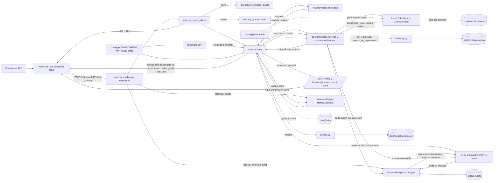

# Arquitectura del HR Assistant

API FastAPI sin estado con un solo agente, un modelo detrás de una interfaz y un directorio de solo lectura. Desde la sesión 2 cada petición lleva un `request_id`, deja un log JSON y alimenta métricas. Desde la sesión 3 un enrutador elige el modelo por pregunta, el modelo real se usa por AI Gateway y cada respuesta informa su costo. Desde la sesión 4 el acceso exige una clave por cliente, hay un límite de peticiones, la configuración de producción se verifica al arrancar y el producto se publica en Render solo si el pipeline pasa. Desde la sesión 5 la CURP y el correo se enmascaran en la pregunta, el historial, la respuesta y el log. Desde la sesión 6 el evento `agent_run` trae `cost_usd` (el mismo número que devuelve `/ask`) y la documentación OpenAPI es pública. Desde la sesión 7 un flujo de GitHub Actions corre cada día `scripts/smoke.py` (seis comprobaciones) con la clave en un secreto de GitHub. Decisiones en `adr/`.



## Publicación

```mermaid
flowchart LR
    DEV[push o pull request] --> ST1[style: pylint 88 columnas]
    ST1 --> UN[unit: pruebas y BDD, cobertura 80 por ciento]
    UN --> E2E[e2e: Playwright con modelo simulado]
    E2E --> DK[docker: docker build]
    DK -->|checksPass| RD[Render: render.yaml, docker, plan free]
    RD --> H[/health]
    RD --> SM[scripts/smoke.py con SMOKE_API_KEY]
    GH[smoke.yml: manual y cron diario 13:17 UTC] -->|secrets.SMOKE_API_KEY, vars.SERVICE_URL| SM
    SM -->|seis comprobaciones| RD
```

## Módulos
- `config.py`: variables de entorno validadas, incluidas observabilidad, costos, `ENVIRONMENT`, `API_KEYS` y el límite.
- `security.py`: lectura de `API_KEYS`, autenticación con `compare_digest` y límite por cliente con reloj inyectado (ADR 0010 y 0011).
- `compliance.py`: reglas de `ENVIRONMENT=production` que impiden arrancar, incluida `PII_MASKING=true` (ADR 0012 y 0013).
- `pii.py`: enmascara CURP y correo como `[CURP]` y `[EMAIL]` en la pregunta, el historial, la respuesta y los valores de cada evento del log (antes de serializar a JSON); funciones puras (ADR 0013).
- `directory.py`: lectura de empleados.
- `router.py`: elige `MODEL_SMALL` o `MODEL_LARGE` y el motivo (ADR 0007).
- `pricing.py`: costo por llamada según la tabla de precios (ADR 0009).
- `llm.py`: interfaz del modelo, `Completion`, modelo simulado y `GatewayModel`, que serializa a texto un `content` que llegue como objeto (ADR 0008).
- `agent.py`: bucle con tope, ventana de historial; en cada vuelta incluye en la conversación la salida del modelo (mensaje assistant) antes del resultado de la herramienta, y el resultado de una herramienta válida termina con una instrucción fija que pide responder con `answer`; el prompt de sistema describe las dos herramientas y sus argumentos; normaliza la salida del modelo (JSON puro, valla de Markdown, texto alrededor del objeto u objeto ya parseado) y, al rechazar una vuelta, emite `invalid_model_output` solo con `reason`, `raw_type` y `raw_chars`, nunca el contenido; una llamada de herramienta inválida emite `invalid_tool_call` solo con `tool` y `arg_keys`, nunca los valores; emite también `audit` y `agent_run`, que desde la sesión 6 incluye `cost_usd`, calculado una sola vez con la función de costo que recibe de `main.py` (ADR 0014).
- `observability.py`: reloj inyectado, logger JSON con `request_id` y `client`, métricas con costo.
- `tracing.py`: trazas opcionales de LangSmith, apagadas por omisión.
- `main.py`: middleware, autenticación, rutas `/`, `/health`, `/ask`, `/metrics`; `401`, `429` y `502`; arma la función de costo del agente y documenta la API en OpenAPI; los metadatos salen de `api_docs.py` (ADR 0014).
- `api_docs.py`: metadatos de la API, modelos `AskRequest`, `AskResponse` y de errores, respuestas por ruta y el esquema de seguridad con el encabezado `X-API-Key`; solo describe, no cambia el comportamiento (ADR 0014).
- `static/index.html`: interfaz web con campo de clave en `sessionStorage`; muestra `request_id`, modelo y costo.
- Fuera de `app/`: `Dockerfile`, `.dockerignore`, `.github/workflows/ci.yml`, `.github/workflows/smoke.yml` (prueba de humo manual y diaria, ADR 0015), `render.yaml`, `scripts/smoke.py` (seis comprobaciones) y `doc/compliance-checklist.md`.
