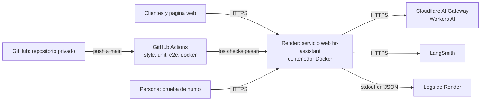

# Propuesta de solución: HR Assistant multi-agente en producción sobre Render

Fecha: 18 de noviembre de 2026 (actualizada el 21 de noviembre de 2026: plataforma Render, PII y costo por petición y documentación pública ya implementados)
Requerimiento: *M4. Reto: Sistema Multi-Agente en Producción* (`M4._Plan_de_Reto_Multiagente_en_produccion.pdf`)

## 1. Resumen

El reto pide llevar un sistema multi-agente a un entorno de producción funcional y demostrar
cuatro capacidades: arquitectura y despliegue, observabilidad, optimización de costos y
seguridad. Se evalúa la capacidad de operar el sistema, no la calidad puntual de las respuestas.

El HR Assistant **ya está desplegado en Render** (servicio web con contenedor Docker, modelo en
Cloudflare Workers AI a través de AI Gateway, trazas en LangSmith) y pasa una prueba de humo
contra la URL pública. Por eso esta propuesta no es una migración: documenta la solución que ya
existe, señala lo que el reto exige y todavía no está cubierto, y propone cómo cerrarlo y cómo
demostrarlo. Ya se cerraron cinco huecos, con verificación en producción o medición real:

- **Detección de datos sensibles (PII)**, sesión 5: la CURP y el correo electrónico (México) se
  enmascaran en todas las salidas (sección 4.5 y `spec/05-pii.md`).
- **Costo por petición y documentación OpenAPI pública**, sesión 6: el evento `agent_run` trae
  `cost_usd` y `/docs` describe toda la API (`spec/06-cost-and-docs.md`).
- **Ahorro de costos con el modelo real**, sesión 6: con las palancas el costo baja un 83,7 % sin
  perder calidad, y con la caché del gateway un 94,6 % (sección 4.3).
- **Concurrencia**, sesión 6: prueba de carga por escalones, local y en Render con el
  modelo real (sección 4.1).
- **Prueba de humo automática**, sesión 7: el flujo `smoke.yml` la corre en GitHub Actions, a
  mano y una vez al día, con seis comprobaciones (sección 5).

El hueco que queda es la **entrega**: recortar el token de Cloudflare, validar el tamaño
de las salidas, grabar el video y preparar el Pull Request.

Hay límites que dependen del **plan de Render** (varias instancias, escalado automático, retención
de logs, envío de logs a un tercero). Cada vez que una capacidad depende del plan se marca como
*a verificar en la documentación de Render*, porque no se ha comprobado en la cuenta usada.

## 2. Punto de partida: qué hay y qué falta

Verificado en el repositorio y en las compuertas de la fábrica (282 pruebas unitarias con 95,31 %
de cobertura, 28 de contrato y 7 de punta a punta) y contra el servicio publicado.

| Requisito del reto | Estado hoy | Evidencia |
| --- | --- | --- |
| Sistema desplegable y funcional | Cumple | Servicio en Render; prueba de humo con seis comprobaciones en verde |
| API REST con health check | Cumple | `GET /health` (también es el *health check* de Render); `POST /ask`; `GET /metrics` con clave |
| Documentación OpenAPI | Cumple | `/docs`, `/redoc` y `/openapi.json` son públicos a propósito; el esquema describe las cuatro rutas, los errores 401, 422, 429 y 502 y el encabezado `X-API-Key`; README con la sección «Documentación de la API» (sesión 6) |
| Contenedor reproducible | Cumple | `Dockerfile` con Python 3.12 slim y usuario sin privilegios (`appuser`); `render.yaml` como Blueprint |
| Requests concurrentes | Cumple con límite | `/ask` es síncrono (lo atiende el pool de hilos de FastAPI) y corre un solo proceso. Local: 100 usuarios con p95 de 320 ms. Render `free` con el modelo real: 3 usuarios con p95 de 1,2 s; sobre el límite por cliente responde `429` sin caerse (sección 4.1) |
| LangSmith | Cumple | Trazas confirmadas con `LANGSMITH_TRACING=true`; `request_id` y `client` en los metadatos; entradas y salidas ocultas |
| Logging estructurado y correlation IDs | Cumple | Log JSON con `request_id` y `client` (ADR 0004); visible en los logs de Render |
| Métricas de latencia, errores y costos | Cumple con límite | `/metrics` con p50, p95, errores, tokens y costo; el evento `agent_run` también trae `cost_usd`, el mismo número que `/ask`. Es por proceso y en memoria (ADR 0005), correcto con una sola instancia |
| Optimización de costos con baseline | Cumple | Medida con el modelo real: baja un 83,7 % sin perder calidad (4.3) |
| Validación de entradas y salidas | Parcial | Entrada: longitud de la pregunta (422) y forma del historial. Salida: se valida la forma del JSON del modelo y se enmascaran CURP y correo; no se limita el tamaño ni se valida el resto del contenido |
| Secretos sin credenciales en el código | Cumple | Variables de entorno en Render (`sync: false`); reglas de compliance al arrancar |
| Auditoría de acciones relevantes | Cumple | Evento `audit` en cada llamada de herramienta |
| Detección de PII (CURP y correo, México) | Cumple | `app/pii.py` en entrada, respuesta y log; 0 coincidencias en los logs de Render y evento `pii_masked` (sesión 5, sección 4.5) |
| Mínimo privilegio | Parcial | Contenedor sin root, claves por cliente y límite por cliente; el token de Cloudflare tiene más permisos de los necesarios |

## 3. Arquitectura en Render

### 3.1 Componentes y decisiones

| Pieza | Elección | Por qué |
| --- | --- | --- |
| Cómputo | Servicio web de Render, `runtime: docker`, plan `free` hoy | Sin servidores que administrar; el mismo contenedor que corre en local y en CI |
| Definición del servicio | `render.yaml` (Blueprint) en el repositorio | Infraestructura como código: el servicio se recrea a partir del archivo |
| Despliegue | `autoDeployTrigger: checksPass` | Render publica solo cuando el CI pasa |
| Health check | `healthCheckPath: /health` | Render no manda tráfico a una versión que no responde, y reemplaza el servicio si deja de responder |
| HTTPS | Certificado administrado por Render | No hay certificados que renovar ni configurar |
| Secretos | Variables de entorno de Render con `sync: false` (`API_KEYS`, `CF_ACCOUNT_ID`, `CF_API_TOKEN`, `LANGSMITH_API_KEY`) | El código ya las lee del entorno; nunca van al repositorio ni a la imagen |
| Modelo | Cloudflare AI Gateway con Workers AI (modelo pequeño y modelo grande) | Ya probado en producción; el gateway aporta caché y analítica |
| Trazas | LangSmith, con `LANGSMITH_TRACING=true` | Trazabilidad de cada ejecución del agente |
| Logs | Salida estándar en JSON, vista en Render > Logs | Sin agente ni dependencia nueva |
| Repositorio | GitHub privado `hr-assistant`, con CI de cuatro etapas | Los despliegues son trazables a un commit |

**Una salvedad de configuración:** hoy `LANGSMITH_TRACING=true` está solo en el panel de Render y no
en `render.yaml`. Si se recreara el servicio desde el Blueprint habría que volver a añadirla. Se
decidió no cambiar el archivo por ahora.

## 4. Requisitos del reto y cómo se cumplen

### 4.1 Arquitectura y despliegue

- **Contenedor**: ya existe y es reproducible (`Dockerfile` más `render.yaml`).
- **API y health check**: sin cambios. `/health` lo usa Render y lo comprueba la prueba de humo.
- **OpenAPI**: hecho en la sesión 6. `/docs`, `/redoc` y `/openapi.json` quedan públicos a
  propósito (el esquema no contiene secretos) y el README los explica. La prueba de humo comprueba
  `GET /openapi.json` sin clave.
- **Concurrencia**: las llamadas al modelo son lentas y de espera (entrada/salida), así que
  el pool de hilos absorbe varias a la vez. Se midió con Locust por escalones
  (`python -m verification.load`), en dos pruebas con objetivos distintos:

**A. Aplicación sola** (local, modelo simulado, sin límite de peticiones; 60 s por escalón;
`output/load-local.md`):

| Usuarios | Peticiones/s | p50 (ms) | p95 (ms) | Errores |
| --- | --- | --- | --- | --- |
| 1 | 3,11 | 15 | 18 | 0 |
| 5 | 15,46 | 13 | 18 | 0 |
| 10 | 31,29 | 11 | 17 | 0 |
| 20 | 62,40 | 9 | 16 | 0 |
| 50 | 154,12 | 17 | 38 | 0 |
| 100 | 207,41 | 160 | 320 | 0 |

El rendimiento crece en línea recta hasta 50 usuarios (unas 3 peticiones por segundo por usuario).
A 100 usuarios se aplana (207 por segundo en lugar de los 300 esperados) y el p95 pasa de 38 a
320 ms: ahí está la rodilla. No hubo errores y todos los escalones cumplen la meta de 2000 ms.
Salvedades: el modelo simulado responde al instante, así que esto mide solo el código de la
aplicación, y Locust corre en la misma máquina que el producto, por lo que no se sabe si la rodilla
es del servidor o del generador de carga.

**B. Render `free` con el modelo real** (pausas de 8 a 12 s para quedar bajo el límite por cliente,
y un escalón final que lo supera a propósito; `output/load-render.md`):

| Usuarios | Peticiones | 200 | 429 | p50 (ms) | p95 (ms) | Otros errores |
| --- | --- | --- | --- | --- | --- | --- |
| 1 | 9 | 9 | 0 | 980 | 1200 | 0 |
| 2 | 17 | 17 | 0 | 920 | 1100 | 0 |
| 3 | 25 | 25 | 0 | 890 | 1200 | 0 |
| 10 (supera el límite a propósito) | 156 | 49 | 107 | 870 | 1600 | 0 |

- Con 1 a 3 usuarios, todas las respuestas fueron 200 y el p95 quedó entre 1,1 y 1,2 s, dentro de
  la meta de 2000 ms. La latencia la domina el modelo y no cambió al pasar de 1 a 3 usuarios, que
  es una concurrencia pequeña.
- En el escalón que supera el límite, el servicio respondió 49 peticiones (p95 de 1,6 s, p99 de
  1,8 s) y rechazó 107 con `429`, sin ningún `502` ni otro error: el límite protege al modelo y el
  servicio no cae.
- Las 49 respuestas 200 en 30 s superan el límite de 30 por minuto porque la ventana es fija
  (ADR 0011) y el escalón cruzó un cambio de minuto: en ese borde puede pasar hasta el doble.
- No se pudo leer `/metrics` al final porque cuenta contra el mismo límite, que el último escalón
  había agotado; la herramienta ahora espera un minuto y reintenta.
- No se midió la capacidad de Render más allá del límite por cliente (con una sola clave el `429`
  llega antes de saturar el servicio), ni la CPU y la memoria del plan. Fueron unas 100 llamadas
  reales al modelo, unos 0,006 USD según el costo por pregunta de la medición de costos (estimado).
- Los resultados valen para el plan `free`; no se extrapolan a producción. La comparación con un
  plan de pago y dos instancias no se hizo (decisión de la persona) y queda como nota.
- **Escalado**: varias instancias y escalado automático dependen del plan (*a verificar en la
  documentación de Render*). Si se escala, hay dos efectos que resolver: el límite por cliente se
  multiplica por el número de instancias, y `/metrics` informa solo de la instancia que contesta
  (ADR 0005 y 0011). Con una sola instancia, ambos son correctos.
- **Resiliencia**: Render hace despliegues sin corte cuando hay *health check* y permite volver a un
  despliegue anterior desde el panel (*a verificar*). En el código, el fallo del modelo se mapea a
  un 502 con `cause` y `status_code` en el log, y hay un tope de vueltas del agente y de duración
  de la llamada al modelo (30 s).
- **Plan `free`**: el servicio se duerme tras un rato sin tráfico y la primera petición tarda hasta
  un minuto. Para una demostración se despierta antes con `/health`; en producción real exige un
  plan de pago.

### 4.2 Observabilidad

- **LangSmith**: funciona. Cada ejecución del agente, cada llamada al modelo y cada herramienta es
  una traza con `request_id` y `client`. `HIDE_INPUTS` y `HIDE_OUTPUTS` en `true` (el arranque lo
  exige en producción), así que las trazas muestran la estructura y no el texto.
- **Logs estructurados y correlation IDs**: log JSON con `request_id` y `client` en cada evento
  (`request`, `agent_run`, `audit`, `error`, `invalid_model_output`, `invalid_tool_call`). En
  Render > Logs se reconstruye una petición completa buscando su `request_id`.
- **Métricas**: `GET /metrics` (con clave) devuelve peticiones, tasa de error, p50 y p95, tokens y
  costo, y si se cumple el SLO de p95 (`SLO_P95_MS`, 2000 ms). Render añade sus propias gráficas
  de CPU, memoria y peticiones HTTP en la pestaña de métricas (*a verificar según el plan*).
- **Costo por petición**: hecho en la sesión 6. La respuesta de `/ask` y el evento `agent_run`
  traen el mismo `cost_usd`, calculado una sola vez, así que el gasto se puede sumar desde los logs
  de Render. Con un modelo sin precio hay error y el evento no se emite.
- **Retención y alertas**: la retención de logs en el panel es limitada según el plan, y el envío a
  un servicio externo (un agregador de logs) suele requerir un plan de pago (*a verificar*). Para
  la evidencia basta descargar los logs de la ventana de la prueba, como ya se hizo en el
  diagnóstico del 502. Las notificaciones de despliegue fallido o de servicio caído se configuran
  en Render hacia correo o Slack (*a verificar*).
- **Qué demuestra que funciona**: durante la puesta en producción, el log con `cause` y
  `status_code` permitió diagnosticar un 401 del gateway sin ver ningún secreto, y los eventos
  `invalid_model_output` e `invalid_tool_call` permitieron encontrar dos defectos del agente con el
  modelo real. Es evidencia concreta de observabilidad útil.

### 4.3 Optimización de costos

Ya implementado en el producto, medido con `verification evaluate` (baseline frente a palancas):

| Estrategia | Qué hace | Trade-off |
| --- | --- | --- |
| Enrutamiento de modelos | Preguntas simples al modelo pequeño; las complejas al grande | Una regla mal calibrada manda una pregunta difícil al modelo débil |
| Ventana de historial | Solo los últimos mensajes viajan al modelo | Pierde contexto antiguo |
| Tope de tokens de salida | Limita la respuesta | Respuestas cortadas si el tope es bajo |
| Caché del gateway con TTL | Repite sin pagar la misma consulta | Respuestas viejas hasta que expire el TTL |

Resultado de `evaluate --real`:

| Configuración | Calidad media | Peor calidad | Costo por corrida (USD) | Tokens de entrada | Errores |
| --- | --- | --- | --- | --- | --- |
| Baseline (`ROUTING=false`, sin ventana de historial) | 100 % | 100 % | 0,002842 | 6269 | 0 |
| Con palancas (configuración por omisión) | 100 % | 100 % | 0,000464 | 5938 | 0 |
| Con palancas y caché del gateway (TTL de 300 s) | 100 % | 100 % | 0,000153 | 6020 | 0 |

Medido con el modelo real (Workers AI vía AI Gateway), con `python -m verification evaluate
--real`: 8 preguntas con historial de relleno, 3 repeticiones por configuración, 0 errores. El
resultado completo está en `output/evaluate-real.md`. Una corrida son las 8 preguntas.

- **Ahorro:** las palancas bajan el costo un 83,7 % frente al baseline (de 0,002842 a 0,000464 USD
  por corrida, unos 0,000058 USD por pregunta) con la misma calidad. Con la caché del gateway baja
  un 94,6 % frente al baseline y un 67 % frente a las palancas solas.
- **De dónde viene:** los tokens de entrada solo bajan un 5,3 % (6269 a 5938), así que el ahorro
  viene del precio por token del modelo pequeño (el enrutamiento), no de la ventana de historial.
  Es una deducción de estos números; no se midió cada palanca por separado.
- **Caché:** el beneficio depende de que lleguen preguntas repetidas. En la medición la primera
  repetición paga y las otras dos salen casi gratis, lo cual favorece a la caché; con tráfico real
  el ahorro será menor y desconocido.
- **Salvedades:** el conjunto es pequeño (8 preguntas) y la calidad se decide por si la respuesta
  contiene ciertos textos, así que `100 %` no demuestra calidad en general. El costo se calcula con la tabla de precios del producto y se contrastó con el
  panel de AI Gateway (siguiente punto).
- **Confirmación en Cloudflare:** el panel de AI Gateway de las últimas 24 horas (captura
  `AIGatewayAnalitycs.jpeg`, tomada después de esta medición y antes de la prueba de carga)
  muestra 168 peticiones, 64,03k tokens, 0 errores y 34 aciertos de caché. El costo de
  `llama-3.3-70b` es 0,0085 USD, igual a las tres corridas del baseline (3 × 0,002842 =
  0,008526), y los 34 aciertos son coherentes con las repeticiones de la fila con caché. El
  total de 0,02 USD no es solo esta medición: el panel también lista modelos que el producto no
  usa (`gpt-oss-120b`, `qwen3.8-27b`), de pruebas anteriores.

Costo de la plataforma: el plan `free` no tiene costo fijo, pero se duerme y tiene poca CPU; un plan
de pago añade un costo mensual fijo por instancia (*ver los precios vigentes de Render; no se
incluyen cifras aquí para no inventarlas*). El costo variable es el del modelo.

### 4.4 Seguridad

| Control | Estado y propuesta |
| --- | --- |
| Validación de entradas | Existe (longitud de la pregunta, forma del historial) |
| Validación de salidas | El detector de PII ya filtra el campo `answer`. Pendiente: un modelo de respuesta con límites de tamaño |
| Secretos | Variables de entorno de Render con `sync: false`; `.gitignore` y `.dockerignore` los excluyen; el arranque en producción se niega si las claves son débiles o el modelo es el simulado |
| Autenticación | Clave por cliente en `X-API-Key`, comparada en tiempo constante; nunca se escribe en log, traza ni error |
| Auditoría | Evento `audit` en cada llamada de herramienta, con el cliente y el `request_id` |
| **Detección de PII** | Módulo nuevo; ver 4.5 |
| Abuso y costo | Límite por cliente y por minuto (`429` con `Retry-After`) |
| Mínimo privilegio | Ver 4.6 |

### 4.5 Detección y enmascarado de PII (CURP y correo, México)

Alcance acordado: **solo** la CURP y el correo electrónico que escribe la persona usuaria. La
premisa es que esos datos **no se muestran de nuevo** en ninguna salida: logs, auditoría, trazas,
mensajes al modelo ni respuestas. Se **enmascaran**; la petición no se bloquea. El detalle está en
`spec/05-pii.md`.

El directorio de empleados (`id`, `name`, `role`, `department`, `start_date`, `status`) no tiene
correos ni CURP, y el sistema devuelve esos datos a propósito, así que no se tocan.

**Por dónde puede salir un dato hoy** (revisado en el código):

| Ruta | Por qué importa |
| --- | --- |
| Evento `audit` de la llamada de herramienta | El modelo puede pasar la CURP o el correo como `employee_id` o `department`, y se registra tal cual |
| Resultado de herramienta («No existe el empleado ...») | Vuelve al modelo, que lo repite en su respuesta |
| Campo `answer` de la respuesta | Lo que diga el modelo sale sin filtro |
| Gateway de Cloudflare | Guarda sus propios logs y su caché con el texto del prompt, fuera de nuestro control |
| Trazas de LangSmith | Hoy ocultas por `HIDE_INPUTS` y `HIDE_OUTPUTS`; si se apagan, el texto saldría |

Los logs actuales no escriben el texto de la pregunta, solo su largo. La fuga está en las rutas de la
tabla.

**Diseño en tres capas** (`app/pii.py` con funciones puras):

1. **Entrada.** Tras validar el largo, la pregunta y el historial (mensajes `user` y `assistant`)
   se enmascaran antes de llegar al agente. El modelo, el gateway y las trazas nunca reciben el
   dato. Ninguna herramienta lo necesita: buscan por `EMP-xxxx` y por departamento.
2. **Salida.** El campo `answer` pasa por el mismo enmascarador, aunque el modelo lo haya inventado
   (por ejemplo, un correo fabricado con el nombre de un empleado).
3. **Log.** `JsonLogger` enmascara los valores de cada campo **antes** de serializar la línea, así
   que cubre todos los eventos y campos, incluidos los anidados y los argumentos de la auditoría,
   sin depender de que cada evento se acuerde de hacerlo. No se enmascara la línea ya
   serializada: un salto de línea o una `ñ` pegados a un correo harían que el patrón rompiera
   el JSON.

Cada vez que se enmascara algo se emite un evento `audit` con `action=pii_masked`, el lugar
(`question`, `history` o `answer`) y el número de CURP y de correos. Nunca el valor.

**Decisiones tomadas:**

| Tema | Decisión |
| --- | --- |
| Marcadores | `[CURP]` y `[EMAIL]` completos; una CURP parcial aún delata la fecha de nacimiento |
| CURP | Solo como palabra completa de 18 caracteres con la estructura oficial (sin letra ni dígito pegado antes o después), sin validar el dígito verificador; se prefiere enmascarar de más una CURP inexistente |
| Interruptor | `PII_MASKING`, activo por omisión; en producción el arranque se niega si se apaga (regla de compliance) |
| API | Sin campos nuevos en la respuesta de `/ask` |
| Error `422` de validación | Si devuelve el valor recibido, solo las CURP y los correos que contenga salen enmascarados; nada más se altera. Si no lo devuelve, no se cambia nada |

**Límites aceptados:** una CURP pegada a otras letras o dígitos no se detecta, y tampoco las variantes ofuscadas (una CURP con espacios o guiones,
«nombre arroba dominio punto com», caracteres de otro alfabeto que se parecen a los latinos, ni un
dato repartido entre dos mensajes). Como no se valida el dígito verificador, puede enmascararse una
CURP que no exista.

**Opciones descartadas por el alcance:** una biblioteca de detección o un servicio de la nube
sirven para muchos tipos de dato, pero para dos patrones fijos son una dependencia de más y más
memoria en un plan con poca. Se retoma si el alcance crece (RFC, INE, teléfono, tarjeta).

**Cómo se comprueba:** pruebas unitarias y de escenarios escritas antes del código; una prueba de
contrato en la que la fábrica captura la salida del producto y verifica que ni la respuesta ni el
log traen los valores de prueba; una quinta comprobación en la prueba de humo contra Render; y la
revisión manual de los logs descargados.

### 4.6 Mínimo privilegio

Render no tiene un sistema de roles como el de una nube de infraestructura, así que el principio se
aplica en estos puntos:

| Recurso | Qué se hace |
| --- | --- |
| Token de Cloudflare | Hoy tiene `AI Gateway: Run`, `Workers AI: Edit` y `Workers AI: Read`. Basta con `AI Gateway: Run` y `Workers AI: Read`; se recorta el permiso `Edit` y se repite la prueba de humo |
| Clave de LangSmith | De ese proyecto, con permiso de escritura de trazas |
| Claves de cliente | Una por cliente, revocables una a una, de 16 caracteres como mínimo |
| Contenedor | Usuario sin root (`appuser`); sin secretos en la imagen |
| Repositorio y despliegue | Repositorio privado; Render conectado solo a ese repositorio; el servicio se publica solo si el CI pasa |
| Acceso al panel | Pocas personas en el espacio de trabajo de Render y de Cloudflare, con rol mínimo (*a verificar según el plan*) |
| Red | El servicio es público (la API lo necesita); la protección está en la clave por cliente, el límite y el WAF o la protección que ofrezca Render, que se debe comprobar en su documentación |

Rotación: si el valor de algún token se mostró en un lugar visible durante las pruebas, se rota en
Cloudflare y se actualiza en Render.

## 5. CI/CD y operación

El pipeline actual tiene cuatro etapas encadenadas en GitHub Actions: `style` (pylint a 88
columnas), `unit` (con cobertura mínima de 80 %), `e2e` (Playwright sobre Chromium) y `docker`
(construye la imagen). Render publica solo cuando pasan.

La **prueba de humo** corre sola desde la sesión 7 (`scripts/smoke.py` y el flujo
`.github/workflows/smoke.yml`, `spec/07-smoke-ci.md`):

1. El flujo `Smoke` se dispara a mano y una vez al día (13:17 UTC). No se dispara con `push` ni
   al terminar el CI, porque GitHub no sabe cuándo termina de desplegar Render; se lanza a
   mano tras publicar. Permisos de solo lectura, tope de 5 minutos y concurrencia sin cancelar.
2. La clave llega como el secreto de repositorio `SMOKE_API_KEY` y la dirección como la variable
   de repositorio `SERVICE_URL`; nunca están en el archivo ni se imprimen. La prueba espera hasta
   90 s por llamada, suficiente para despertar un servicio dormido.
3. Las seis comprobaciones: `/health` 200, `/openapi.json` público que describe `/ask` y
   `/health`, `/ask` sin clave 401, `/ask` con clave 200, la respuesta trae al empleado (detecta
   el caso en que el agente falla con código 200) y la respuesta a una pregunta con una CURP y un
   correo inventados no los repite.

Verificada en producción: la corrida manual del flujo `Smoke` terminó en `success` con las seis comprobaciones en `[OK]` (la clave aparece enmascarada como `***` en el registro). Las dos corridas anteriores fallaron con código 2 porque la clave y la variable se habían creado dentro de un Environment y no a nivel de repositorio; el script no imprimió ningún valor.

Hay dos copias de la lógica (la del producto y `verification/production.py`, la de la fábrica); la
prueba `tests/test_smoke_parity.py` exige que den el mismo veredicto. Cada corrida despierta el
servicio del plan `free` y hace dos llamadas al modelo, y GitHub desactiva los flujos
programados tras 60 días sin actividad.

La publicación conserva la **aprobación humana** de la fábrica: el `git push` que redespliega solo
ocurre tras pedir permiso a la persona.

## 6. Cambios de código necesarios

Pocos y pequeños. Siguen el flujo de la fábrica: pruebas en rojo primero, después el cambio.

| Cambio | Para qué | Quién | Estado |
| --- | --- | --- | --- |
| `app/pii.py`, su uso en `/ask` y en `JsonLogger`, y la regla `PII_MASKING` en compliance | Enmascarar CURP y correo en entradas, respuestas y logs | `qa-unit` y `security` | Hecho, sesión 5 |
| Captura de la salida del producto en `verification/server.py`, prueba de contrato nueva y comprobación de PII en la prueba de humo | Comprobar por código que los logs y la respuesta no traen el dato | el supervisor | Hecho, sesión 5 |
| `cost_usd` en el evento `agent_run` | Costo por petición agregable desde los logs | `qa-unit` y `developer` | Hecho, sesión 6 |
| `/docs` público, esquema OpenAPI completo y README | Cumplir y controlar la documentación OpenAPI | `developer` y `security` | Hecho, sesión 6 |
| Comprobación de `/openapi.json` en la prueba de humo | Comprobar la documentación pública en producción | el supervisor | Hecho, sesión 6 |
| Modelo de respuesta con límites de tamaño | Validar el contenido de las salidas | `security` | Pendiente |
| `smoke.yml` en `.github/workflows/` y `scripts/smoke.py` con seis comprobaciones | Prueba de humo automática | `qa-unit` y `deploy` | Hecho, sesión 7 |

## 7. Costos y trade-offs de la plataforma

| Decisión | Ventaja | Costo |
| --- | --- | --- |
| Plan `free` | Sin costo fijo | Se duerme tras un rato sin tráfico y tiene poca CPU y memoria; no sirve para producción real |
| Plan de pago, una instancia | Siempre activo y más recursos | Costo mensual fijo; sigue siendo un solo punto de fallo |
| Plan de pago, dos o más instancias | Disponibilidad y capacidad | El límite por cliente se multiplica y las métricas se parten por instancia |
| Detector de PII local | Sin costo variable | Cobertura menor |
| Caché del gateway con TTL largo | Menos costo del modelo | Respuestas más viejas |

Para el reto se sugiere **demostrar en `free`** el despliegue, la observabilidad y la seguridad, y
mostrar la prueba de carga y el escalado, como comparación documentada, en un plan de pago durante
un rato corto.

## 8. Plan de trabajo en 4 horas

Como el despliegue ya existe, el tiempo se va en cerrar huecos y reunir evidencia.

| Bloque | Tiempo | Resultado |
| --- | --- | --- |
| Revisión y decisiones | 0:00 a 0:20 | Decisiones de la sección 10 |
| Seguridad | 0:20 a 1:20 | `pii.py` con pruebas, `/docs` resuelto y token de Cloudflare recortado |
| Observabilidad | 1:20 a 1:50 | `cost_usd` en el log y recorrido de una petición por `request_id` y en LangSmith |
| Costos | 1:50 a 2:30 | `evaluate` con el modelo real y costo por petición |
| Concurrencia | 2:30 a 3:00 | Prueba de carga moderada y análisis |
| Automatización | 3:00 a 3:20 | `smoke.yml` en GitHub Actions |
| Cierre | 3:20 a 4:00 | README, diagramas, video de 5 minutos y Pull Request |

Ya están hechos el bloque de PII, el de `cost_usd` y `/docs`, la medición con el modelo real
y la prueba de carga. Quedan el recorte del token, la validación del tamaño de las salidas y el cierre. Si falta
tiempo, lo primero que se deja fuera es la validación del tamaño de las salidas.

## 9. Evidencia

**Ya disponible:**

- Servicio publicado en `https://hr-assistant-lhob.onrender.com` y prueba de humo con seis
  comprobaciones en verde (código HTTP, documentación pública, contenido de la respuesta y datos
  personales no devueltos).
- Trazas en LangSmith con `request_id` y `client`.
- Logs con eventos `request`, `agent_run` (con `cost_usd`), `audit` (incluido `pii_masked`),
  `error`, `invalid_model_output` e `invalid_tool_call`.
- Enmascarado de PII verificado en producción: en los logs de Render, 0 coincidencias de la CURP y
  el correo inventados y un evento `pii_masked` solo con conteos.
- Costo por petición verificado en producción: eventos `agent_run` con `cost_usd` numérico.
- `GET /openapi.json` público, comprobado por la prueba de humo.
- CI de cuatro etapas en verde; 282 pruebas unitarias con 95,31 % de cobertura, 28 de contrato y
  7 de punta a punta.
- Tabla de `evaluate --real` (baseline, palancas y caché) con el modelo real, en
  `output/evaluate-real.md`.
- Captura del panel de AI Gateway (`AIGatewayAnalitycs.jpeg`): confirma el consumo y el costo
  de la medición con el modelo real.
- Prueba de humo automática en GitHub Actions (`smoke.yml`), con una corrida manual en `success`
  y seis comprobaciones en `[OK]`.
- Prueba de carga por escalones: local (`output/load-local.md`) y Render con el modelo real
  (`output/load-render.md`).
- Historial de la puesta en producción en `output/report.md`: tres defectos encontrados y
  corregidos con el modelo real, y las sesiones 5 y 6 con su evidencia.

**Por producir:**

- Captura de la CPU y la memoria de Render durante la prueba de carga, si se tomó.
- Captura del recorte de permisos del token de Cloudflare.
- Video de 5 minutos como máximo y Pull Request con la etiqueta que se decida.

## 10. Decisiones que necesita la persona

1. **Plan de Render** para la demostración: `free` o uno de pago, y si se prueban dos instancias.
2. **PII**: decidido. Solo CURP y correo (México); se enmascara y no se bloquea (sección 4.5).
   Queda por decidir si el alcance crece más adelante (RFC, INE, teléfono, tarjeta).
3. **`/docs` en producción**: decidido. Público, porque el esquema no contiene secretos (sesión 6).
4. **Modelo**: seguir con el pequeño para preguntas con herramientas o enrutarlas al grande si el
   pequeño sigue fallando con el modelo real.
5. **`LANGSMITH_TRACING` en `render.yaml`**: dejarlo solo en el panel (como está) o fijarlo en el
   Blueprint.
6. **Logs**: solo descarga manual de la ventana de prueba o envío a un agregador (requiere plan).
7. **Pull Request** (sigue abierto): el reto pide entregarlo desde el fork de la persona hacia el repositorio base de la
   clase. El producto vive hoy en su propio repositorio; hay que decidir cómo se incorpora al
   repositorio base (por ejemplo, como carpeta en el fork).

## 11. Riesgos

| Riesgo | Efecto | Mitigación |
| --- | --- | --- |
| El modelo pequeño no cierra bien una respuesta | Mensaje «No pude completar la respuesta» con código 200 | Eventos `invalid_model_output` e `invalid_tool_call` para diagnosticar; la prueba de humo comprueba el contenido; alternativa: enrutar preguntas con herramientas al modelo grande |
| Límite y métricas por proceso al escalar | El límite por cliente se multiplica por el número de instancias | Dividir el límite entre instancias; después, un almacén compartido detrás de la misma interfaz, como prevé el ADR 0011 |
| Plan `free` dormido durante la demostración | La primera petición tarda hasta un minuto | Despertarlo antes con `/health` y mantener el tiempo máximo de la prueba en 90 s |
| Token de Cloudflare expuesto o con permisos de más | Gasto ajeno en el modelo | Recortar a `AI Gateway: Run` y `Workers AI: Read`; rotar si su valor se mostró |
| CURP o correo ofuscados que el detector no ve | El dato aparece en una salida | Enmascarado antes del modelo y sobre la línea del log; `HIDE_INPUTS` y `HIDE_OUTPUTS` en `true`; límites aceptados en 4.5 |
| Pérdida de logs por retención corta | Sin evidencia a posteriori | Descargar los logs justo después de cada prueba |
| Tiempo de 4 horas | Entrega incompleta | Priorizar costos con el modelo real, PII y video; la prueba de carga y la automatización, si queda tiempo |
