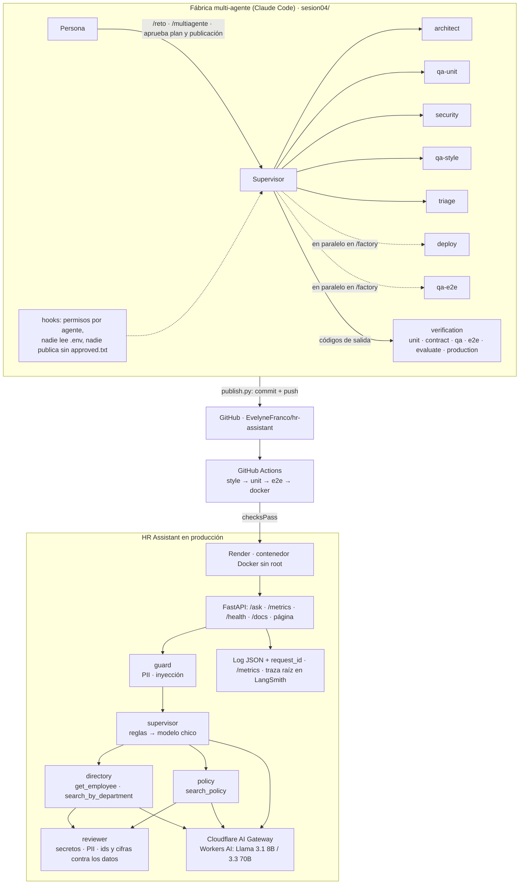
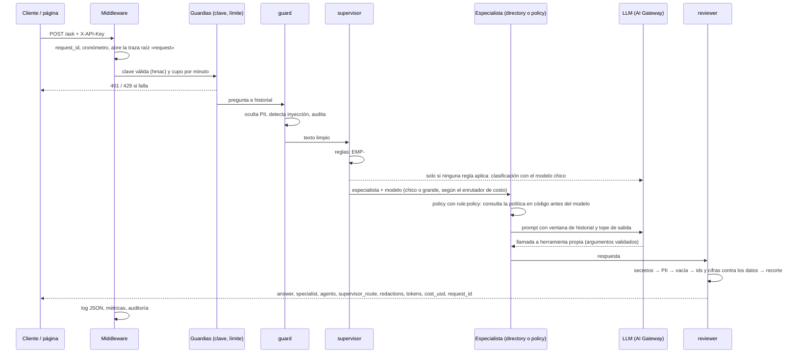

# Reto M4 · Sistema multi-agente en producción: HR Assistant

**Autora:** Evelyne Franco · **Rama:** `reto/evelyne-franco` · **Servicio en producción:**
https://hr-assistant-m1rp.onrender.com (`/health`, `/docs`)

## Resumen

Llevé a producción el **HR Assistant**: una API REST (FastAPI) con página web que responde preguntas de Recursos
Humanos sobre empleados y políticas. Es **multi-agente en dos niveles**:

- **En tiempo de ejecución**, cada pregunta pasa por cuatro agentes: `guard` (filtro de entrada), `supervisor` (elige
  quién contesta), un especialista (`directory` para empleados o `policy` para políticas de RH, cada uno con sus
  propias herramientas de solo lectura) y `reviewer` (valida la salida contra los datos).
- **En construcción**, una **fábrica multi-agente de Claude Code** construye, prueba, revisa y publica el producto:
  10 agentes especializados con un supervisor, trabajo en paralelo, compuertas automáticas y aprobación humana.

Está desplegado en **Render** con contenedor Docker y un pipeline de CI de 4 etapas. Tiene observabilidad completa
(log JSON con `request_id`, `/metrics` y una traza raíz por petición en LangSmith con los cuatro agentes adentro),
un costo **86 a 87 % más bajo** que el baseline con la misma calidad, y más de 30 controles de seguridad, entre ellos
la detección de PII.

## Punto de partida y aportaciones propias

| Origen | Qué incluye |
| --- | --- |
| **Material del curso (sesiones 1 a 4)** | La fábrica de agentes (`sesion04/.claude/`, `hooks/`, `verification/`), las specs 01 a 04 y la base del producto: observabilidad, costos, acceso por clave, límite de peticiones, compliance, contenedor y CI |
| **Mi trabajo** | Correr y dirigir la fábrica en las 4 sesiones (aprobé planes y publicaciones). Configurar Cloudflare AI Gateway, LangSmith y Render. Diagnosticar y resolver los fallos de producción (abajo, en «Problemas encontrados»). **Para el reto:** escribir `sesion04/spec/05-security-hardening.md` (PII, validación de salidas y de argumentos, inyección, concurrencia) y el comando `/reto` (`sesion04/.claude/skills/reto/SKILL.md`), que la fábrica usó para implementarla, probarla y publicarla. **Segunda iteración:** escribir `sesion04/spec/06-multiagente.md` (supervisor, especialista de políticas, revisor contra los datos y traza raíz), sus políticas de RH (`spec/policies.json`), su contrato (`verification/contract/test_contract_06.py`) y el comando `/multiagente`, para resolver tres limitaciones que yo misma documenté en la primera entrega (abajo, en «Segunda iteración»). Después de desplegarla, encontré en producción que las preguntas de vacaciones por empleado no se respondían bien, lo diagnostiqué y escribí la Adenda 1 (vacaciones calculadas en código), que la fábrica implementó y publicó. También armé esta documentación, las evidencias y el video |

## Arquitectura del sistema

### Dos sistemas, un repositorio



### Flujo de una pregunta (`POST /ask`)



**Por qué un supervisor con reglas antes que modelo.** Las preguntas con un id, un departamento o una palabra clave
de política (la gran mayoría) se enrutan en código: sin latencia ni costo extra y de forma determinista. Solo las
preguntas ambiguas pagan una llamada corta al modelo chico. Cada especialista tiene **solo sus herramientas**:
`policy` no puede consultar empleados y `directory` no puede consultar políticas (mínimo privilegio, ADR 0014).

La arquitectura completa, con diagrama de componentes y estructura de archivos, está en
[hr-assistant/doc/architecture.md](hr-assistant/doc/architecture.md).

### Decisiones de arquitectura

Las decisiones están en **15 ADR** ([hr-assistant/doc/adr/](hr-assistant/doc/adr/)). Las más importantes para
producción:

| Decisión | Por qué | ADR |
| --- | --- | --- |
| API sin estado; el historial lo manda el cliente | Escala horizontal y reinicios sin pérdida | 0001 |
| Interfaz de modelo con un proveedor simulado (`fake`) y uno real (`gateway`) | Pruebas y CI sin red ni costo; el modelo se cambia sin tocar el agente | 0002, 0007 |
| Bucle del agente con tope de pasos | Costo y latencia acotados; no hay bucles infinitos | 0003 |
| Compliance al arrancar | En producción el servicio **se niega a arrancar** si falta un secreto, si el modelo es `fake` o si las trazas muestran contenido | 0012 |
| Publicar solo si el CI pasa (`autoDeployTrigger: checksPass`) | Nada llega a producción sin pruebas | 0012 |
| PII con expresiones regulares en el proceso, no con un servicio externo | Determinista, sin costo, y el dato nunca sale del proceso | 0013 |
| Supervisor con reglas antes que modelo; especialistas con herramientas separadas | Enrutar sin costo la mayoría de las preguntas y limitar lo que cada agente puede tocar | 0014 |
| Una traza raíz por petición; los agentes de código no reciben texto | Ver la petición completa como un árbol, con cada control dentro del agente que lo registró | 0015 |

### Concurrencia

- Las rutas son síncronas: FastAPI las atiende en su pool de hilos.
- Las métricas, el log y el límite de peticiones están protegidos con `threading.Lock`.
- Una prueba manda **20 peticiones `/ask` simultáneas**, con preguntas de los dos especialistas mezcladas, y comprueba
  cuatro cosas: todas responden `200`, cada una tiene su propio `request_id`, `/metrics` cuenta exactamente 20 y el
  límite sigue contando por cliente.
- La API no guarda estado, así que puede escalar con más instancias. La limitación está documentada más abajo.

## Requisitos del reto y dónde se cumplen

### 1. Arquitectura y despliegue

| Requisito | Cómo | Evidencia |
| --- | --- | --- |
| Desplegado en cloud | Render (Docker, `python:3.12-slim`, usuario sin root), Blueprint en `render.yaml` | [renderconellive.png](evidencias/renderconellive.png) |
| Despliegue reproducible | CI encadenado `style → unit → e2e → docker`; Render publica solo si pasa | [actions-4enverde.png](evidencias/actions-4enverde.png) |
| API REST con health check | `GET /health` sin clave | [render-health-ok.png](evidencias/render-health-ok.png) |
| Documentación OpenAPI | `/docs` (Swagger) | [render-docs.png](evidencias/render-docs.png) |
| Sistema funcionando | Página web con el modelo real | [hr-assistance-working.png](evidencias/hr-assistance-working.png) y, con el sistema multi-agente, [preguntando-dias-vacaciones-multiagente.png](evidencias/preguntando-dias-vacaciones-multiagente.png) |
| Concurrencia | Prueba de 20 peticiones simultáneas | [hr-assistant/tests/test_concurrency.py](hr-assistant/tests/test_concurrency.py) |

### 2. Observabilidad

| Requisito | Cómo |
| --- | --- |
| LangSmith | **Una traza raíz `request` por petición** con los agentes adentro, en orden: `agent.guard`, `agent.supervisor`, `agent.directory` o `agent.policy` (con sus runs de modelo y herramientas) y `agent.reviewer` (ADR 0015). Los agentes de código no reciben texto y devuelven solo un resumen; entradas y salidas ocultas por política (ADR 0006). Evidencia: [langsmith-multiagente-request.png](evidencias/langsmith-multiagente-request.png) (una petición de producción: `request` con los agentes y las herramientas `search_policy` y `vacation_days` adentro, metadatos `specialist: policy` y `supervisor_route: rule:policy_employee`, «No inputs» y «No outputs» en la raíz) y [langsmith-multiagente.png](evidencias/langsmith-multiagente.png) (cada petición nueva es un solo run raíz `request`). Primera iteración: [langsmith-traza2.png](evidencias/langsmith-traza2.png) |
| Trazabilidad de ejecuciones | Cada traza lleva `request_id` y cliente; la raíz y el especialista, además, `specialist` y `supervisor_route`. Los spans de seguridad quedan dentro del agente que los registró |
| Logging estructurado con correlation ID | Una línea JSON por evento (`request`, `agent_run`, `audit`, `security`) con `request_id`; el cliente puede mandar `X-Request-ID` |
| Métricas de latencia, errores y costo | `GET /metrics`: `requests`, `error_rate`, `latency_ms` p50/p95, `tokens`, `cost_usd`, `slo` (p95 contra objetivo), `security` (conteo por control), `specialists` (respuestas por especialista) y `supervisor` (decisiones por motivo: `rule:employee`, `rule:department`, `rule:policy`, `model`, `model_invalid`) |
| Costo por request | Cada respuesta de `/ask` trae `input_tokens`, `output_tokens`, `model`, `route`, `cached_calls` y `cost_usd` (incluye la llamada del supervisor cuando la hay), además de `specialist`, `agents` y `supervisor_route` |
| Métricas en producción | [metrics.png](evidencias/metrics.png): 351 peticiones, `error_rate` 0, SLO cumplido, costo acumulado de 0.00024 USD y `security.pii` = 2 (una detección en la entrada y una en la salida) |
| Dashboards | Cloudflare AI Gateway: peticiones, tokens, costo, errores y caché por modelo ([cloudflare-gateway.png](evidencias/cloudflare-gateway.png)), y el log de cada llamada al modelo ([cloudflare-logs.png](evidencias/cloudflare-logs.png)). LangSmith: trazas y latencias |

El mismo `request_id` une los tres lugares donde se ve el sistema: el log de Render, la traza de LangSmith y la
respuesta al cliente.

**El conteo propio coincide con el del proveedor.** La pregunta `963d4fff...` hizo dos llamadas al modelo a las
11:57:14. En Cloudflare suman 287 + 349 = **636** tokens de entrada y 21 + 24 = **45** de salida. El evento
`agent_run` del log de Render dice exactamente `input_tokens: 636` y `output_tokens: 45`. Por eso el `cost_usd` que
calcula el producto es confiable.

### 3. Optimización de costos

Tres palancas combinadas producen el ahorro medido, y una cuarta queda lista pero apagada (ADR 0008 y 0009):

1. **Routing de modelos:** las preguntas cortas y simples van a Llama 3.1 8B; las demás, a Llama 3.3 70B.
2. **Ventana de historial:** solo los últimos `HISTORY_WINDOW` mensajes van al modelo.
3. **Tope de salida:** `MODEL_MAX_TOKENS`.
4. **Caché del AI Gateway (disponible, apagada):** `CACHE_TTL_SECONDS` manda el encabezado `cf-aig-cache-ttl`. En producción vale `0` (Cloudflare muestra `Cached: 0`) y `evaluate` no la mide, así que **el ahorro de abajo viene solo de las palancas 1 a 3**. Está apagada por omisión. Conviene activarla si las preguntas se repiten mucho, con el riesgo de servir una respuesta vieja si cambia el directorio.

**Evidencia frente al baseline.** `verification evaluate` corre el mismo set de preguntas con y sin palancas:

| Configuración | Calidad | Costo USD | Tokens de entrada |
| --- | --- | --- | --- |
| Baseline (sin palancas) | 100 % | 0.000911 | 1647 |
| Con palancas | 100 % | 0.000121 | 1077 |
| **Ahorro** | **sin pérdida** | **-86.7 %** | **-34.6 %** |

Captura: [pruebas-costos.png](evidencias/pruebas-costos.png).

**Con el sistema multi-agente (segunda iteración)**, el mismo set da:

| Configuración | Calidad | Costo USD | Tokens de entrada |
| --- | --- | --- | --- |
| Baseline (sin palancas) | 100 % | 0.000914 | 1708 |
| Con palancas | 100 % | 0.000125 | 1138 |
| **Ahorro** | **sin pérdida** | **-86.3 %** | **-33.4 %** |

El costo sube un poco en las dos configuraciones (de 0.000003 a 0.000004 USD) por la llamada de clasificación del supervisor
en la pregunta que ninguna regla cubre («¿Qué clima hace hoy en Monterrey?»). Las demás preguntas se enrutan con
reglas, sin costo, y el ahorro se mantiene.

**Trade-offs.**
- El modelo chico podría responder peor en preguntas complejas. Por eso el router es conservador y la calidad se mide
  en cada corrida: la palanca solo se queda si la calidad no baja. **Caso real observado en producción:** a «que
  numero de empleado es Ana», el modelo chico (Llama 3.1 8B) respondió `EMP-0003`, aunque Ana López es `EMP-0001`.
  Llamó bien a `get_employee`, pero mezcló los datos al redactar
  ([alucinacion-modelo-chico.png](evidencias/alucinacion-modelo-chico.png)). El set de `evaluate` no tenía esa
  pregunta, así que el 100 % de calidad mide solo lo que el set cubre. Para mitigarlo, habría que agregar al set las
  preguntas que fallen en producción y enrutar al modelo grande las que piden un identificador.
- La ventana corta pierde contexto en conversaciones largas.
- La caché puede devolver una respuesta vieja si cambian los datos; se mitiga con un TTL corto.

Los detalles están en el README del producto: [hr-assistant/README.md](hr-assistant/README.md#costos).

### 4. Seguridad y controles

El inventario completo, con **dónde está cada control y qué prueba lo comprueba**, está en
[hr-assistant/doc/security.md](hr-assistant/doc/security.md). Ese documento incluye el modelo de amenazas, los
falsos positivos y negativos y los trade-offs. Resumen por requisito:

| Requisito de la rúbrica | Controles |
| --- | --- |
| Validación de inputs | Pregunta vacía o demasiado larga → `422`; `X-Request-ID` validado; nombre de cliente restringido; argumentos de herramientas validados (`EMP-####` o un nombre de 1 a 80 caracteres; solo departamentos existentes) |
| Validación de outputs | El agente `reviewer`, en este orden: secretos → `[REDACTED:secret]`; PII → `[REDACTED:<tipo>]`; respuesta vacía → mensaje fijo seguro; **comprobación contra los datos** (un id `EMP-####` que no existe y que la persona no escribió, o una cifra que no está en la política consultada, reemplazan la respuesta y quedan en la auditoría como `ungrounded`); recorte a `MAX_ANSWER_CHARS` |
| Gestión de secretos | Nada en el código ni en el repositorio. `.env` local y Environment Group en Render; `CF_API_TOKEN` como `SecretStr`; los errores nunca muestran valores; la clave se compara en tiempo constante (`hmac.compare_digest`) |
| Auditoría | Evento `audit` por herramienta y evento `security` por detección (`request_id`, `client`, `stage`, `control`, `kinds`), **sin el valor detectado** |
| Detección de PII | Correo, teléfono, tarjeta (con Luhn), CURP y RFC, en la pregunta, el historial y la respuesta. Se detectan **antes** de que el texto llegue al modelo, al log o a la traza. Evidencias: [render-log-security2.png](evidencias/render-log-security2.png) (entrada: el correo de la pregunta se detecta y el log no lo contiene; las 4 líneas comparten `request_id`), [render-log-security.png](evidencias/render-log-security.png) (salida: el modelo inventó un correo) y [alucinacion-modelo-chico.png](evidencias/alucinacion-modelo-chico.png) (ese correo inventado le llegó al usuario como `[REDACTED:email]`) |
| Mínimo privilegio | Clave por cliente; cada especialista con **solo sus herramientas** de solo lectura (`directory`: 2; `policy`: 1); el supervisor y el revisor no tienen herramientas; contenedor sin root; CI con `contents: read`; en la fábrica, cada agente escribe solo en sus carpetas y nadie lee `.env` |
| Acceso por clave | `POST /ask` y `GET /metrics` exigen `X-API-Key`; con una clave inválida la página muestra «Clave inválida», el agente no se ejecuta y la petición igual lleva su `request_id`. Evidencia: [clave-invalida.png](evidencias/clave-invalida.png) |
| Controles adicionales | Límite de peticiones por cliente (`429` con `Retry-After`); compliance al arrancar en producción; detección y auditoría de inyección de prompt; la página guarda la clave en `sessionStorage` y nunca en el código |

## Instalación y ejecución

**Requisitos:** Python 3.12, [`uv`](https://docs.astral.sh/uv/) y Docker (opcional). Para usar el modelo real hace
falta una cuenta de Cloudflare con AI Gateway.

```bash
git clone git@github.com:EvelyneFranco/NextGenCode-M4-Agentes.git
cd NextGenCode-M4-Agentes
git switch reto/evelyne-franco
cd reto/evelyne-franco/hr-assistant

uv venv --python 3.12
uv pip install -r requirements.txt
cp .env.example .env        # llenar los valores; .env nunca se sube
```

**Variables de entorno.** Todas están explicadas en `.env.example`. Las principales:

| Variable | Para qué |
| --- | --- |
| `MODEL_PROVIDER` | `fake` (simulado, sin costo) o `gateway` (Cloudflare) |
| `CF_ACCOUNT_ID`, `CF_GATEWAY_ID`, `CF_API_TOKEN` | Cloudflare AI Gateway (secretos) |
| `API_KEYS` | `cliente:clave,cliente2:clave2`; en producción, claves de 16 caracteres o más (secreto) |
| `ENVIRONMENT` | `production` activa las reglas de compliance |
| `LANGSMITH_TRACING`, `LANGSMITH_API_KEY` | Trazas en LangSmith |
| `RATE_LIMIT_PER_MINUTE`, `MAX_ANSWER_CHARS` | Límites |

**Ejecutar:**

```bash
uv run --env-file .env uvicorn app.main:app --port 8000
# Página: http://127.0.0.1:8000/   Swagger: /docs   Métricas: /metrics (con clave)

uv run python -m pytest tests -q --cov=app       # pruebas y escenarios BDD
docker build -t hr-assistant . && docker run --env-file .env -p 8000:8000 hr-assistant
```

**Probar la detección de PII contra producción.** La clave se carga sin que aparezca en pantalla:

```bash
read -s API_KEY && export API_KEY
curl -s -X POST https://hr-assistant-m1rp.onrender.com/ask \
  -H "X-API-Key: $API_KEY" -H "Content-Type: application/json" \
  -d '{"question": "Mi correo es ana@empresa.com, ¿en qué departamento está EMP-0001?"}'
# La respuesta trae "redactions": ["email"]; el log de Render muestra el evento security sin el correo.
```

**Desplegar en Render:** Render > New > Blueprint > conectar el repositorio. Después, crear un Environment Group con
`API_KEYS`, `CF_ACCOUNT_ID` y `CF_API_TOKEN` y **conectarlo al servicio** (Link). `CF_GATEWAY_ID` lleva el nombre
del gateway.

**Reconstruir con la fábrica:** desde `sesion04/`, correr `claude` y luego `/factory hr-assistant` (sesión 4) o
`/reto <url>` (seguridad reforzada) y después `/multiagente <url>` (supervisor, especialistas y traza raíz).

## La fábrica en acción

| Paso | Evidencia |
| --- | --- |
| Una persona aprueba el plan antes de que se escriba código | [human-in-the-loop-aprueba-plan.png](evidencias/human-in-the-loop-aprueba-plan.png) |
| TDD: qa-unit escribe las pruebas primero... | [creandolosunittestTDD.png](evidencias/creandolosunittestTDD.png) |
| ...y fallan antes del código (rojo esperado) | [unittestfail-esperado.png](evidencias/unittestfail-esperado.png) |
| Compuertas en verde: 151 pruebas, cobertura de 96.58 %, contrato 22/22, QA 10/10, e2e 5/5 | [subircambiosengithub-aprobar.png](evidencias/subircambiosengithub-aprobar.png) (vuelta final) y [pruebas-costos.png](evidencias/pruebas-costos.png) (primera vuelta) |
| Una persona aprueba la publicación | [subircambiosengithub-aprobar.png](evidencias/subircambiosengithub-aprobar.png) |
| Reporte, pipeline y bitácora de la corrida | [fabrica/report.md](fabrica/report.md), [fabrica/pipeline.md](fabrica/pipeline.md) |
| Segunda corrida (`/multiagente`): plan aprobado al primer intento, 25 pruebas nuevas en rojo antes del código, compuertas en verde (176 pruebas, cobertura de 96.67 %, contrato 28/28, QA 10/10, e2e 5/5), qa-style APROBADO en la primera vuelta y prueba de humo en producción OK | [fabrica/multiagente/report.md](fabrica/multiagente/report.md), [plan](fabrica/multiagente/plan.md), [pipeline](fabrica/multiagente/pipeline.md); aprobación para publicar: [multiagente-aprobar-despliegue.png](evidencias/multiagente-aprobar-despliegue.png); CI: [hr-assistance-actions-multiagente.png](evidencias/hr-assistance-actions-multiagente.png) |
| Tercera corrida (`/multiagente`, Adenda 1): plan aprobado, 24 pruebas nuevas con reloj fijo en rojo antes del código, una corrección (pylint en las pruebas), compuertas en verde (201 pruebas, cobertura de 96.76 %, contrato 34/34, QA 10/10, e2e 5/5), qa-style APROBADO y prueba de humo en producción OK | [fabrica/multiagente-adenda/report.md](fabrica/multiagente-adenda/report.md), [plan](fabrica/multiagente-adenda/plan.md), [pipeline](fabrica/multiagente-adenda/pipeline.md); aprobaciones: [aprobar-plan-multiagente-correccion.png](evidencias/aprobar-plan-multiagente-correccion.png) y [autorizar-plublicar-multiagente.png](evidencias/autorizar-plublicar-multiagente.png); CI del commit `45f31cf`: [actions-green-multiagente.png](evidencias/actions-green-multiagente.png) |

## Video de demostración

**Enlace:** https://youtu.be/KowtH02gA98 (2 min 39 s)

Muestra el sistema activo y funcionando en producción en Render. El plan gratuito apaga el servicio tras un
periodo de inactividad, así que el video es la evidencia de que está vivo.

## Notas adicionales

### Segunda iteración: de un agente a un sistema multi-agente

En la primera entrega documenté tres limitaciones propias. La segunda iteración (`spec/06-multiagente.md`, corrida con
`/multiagente`) las resuelve:

| Limitación que documenté | Qué hice | Cómo se comprueba |
| --- | --- | --- |
| La fábrica era multi-agente, pero **el producto tenía un solo agente** | Cuatro agentes por petición: `guard`, `supervisor`, un especialista (`directory` o el nuevo `policy`, con 6 políticas de RH) y `reviewer`. La respuesta dice qué agentes corrieron (`agents`) y por qué (`supervisor_route`) | `tests/test_supervisor.py`, `test_specialists.py`, `features/multiagent.feature` y `verification/contract/test_contract_06.py` |
| **El span de PII de entrada no aparecía en LangSmith**, porque el filtro corría antes de la traza `agent_run` | Una traza raíz `request` por petición; el filtro de entrada es el agente `agent.guard` dentro de ella | `tests/test_root_trace.py`, con un trazador espía: una sola raíz, hijos en orden, el span de PII dentro de `agent.guard` y ningún texto en los agentes de código |
| **El modelo chico puede inventar datos** (caso `EMP-0003` para Ana) | `reviewer` compara la respuesta contra los datos: bloquea ids que no existen y cifras de política que no están en el texto. Además, con `rule:policy` la política se consulta en código, así que el modelo siempre la tiene enfrente | `tests/test_reviewer.py` y el escenario del número inventado en `features/multiagent.feature` |

Lo que **no** resuelve: el caso `EMP-0003` en concreto sigue siendo posible, porque ese id sí existe en el directorio;
la regla detecta ids inexistentes, no ids reales asignados a otra persona. Para eso haría falta comparar el nombre
preguntado con el empleado citado.

#### Hallazgo en producción después de desplegar: vacaciones por empleado (Adenda 1)

Con el sistema multi-agente ya publicado, probé el especialista de políticas en la página de producción:

- «¿Cuántos días de vacaciones tengo?» → `policy` tenía la política enfrente, pero el modelo respondió que no conocía
  mi antigüedad y no dio la regla.
- «¿Cuántos días de vacaciones tiene el empleado 004?» → respondió el texto completo de la política, sin decir cuántos
  días le tocan a ese empleado.

Diagnóstico: «empleado 004» no se reconocía como `EMP-0004`; con un id, la regla `rule:employee` mandaba la pregunta a
`directory`, que no sabe de políticas; y `policy` no tenía la fecha de ingreso ni quién calculara la antigüedad.
Decidí que el cálculo **no** lo hiciera el modelo chico (ya había mezclado datos antes), sino el código. Lo escribí como
Adenda 1 de `spec/06-multiagente.md` y la fábrica la implementó:

| Cambio | Dónde |
| --- | --- |
| `guard` normaliza «empleado 004», «emp-4» o «EMP4» a `EMP-0004` | `app/employee_ids.py` |
| `supervisor`: regla nueva `rule:policy_employee` (vacaciones + id), antes de `rule:employee` | `app/supervisor.py` |
| Herramienta `vacation_days`, solo de `policy`: años de servicio y días según la política, con el reloj inyectado; dice si el empleado no está activo o no cumple su primer año | `app/vacations.py` |
| `reviewer` acepta las cifras de `vacation_days`; si el modelo inventa otra, responde con una frase armada en código | `app/reviewer.py` |
| El prompt de `policy` da la regla general cuando no hay id, en lugar de negarse | `app/prompts.py` |

Resultado en producción ([preguntando-dias-vacaciones-multiagente.png](evidencias/preguntando-dias-vacaciones-multiagente.png)):
«¿Cuántos días de vacaciones tiene el empleado 001?» → «Ana López tiene 22 días de vacaciones.», con
`search_policy` y `vacation_days` en las herramientas. Ana ingresó el 2019-03-04: 7 años de servicio, 22 días según la
tabla de la política.

En la misma captura, una pregunta con un error de dedo («vacac**i**nes») no coincide con ninguna palabra clave: el
supervisor la clasifica con el modelo y la respuesta es pobre («No tengo acceso a esa información»). Las palabras
clave no toleran errores de escritura; queda como mejora futura.

### Problemas encontrados y soluciones

| Problema | Causa | Solución |
| --- | --- | --- |
| `POST /ask` respondía `502 model unavailable` | El AI Gateway tenía activado **Authenticated Gateway** (`401`, código 2009) | Se diagnosticó con `curl` contra el gateway y se desactivó esa opción |
| No aparecían trazas en LangSmith | Faltaba `LANGSMITH_TRACING=true` y levantar uvicorn con `--env-file .env` | Se configuró y se reinició el servicio |
| Render: `Con MODEL_PROVIDER=gateway falta: CF_ACCOUNT_ID, CF_API_TOKEN` | El Environment Group existía pero **no estaba conectado** al servicio | Link del grupo al servicio. Gracias a la compliance, el servicio falló al arrancar en lugar de arrancar a medias |
| La primera prueba de humo falló | `SMOKE_API_KEY` no estaba en la shell de la fábrica, y la clave quedó visible en un chat | Se **rotó la clave** en Render y se cargó con `read -s` en la misma terminal. Triage clasificó el fallo como `persona` y el ciclo 2 pasó |
| Sin trazas de producción en LangSmith | `render.yaml` trae las trazas apagadas. Al encenderlas, el log de Render mostró `LangSmithError ... 403 Forbidden`: la clave cargada en Render no era la clave de tracing en uso | Se buscó `langsmith` en el log de Render. En LangSmith > API Keys, la columna «Last Used At» mostró qué clave funcionaba, y se cargó esa en Render. La clave es de tipo **Tracing only** (mínimo privilegio: solo puede enviar trazas) |

### Limitaciones conocidas

- El plan gratuito de Render se apaga por inactividad: la primera petición tarda unos 50 segundos.
- Las métricas y el límite de peticiones viven en memoria y son por instancia. Con varias réplicas harían falta Redis
  y Prometheus.
- La detección de PII cubre formatos fijos. Las direcciones y la PII sin formato quedan fuera del alcance
  (documentado en `security.md`).
- Rotar claves requiere reiniciar el servicio.
- Si se pregunta por un empleado que no existe con un formato ambiguo (por ejemplo, «quien es el empleado 10»), el
  agente puede llegar al tope de pasos (`AGENT_MAX_STEPS=3`) y responder «No pude completar la respuesta» en lugar de
  «no existe». El tope evita bucles y gasto sin control, pero el mensaje es menos claro. Con el formato `EMP-0099` sí
  responde que no existe (está en el set de `evaluate`).
- `latency_ms` de `/metrics` mezcla todas las rutas. En producción, la mayoría de las peticiones son health checks de
  Render (`/health`, unos 1 ms), así que el p50 y el p95 globales (1 ms y 3.7 ms) esconden la latencia real de
  `/ask` (unos 800 ms en el log). La mejora es medir la latencia por ruta.
- **Brecha de observabilidad detectada en producción (resuelta en la segunda iteración):** una detección de PII en la
  **entrada** quedaba en el log (evento `security`) y en `/metrics`, pero su span `security` **no aparecía en
  LangSmith**, porque la pregunta se filtraba antes de que empezara la traza `agent_run`. Las pruebas unitarias usaban
  un trazador simulado y no detectaron el problema. Se corrigió con una traza raíz por petición que contiene al agente
  `guard` (ADR 0015), y ahora una prueba comprueba el anidamiento. El log JSON sigue siendo la fuente de verdad de la
  auditoría ([render-log-security2.png](evidencias/render-log-security2.png)).
- En la traza, los runs del especialista (`agent_run` y `llm`) sí reciben el texto ya limpio de PII. Por eso
  `HIDE_INPUTS` y `HIDE_OUTPUTS` siguen siendo obligatorios en producción.
- El supervisor recibe la pregunta sin PII por el orden del pipeline (`guard` corre antes), pero ninguna prueba lo
  afirma de forma directa.

### Mejoras futuras

- Límite y métricas compartidos (Redis, Prometheus y Grafana).
- Rotación de claves sin reiniciar.
- Detección de PII con modelo para texto libre.
- Alertas sobre `slo.met` y `security.injection`.
- Agregar al set de `evaluate` las preguntas que fallan en producción (por ejemplo, el caso de `EMP-0003` y las de
  vacaciones por empleado).
- Palabras clave del supervisor tolerantes a errores de escritura («vacacines»).
- Evitar el falso positivo conocido de la normalización de ids: «emp 2021» se convierte en `EMP-2021`.
- Mostrar el costo en la página con un número fijo de decimales (hoy aparece, por ejemplo, `0.000039095999999999`).

### Archivos de esta entrega

```
reto/evelyne-franco/
├── README.md            este documento (descripción del PR)
├── hr-assistant/        el producto exacto que corre en Render (commit 45f31cf), sin .git ni .env
│   ├── app/             código (pii.py, guardrails.py y security.py son del reto; guard.py, supervisor.py,
│   │                    policies.py, reviewer.py, orchestrator.py y prompts.py, de la segunda iteración;
│   │                    employee_ids.py y vacations.py, de la Adenda 1)
│   ├── data/            employees.json, policies.json y model_prices.json
│   ├── tests/  e2e/     pruebas unitarias, BDD y Playwright
│   ├── doc/             architecture.md, security.md, compliance-checklist.md y 15 ADR
│   └── Dockerfile  render.yaml  .github/workflows/ci.yml
├── fabrica/             plan, revisión de qa-style, triage, reporte y pipeline de la corrida /reto
│   ├── multiagente/     lo mismo para la corrida /multiagente
│   └── multiagente-adenda/  y para la corrida de la Adenda 1
└── evidencias/          capturas
sesion04/spec/05-security-hardening.md          spec del reto
sesion04/spec/06-multiagente.md, policies.json  spec de la segunda iteración
sesion04/.claude/skills/reto/SKILL.md           comando /reto de la fábrica
sesion04/.claude/skills/multiagente/SKILL.md    comando /multiagente
sesion04/verification/contract/test_contract_06.py  contrato de la segunda iteración
```

**Etiqueta sugerida:** `Share-OK`.
