# Pipeline de la fábrica

```mermaid
flowchart LR
  s0["architect<br/>209 s"]:::ok
  s1["qa-unit<br/>602 s"]:::ok
  s2["verify unit<br/>7 s"]:::fail
  s3["developer<br/>325 s"]:::ok
  s4["observability<br/>422 s"]:::ok
  s5["verify unit<br/>6 s"]:::ok
  s6["verify contract<br/>4 s"]:::ok
  s7["verify qa<br/>4 s"]:::fail
  s8["qa-unit<br/>63 s"]:::ok
  s9["verify unit<br/>6 s"]:::ok
  s10["verify contract<br/>5 s"]:::ok
  s11["verify qa<br/>4 s"]:::ok
  s12["verify e2e<br/>7 s"]:::ok
  s13["verify evaluate<br/>4 s"]:::ok
  s14["architect<br/>367 s"]:::ok
  s15["qa-style<br/>429 s"]:::ok
  s16["verify production<br/>341 s"]:::ok
  s0 --> s1
  s1 --> s2
  s2 --> s3
  s3 --> s4
  s4 --> s5
  s5 --> s6
  s6 --> s7
  s7 --> s8
  s8 --> s9
  s9 --> s10
  s10 --> s11
  s11 --> s12
  s12 --> s13
  s13 --> s14
  s14 --> s15
  s15 --> s16
  classDef ok fill:#d4f4dd,stroke:#1e7b3a
  classDef fail fill:#fde2e2,stroke:#a12a2a
```

| # | Paso | Resultado | Segundos |
| --- | --- | --- | --- |
| 1 | architect | pasó | 209 |
| 2 | qa-unit | pasó | 602 |
| 3 | verify unit | falló | 7 |
| 4 | developer | pasó | 325 |
| 5 | observability | pasó | 422 |
| 6 | verify unit | pasó | 6 |
| 7 | verify contract | pasó | 4 |
| 8 | verify qa | falló | 4 |
| 9 | qa-unit | pasó | 63 |
| 10 | verify unit | pasó | 6 |
| 11 | verify contract | pasó | 5 |
| 12 | verify qa | pasó | 4 |
| 13 | verify e2e | pasó | 7 |
| 14 | verify evaluate | pasó | 4 |
| 15 | architect | pasó | 367 |
| 16 | qa-style | pasó | 429 |
| 17 | verify production | pasó | 341 |
