# Pipeline de la fábrica

```mermaid
flowchart LR
  s0["architect<br/>347 s"]:::ok
  s1["qa-unit<br/>841 s"]:::ok
  s2["verify unit<br/>6 s"]:::fail
  s3["developer<br/>634 s"]:::ok
  s4["observability<br/>843 s"]:::ok
  s5["qa-unit<br/>161 s"]:::ok
  s6["verify unit<br/>6 s"]:::ok
  s7["verify contract<br/>7 s"]:::ok
  s8["verify qa<br/>7 s"]:::ok
  s9["verify e2e<br/>4 s"]:::fail
  s10["verify unit<br/>215 s"]:::ok
  s11["verify contract<br/>6 s"]:::ok
  s12["verify qa<br/>7 s"]:::ok
  s13["verify e2e<br/>6 s"]:::ok
  s14["verify evaluate<br/>4 s"]:::ok
  s15["architect<br/>362 s"]:::ok
  s16["qa-style<br/>452 s"]:::ok
  s17["verify production<br/>3187 s"]:::fail
  s18["verify production<br/>386 s"]:::ok
  s0 --> s1
  s1 --> s2
  s2 --> s3
  s3 --> s4
  s3 --> s5
  s4 --> s6
  s5 --> s6
  s6 --> s7
  s7 --> s8
  s8 --> s9
  s9 --> s10
  s10 --> s11
  s11 --> s12
  s12 --> s13
  s13 --> s14
  s14 --> s15
  s15 --> s16
  s16 --> s17
  s17 --> s18
  classDef ok fill:#d4f4dd,stroke:#1e7b3a
  classDef fail fill:#fde2e2,stroke:#a12a2a
```

| # | Paso | Resultado | Segundos |
| --- | --- | --- | --- |
| 1 | architect | pasó | 347 |
| 2 | qa-unit | pasó | 841 |
| 3 | verify unit | falló | 6 |
| 4 | developer | pasó | 634 |
| 5 | observability | pasó | 843 |
| 6 | qa-unit | pasó | 161 |
| 7 | verify unit | pasó | 6 |
| 8 | verify contract | pasó | 7 |
| 9 | verify qa | pasó | 7 |
| 10 | verify e2e | falló | 4 |
| 11 | verify unit | pasó | 215 |
| 12 | verify contract | pasó | 6 |
| 13 | verify qa | pasó | 7 |
| 14 | verify e2e | pasó | 6 |
| 15 | verify evaluate | pasó | 4 |
| 16 | architect | pasó | 362 |
| 17 | qa-style | pasó | 452 |
| 18 | verify production | falló | 3187 |
| 19 | verify production | pasó | 386 |
