# Pipeline de la fábrica

```mermaid
flowchart LR
  s0["architect<br/>205 s"]:::ok
  s1["architect<br/>139 s"]:::ok
  s2["qa-unit<br/>314 s"]:::ok
  s3["verify unit<br/>4 s"]:::fail
  s4["security<br/>431 s"]:::ok
  s5["verify unit<br/>5 s"]:::fail
  s6["qa-unit<br/>47 s"]:::ok
  s7["verify unit<br/>4 s"]:::ok
  s8["verify contract<br/>6 s"]:::ok
  s9["verify qa<br/>6 s"]:::ok
  s10["verify e2e<br/>5 s"]:::ok
  s11["verify evaluate<br/>4 s"]:::ok
  s12["architect<br/>225 s"]:::ok
  s13["qa-style<br/>308 s"]:::ok
  s14["security<br/>71 s"]:::ok
  s15["qa-unit<br/>47 s"]:::ok
  s16["verify unit<br/>4 s"]:::ok
  s17["verify contract<br/>5 s"]:::ok
  s18["verify qa<br/>5 s"]:::ok
  s19["verify e2e<br/>6 s"]:::ok
  s20["verify e2e<br/>6 s"]:::ok
  s21["verify evaluate<br/>3 s"]:::ok
  s22["qa-style<br/>27 s"]:::ok
  s23["verify production<br/>384 s"]:::fail
  s24["triage<br/>27 s"]:::ok
  s25["verify production<br/>24 s"]:::ok
  s26["verify production<br/>422 s"]:::ok
  s0 --> s1
  s1 --> s2
  s2 --> s3
  s3 --> s4
  s4 --> s5
  s5 --> s6
  s6 --> s7
  s7 --> s8
  s8 --> s9
  s9 --> s10
  s10 --> s11
  s11 --> s12
  s12 --> s13
  s13 --> s14
  s13 --> s15
  s14 --> s16
  s15 --> s16
  s16 --> s17
  s17 --> s18
  s18 --> s19
  s19 --> s20
  s20 --> s21
  s21 --> s22
  s22 --> s23
  s23 --> s24
  s24 --> s25
  s25 --> s26
  classDef ok fill:#d4f4dd,stroke:#1e7b3a
  classDef fail fill:#fde2e2,stroke:#a12a2a
```

| # | Paso | Resultado | Segundos |
| --- | --- | --- | --- |
| 1 | architect | pasó | 205 |
| 2 | architect | pasó | 139 |
| 3 | qa-unit | pasó | 314 |
| 4 | verify unit | falló | 4 |
| 5 | security | pasó | 431 |
| 6 | verify unit | falló | 5 |
| 7 | qa-unit | pasó | 47 |
| 8 | verify unit | pasó | 4 |
| 9 | verify contract | pasó | 6 |
| 10 | verify qa | pasó | 6 |
| 11 | verify e2e | pasó | 5 |
| 12 | verify evaluate | pasó | 4 |
| 13 | architect | pasó | 225 |
| 14 | qa-style | pasó | 308 |
| 15 | security | pasó | 71 |
| 16 | qa-unit | pasó | 47 |
| 17 | verify unit | pasó | 4 |
| 18 | verify contract | pasó | 5 |
| 19 | verify qa | pasó | 5 |
| 20 | verify e2e | pasó | 6 |
| 21 | verify e2e | pasó | 6 |
| 22 | verify evaluate | pasó | 3 |
| 23 | qa-style | pasó | 27 |
| 24 | verify production | falló | 384 |
| 25 | triage | pasó | 27 |
| 26 | verify production | pasó | 24 |
| 27 | verify production | pasó | 422 |
