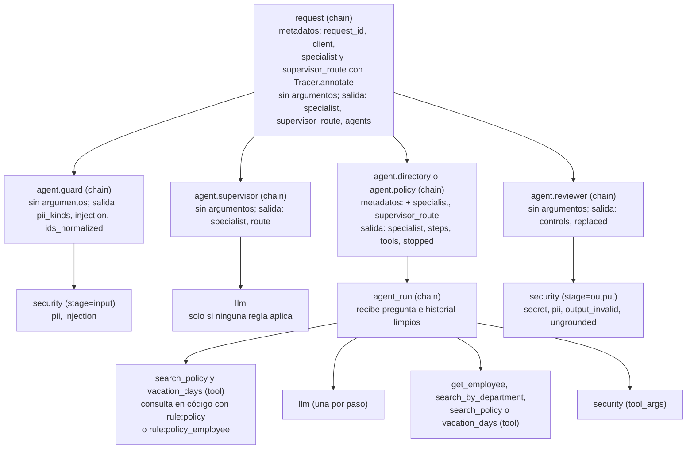
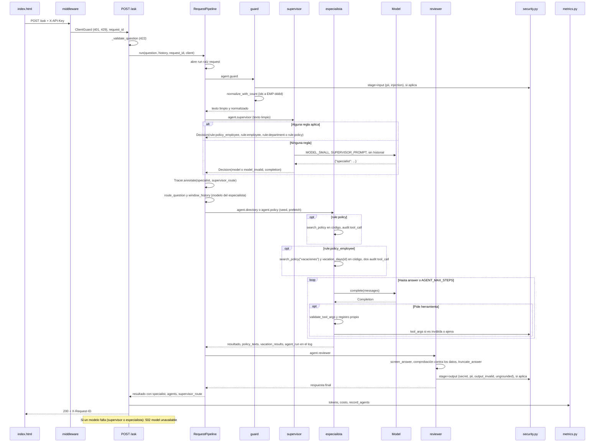
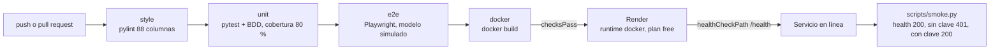

# Arquitectura del HR Assistant

## Visión general

HR Assistant es una API web sin estado que permite al personal de Recursos Humanos consultar, en lenguaje natural,
el directorio de empleados y las políticas de RH. Desde la spec 06 cada pregunta pasa por un **sistema
multi-agente**: dos agentes de código (`guard` y `reviewer`), un `supervisor` que elige a un solo especialista, y
dos especialistas con bucle acotado y herramientas de solo lectura (`directory` y `policy`).

Lo que ya existía sigue igual:

- Sesión 2: cada petición lleva un `request_id`, deja eventos en un log JSON, alimenta las métricas del proceso y,
  si se enciende, genera trazas en LangSmith.
- Sesión 3: modelo real (Cloudflare Workers AI a través de AI Gateway) y cuatro palancas de costo: enrutamiento por
  regla, ventana de historial, tope de tokens de salida y caché del gateway. Cada respuesta dice qué modelo usó, por
  qué y cuánto costó.
- Sesión 4: clave por cliente (ADR 0010), límite por minuto (ADR 0011), compliance al arrancar (ADR 0012), Docker, CI
  y publicación en Render solo si el pipeline pasa.
- Seguridad reforzada (ADR 0013, `doc/security.md`): PII oculta en entrada y salida, validación de salida y de
  argumentos, auditoría de inyección y evento `security` por cada detección.

Nuevo en la spec 06 (ADR 0014 y ADR 0015):

- `app/orchestrator.py:RequestPipeline` encadena `guard`, `supervisor`, un especialista y `reviewer`.
- El supervisor decide con reglas en código y solo llama a `MODEL_SMALL` si ninguna aplica.
- El especialista `policy` contesta con `search_policy` sobre `data/policies.json`; con `rule:policy` la política se
  consulta en código antes de llamar al modelo.
- El `reviewer` comprueba la respuesta contra los datos: ids del directorio y números de las políticas.
- Cada petición es **una** traza raíz `request` con un run hijo por agente.
- `POST /ask` agrega `specialist`, `agents` y `supervisor_route`; `GET /metrics` agrega `specialists` y
  `supervisor`.

Adenda 1 de la spec 06, vacaciones por empleado (ADR 0014):

- `guard` normaliza los ids escritos de otra forma («empleado 004», «emp-4», «EMP4») a `EMP-0004` sobre la pregunta
  ya limpia de PII (`app/employee_ids.py`); el historial no se toca.
- Nueva regla del supervisor, antes de `rule:employee`: id y tema `vacaciones` van a `policy` con
  `rule:policy_employee`.
- Nueva herramienta `vacation_days` (`app/vacations.py:VacationBook`), solo de `policy`, de solo lectura, con el
  reloj inyectado. Con `rule:policy_employee` corre en código después de `search_policy("vacaciones")`.
- El `reviewer` acepta también los números de `vacation_days` y, si el modelo inventa uno, responde la frase armada
  en código (`vacation_sentence`).

## Agentes de una petición

```mermaid
graph TD
    ASK[POST /ask<br>main.py: ClientGuard,<br>_validate_question 422] --> PIPE[orchestrator.py<br>RequestPipeline.run<br>RequestContext por petición]

    PIPE --> G[guard<br>guard.py: screen_input<br>inyección, PII y<br>normalize_with_count de ids]
    G -- texto limpio, ids EMP-dddd --> S{supervisor<br>supervisor.py}
    S -- "EMP-dddd y vacaciones: rule:policy_employee" --> PFE[search_policy vacaciones<br>y vacation_days en código<br>prefetch, dos audit tool_call]
    S -- "EMP-dddd: rule:employee" --> D
    S -- "departamento: rule:department" --> D
    S -- "palabra clave: rule:policy" --> PF[search_policy en código<br>prefetch, audit tool_call]
    S -- "sin regla: una llamada a MODEL_SMALL<br>model o model_invalid" --> SM[(MODEL_SMALL<br>SUPERVISOR_PROMPT,<br>sin historial)]
    SM -- directory --> D
    SM -- policy --> P
    PF --> P
    PFE --> P

    subgraph Especialistas - agent.py, un solo Agent por petición
        D[directory<br>get_employee<br>search_by_department]
        P[policy<br>POLICY_PROMPT<br>search_policy, vacation_days]
    end

    RT[routing.py<br>route_question, window_history<br>modelo del especialista] -.-> D
    RT -.-> P
    D --> DIR[(employees.json)]
    P --> POL[(policies.json)]
    P -- VacationBook --> DIR
    CLK[clock.py<br>reloj inyectado] -.-> P

    D --> R[reviewer<br>reviewer.py]
    P --> R
    R --> R1[screen_answer<br>secretos, PII, vacía]
    R1 --> R2[comprobación contra los datos<br>directory: ids EMP-dddd<br>policy: números de la política<br>y de vacation_days]
    R2 --> R3[truncate_answer<br>MAX_ANSWER_CHARS]
    R3 --> RESP[200 con specialist, agents,<br>supervisor_route y campos anteriores]

    G -. stage=input .-> SEC[security.py<br>SecurityAudit]
    D -. tool_args .-> SEC
    P -. tool_args .-> SEC
    R -. stage=output, ungrounded .-> SEC
```

Solo corre un especialista por petición. Cada uno tiene su propio registro de herramientas (`directory_tools`,
`policy_tools`); una herramienta ajena se trata como `unknown_tool` y no se ejecuta (mínimo privilegio, ADR 0014).
`vacation_days` solo existe en `policy_tools`.

## Cálculo de vacaciones por empleado (Adenda 1)

- `VacationBook.vacation_days(employee_id)` busca al empleado con `Directory.find`, toma «hoy» de `clock.now()` (UTC)
  y calcula `years_of_service` (años completos desde `start_date`).
- `vacation_days_for(years)`: menos de 1 año da 0; de 1 a 5 años, `10 + 2 * años` (12 a 20); desde 6 años,
  `20 + 2 * ((años - 1) // 5)` (22 de 6 a 10, 24 de 11 a 15, y así).
- `status` distinto de `activo` da `days = 0` y `note` «El empleado no está activo.»; menos de 1 año da `days = 0` y
  la nota del primer año; en los demás casos `note` es vacía. Un id inexistente o una `start_date` ilegible da
  `{"error": "empleado no encontrado"}`.
- El resultado válido se guarda en `RunState.vacation_results` y llega al `reviewer` en `ReviewInput`.

## Traza raíz por petición



- Todos los runs llevan `request_id` y `client`; nunca la clave.
- El raíz, `agent.guard`, `agent.supervisor` y `agent.reviewer` trazan funciones sin parámetros: el texto vive en
  `RequestContext` y no llega a la traza aunque falten `HIDE_INPUTS` y `HIDE_OUTPUTS`. `ids_normalized` es solo un
  conteo, nunca el id.
- `agent_run`, sus runs `llm` y sus herramientas sí reciben texto limpio, y `llm` devuelve la salida cruda del
  modelo; por eso la compliance sigue exigiendo `HIDE_INPUTS=true` y `HIDE_OUTPUTS=true` en producción.
- Con `LANGSMITH_TRACING=false` o sin `LANGSMITH_API_KEY`, `Tracer.traceable` es la identidad y `annotate` no hace
  nada: no se importa `langsmith`.

## Diagrama de componentes

```mermaid
graph TD
    subgraph Navegador
        UI[index.html<br>clave en sessionStorage<br>pregunta, historial,<br>request_id, modelo y costo]
    end

    subgraph FastAPI - main.py
        MW[middleware.py<br>request_id, latencia,<br>client en el log, errores 500]
        OPEN[GET /, /health, /docs]
        DEP[ClientGuard<br>401 y 429]
        ASK[POST /ask<br>422, 502]
        MET[GET /metrics]
    end

    subgraph Agentes
        ORCH[orchestrator.py<br>RequestPipeline, _prefetch]
        GUARD[guard.py<br>screen_input]
        IDS[employee_ids.py<br>normalize_with_count]
        SUP[supervisor.py<br>route_by_rules, Supervisor]
        AGENT[agent.py<br>Agent, directory_tools,<br>policy_tools, Seed, prefetch]
        REV[reviewer.py<br>Reviewer, ungrounded_ids,<br>ungrounded_numbers]
        PROMPTS[prompts.py<br>SUPERVISOR_PROMPT,<br>POLICY_PROMPT]
    end

    subgraph Datos
        DIR[directory.py<br>get_employee, find<br>search_by_department]
        POL[policies.py<br>PolicyBook, search_policy,<br>match_question]
        VAC[vacations.py<br>VacationBook, vacation_days,<br>vacation_sentence]
    end

    subgraph Seguridad
        AUTH[auth.py]
        RL[ratelimit.py]
        COMP[compliance.py]
        PII[pii.py<br>redact_pii]
        GR[guardrails.py<br>inyección, screen_answer,<br>truncate_answer, validate_tool_args]
        SEC[security.py<br>SecurityAudit]
    end

    subgraph Modelo y costo
        ROUTE[routing.py]
        LLM[llm.py<br>FakeModel con papeles<br>supervisor y policy]
        GW[gateway.py]
        PRICE[pricing.py]
    end

    subgraph Observabilidad
        LOG[logs.py]
        METRICS[metrics.py<br>specialists, supervisor]
        TRACE[tracing.py<br>traceable, annotate]
        CLOCK[clock.py]
    end

    EMP[(employees.json)]
    POLJ[(policies.json)]
    PRICES[(model_prices.json)]
    CF[(Cloudflare AI Gateway)]
    LS[(LangSmith)]
    CONFIG[config.py]

    UI -- X-API-Key --> MW
    MW --> OPEN
    MW --> DEP
    DEP --> AUTH
    DEP --> RL
    DEP --> ASK
    DEP --> MET
    ASK -- pregunta, historial, request_id, client --> ORCH
    ORCH --> GUARD
    GUARD --> GR
    GUARD --> PII
    GUARD --> IDS
    ORCH --> SUP
    SUP --> POL
    SUP -- sin regla --> LLM
    SUP --> PROMPTS
    ORCH --> ROUTE
    ORCH --> AGENT
    AGENT --> LLM
    LLM --> GW
    GW --> CF
    AGENT --> PRICE
    PRICE --> PRICES
    AGENT -- validate_tool_args --> GR
    AGENT --> DIR
    AGENT --> POL
    AGENT --> VAC
    VAC --> DIR
    DIR --> EMP
    POL --> POLJ
    ORCH --> REV
    REV --> GR
    REV --> VAC
    GUARD --> SEC
    AGENT --> SEC
    REV --> SEC
    SEC --> LOG
    SEC --> METRICS
    SEC -.-> TRACE
    AGENT -- agent_run, audit --> LOG
    ASK -- tokens, costo, specialist, supervisor_route --> METRICS
    MET --> METRICS
    ORCH -. request y agent.* .-> TRACE
    TRACE -. solo con clave .-> LS
    CLOCK -.-> MW
    CLOCK -.-> LOG
    CLOCK -.-> RL
    CLOCK -.-> VAC
    CONFIG -.-> COMP
    CONFIG -.-> ORCH
    CONFIG -.-> GW
    CONFIG -.-> TRACE
```

## Diagrama de secuencia de `POST /ask`



## Del repositorio a Render



## Principios

1. **Sin estado** (ADR 0001): el historial viaja desde el navegador; `RequestContext` vive solo durante la
   petición. Las métricas y el límite son estado operativo por proceso (ADR 0005, ADR 0011).
2. **Inyección de dependencias**: `create_app()` recibe configuración, modelos, directorio, políticas, precios,
   reloj, logger, métricas, trazador, autenticación y limitador. El mismo reloj llega a `VacationBook`.
3. **Interfaz del modelo** (ADR 0002, ADR 0007): `complete(messages)` devuelve un `Completion` con sus tokens.
4. **Bucle acotado** (ADR 0003), por especialista.
5. **Trazabilidad sin contenido** (ADR 0004): logs con conteos, modelo, ruta, costo, cliente, especialista y motivo
   del supervisor; nunca texto ni clave.
6. **Trazas opcionales y privadas** (ADR 0006), con una raíz por petición (ADR 0015).
7. **Enrutamiento por regla** (ADR 0008) para el modelo y **supervisor con reglas antes que modelo** (ADR 0014) para
   el especialista. Son dos decisiones distintas: `route` y `supervisor_route`.
8. **Costo medido por llamada** (ADR 0009), incluida la llamada del supervisor.
9. **Acceso por cliente** (ADR 0010) y **compliance como código** (ADR 0012).
10. **PII fuera, datos dentro** (ADR 0013): `guard` limpia la entrada antes del supervisor; `reviewer` valida la
    salida y la comprueba contra el directorio, las políticas y los resultados de `vacation_days`.
11. **Mínimo privilegio entre especialistas** (ADR 0014): cada uno ve solo sus herramientas.
12. **Cálculos en código, no en el modelo** (ADR 0014, Adenda 1): la antigüedad y los días de vacaciones los calcula
    `VacationBook`; el modelo solo los redacta y el `reviewer` los comprueba.
13. **Secretos fuera del código** y **seguridad en el navegador** (`textContent`, `sessionStorage`).

## Estructura de archivos

```
product/
  app/
    config.py          Configuración y validación desde el entorno
    auth.py            API_KEYS: interpretación y búsqueda del cliente
    ratelimit.py       Límite por cliente con ventana de 60 s
    compliance.py      Reglas de producción que se revisan al arrancar
    pii.py             Detección y ocultamiento de PII (regex y Luhn)
    guardrails.py      Inyección, secretos, validación de salida y de argumentos
    security.py        Auditoría de seguridad: log, métricas y span security
    clock.py           Reloj inyectable (UTC y monotónico)
    logs.py            Logger JSON, una línea por evento
    metrics.py         Métricas del proceso, SLO, costo, security, specialists y supervisor
    tracing.py         Tracer: traceable opcional y annotate (LangSmith)
    middleware.py      request_id, latencia, evento request con client, errores 500
    llm.py             FakeModel (directory, supervisor y policy) y fábrica de modelos
    completion.py      Tipos Completion, Model y ModelUnavailable
    gateway.py         Cliente de Cloudflare AI Gateway
    routing.py         Regla de modelo y ventana de historial
    pricing.py         Tabla de precios y costo por llamada
    directory.py       Herramientas de consulta sobre empleados y find por id exacto
    policies.py        PolicyBook: search_policy y match_question
    employee_ids.py    Id canónico EMP-dddd y normalización de ids escritos de otra forma
    vacations.py       VacationBook: vacation_days, tabla de días y frase armada en código
    prompts.py         SUPERVISOR_PROMPT y POLICY_PROMPT
    text.py            Utilidades de texto compartidas (fold_text)
    guard.py           Agente guard: filtro de entrada y normalización de ids
    supervisor.py      Agente supervisor: reglas y llamada a MODEL_SMALL
    agent.py           Especialista con bucle acotado, registro propio, prefetch y seed
    reviewer.py        Agente reviewer: validación de salida y comprobación contra los datos
    orchestrator.py    RequestPipeline: orden de los agentes, prefetch y traza raíz
    main.py            create_app(), rutas, ClientGuard, 401, 422, 429 y 502
    static/index.html  Página web autocontenida con campo de clave
  data/                employees.json, policies.json y model_prices.json
  tests/               Unitarias y Gherkin (qa-unit)
  e2e/                 Pruebas de punta a punta con Playwright (qa-e2e)
  scripts/smoke.py     Prueba de humo contra la URL publicada (deploy)
  doc/                 Este documento, adr/ y security.md (architect), compliance-checklist.md (security)
  .github/workflows/   ci.yml: style, unit, e2e, docker (deploy)
  Dockerfile           python:3.12-slim, usuario sin root (deploy)
  render.yaml          Blueprint de Render (deploy)
  README.md            Qué es, cómo correrlo, variables
  requirements.txt     Dependencias
```
