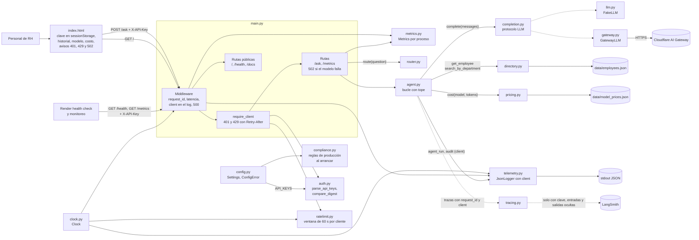
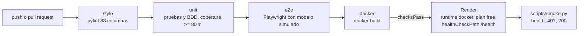

# Arquitectura del HR Assistant

Asistente de Recursos Humanos que responde preguntas sobre empleados. API FastAPI sin estado, un solo agente
con dos herramientas de solo lectura y un modelo detrás de una interfaz. Desde la sesión 2, cada petición tiene
un `request_id` que aparece en la respuesta, en el log JSON y en las trazas. Desde la sesión 3, una regla elige
entre un modelo barato y uno capaz (simulados o reales vía Cloudflare AI Gateway) y cada respuesta dice qué
modelo usó y cuánto costó. Desde la sesión 4, `/ask` y `/metrics` exigen una clave por cliente y tienen límite
de peticiones; en producción el producto se niega a arrancar si la configuración no cumple; se publica en Render
como contenedor solo si el CI pasa.

## Componentes



## Secuencia de una pregunta

```mermaid
sequenceDiagram
    participant W as Página web
    participant MW as Middleware
    participant S as require_client
    participant API as Ruta /ask
    participant A as Agent
    participant L as LLM (fake o gateway)
    participant T as Log JSON
    W->>W: clave de sessionStorage
    W->>MW: POST /ask con X-API-Key
    MW->>MW: request_id y t0
    MW->>S: petición
    alt sin clave o clave inválida
        S-->>MW: 401 invalid or missing API key
    else más de RATE_LIMIT_PER_MINUTE en 60 s
        S-->>MW: 429 rate limit exceeded, Retry-After N
    else cliente válido
        S->>API: request.state.client
        API->>A: run(question, history) con modelo enrutado y client
        loop hasta AGENT_MAX_STEPS
            A->>L: complete(messages)
            L-->>A: texto, tokens, cached
            opt pide herramienta
                A->>T: audit (tool, args, client)
            end
        end
        A->>T: agent_run (conteos, model, cost_usd, client)
        API-->>MW: 200 {answer, ..., cost_usd} o 502
    end
    MW->>T: request (status, latency_ms, client)
    MW-->>W: respuesta con X-Request-ID
    W->>W: pinta respuesta, o «Clave inválida», o «Demasiadas preguntas; espera N segundos»
```

## Entrega



## Principios

- Sin estado de conversación entre peticiones; el historial lo guarda y envía el navegador (ADR 0001).
- El agente solo conoce `complete(messages)` y el protocolo JSON; el bucle tiene tope (ADR 0002).
- Dependencias inyectadas en `create_app`, incluidos el reloj, el cliente HTTP y el limitador; configuración
  validada al arrancar (ADR 0003).
- Un `request_id` por petición y log JSON sin texto de preguntas ni respuestas (ADR 0004).
- Métricas en memoria por proceso, identificadas por `pid` (ADR 0005).
- Trazas de LangSmith opcionales, ocultando entradas y salidas por omisión (ADR 0006).
- Una regla en código elige el modelo por pregunta (ADR 0007).
- El modelo real es un adaptador de AI Gateway con cliente inyectado; sus fallos son 502 (ADR 0008).
- Cada respuesta lleva su costo; ventana de historial, tope de salida y caché son palancas medidas (ADR 0009).
- Con un modelo inyectado sin nombre, `/ask` no reporta costo (ADR 0010).
- Una clave por cliente, comparada en tiempo constante; solo el nombre del cliente se registra (ADR 0011).
- Límite de peticiones por cliente, en memoria y con reloj inyectado (ADR 0012).
- Compliance como código al arrancar; Render publica solo si el CI pasa (ADR 0013).
- La página pinta todo con `textContent`, nunca con `innerHTML`, y guarda la clave solo en `sessionStorage`.

## Configuración

| Variable | Por omisión | Validación |
| --- | --- | --- |
| `ENVIRONMENT` | `development` | `development` o `production`; con `production` se aplican las reglas de compliance |
| `API_KEYS` | vacía | `cliente:clave,...`; cliente en `[A-Za-z0-9._-]`; sin repetidos; secreto, nunca se registra |
| `RATE_LIMIT_PER_MINUTE` | `30` | entero >= 1 |
| `MODEL_PROVIDER` | `fake` | `fake` o `gateway` (en producción, no `fake`) |
| `AGENT_MAX_STEPS` | `3` | entero >= 1 |
| `MAX_QUESTION_CHARS` | `2000` | entero >= 1 |
| `EMPLOYEES_PATH` | `data/employees.json` | archivo existente; relativo a `product/` |
| `SERVICE_NAME` | `hr-assistant` | texto no vacío |
| `SLO_P95_MS` | `2000` | entero >= 1 |
| `LANGSMITH_TRACING` | `false` | `true` o `false` |
| `HIDE_INPUTS` / `HIDE_OUTPUTS` | `true` | `true` o `false` (en producción con trazas, `true`) |
| `LANGSMITH_API_KEY` | sin valor | solo se comprueba que exista; nunca se registra |
| `CF_ACCOUNT_ID`, `CF_GATEWAY_ID`, `CF_API_TOKEN` | vacía, `default`, vacía | obligatorias con `gateway`; el token nunca se registra |
| `MODEL_SMALL` | `@cf/meta/llama-3.1-8b-instruct-fast` | no vacío y con precio |
| `MODEL_LARGE` | `@cf/meta/llama-3.3-70b-instruct-fp8-fast` | no vacío y con precio |
| `ROUTING` | `true` | `true` o `false` |
| `ROUTER_MAX_CHARS` | `80` | entero >= 1 |
| `HISTORY_WINDOW` | `6` | entero >= 0 |
| `MODEL_MAX_TOKENS` | `300` | entero >= 1 |
| `MODEL_TEMPERATURE` | `0` | número entre 0 y 2 |
| `CACHE_TTL_SECONDS` | `0` | entero >= 0 (0: apagada) |
| `PRICES_PATH` | `data/model_prices.json` | archivo existente; relativo a `product/` |
| `PORT` | `8000` | lo pone Render; lo usa el `CMD` del contenedor |
