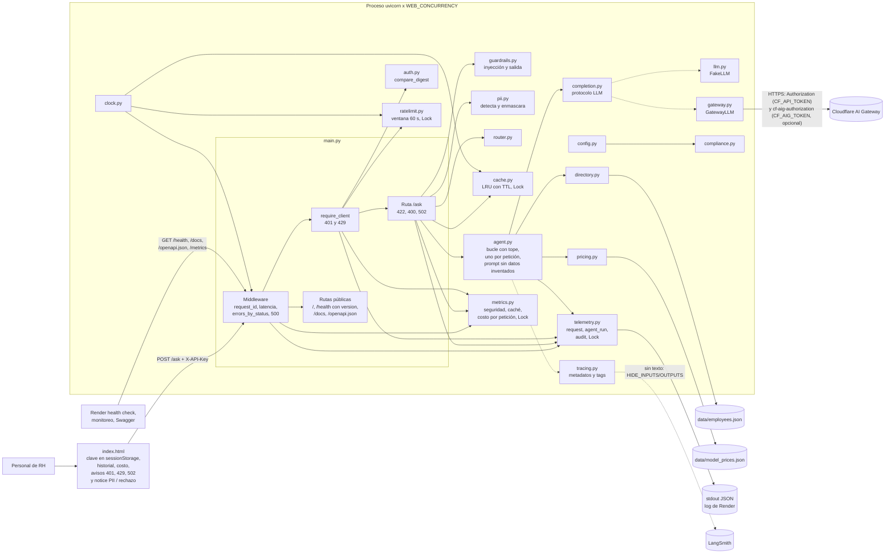
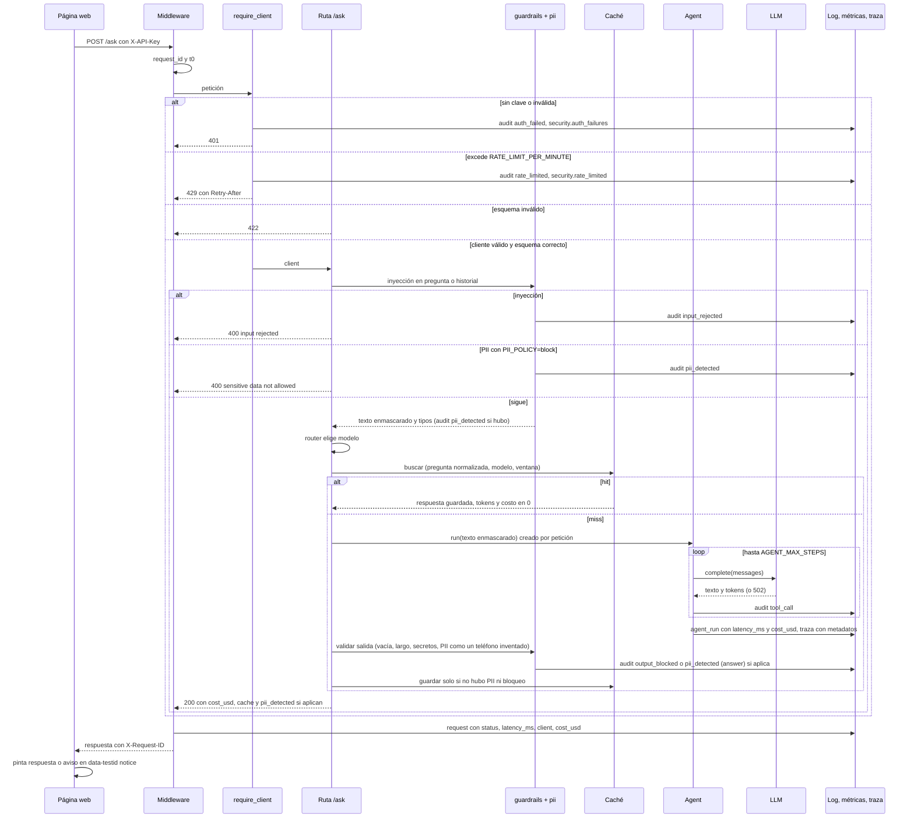

# Arquitectura del HR Assistant

Asistente de Recursos Humanos que responde preguntas sobre empleados. API FastAPI sin estado, un solo agente
con dos herramientas de solo lectura y un modelo detrás de una interfaz. Desde la sesión 2, cada petición tiene
un `request_id` que aparece en la respuesta, en el log JSON y en las trazas. Desde la sesión 3, una regla elige
entre un modelo barato y uno capaz (simulados o reales vía Cloudflare AI Gateway) y cada respuesta dice qué
modelo usó y cuánto costó. Desde la sesión 4, `/ask` y `/metrics` exigen una clave por cliente y tienen límite
de peticiones; en producción el producto se niega a arrancar si la configuración no cumple; se publica en Render
como contenedor solo si el CI pasa. En el reto, la API queda documentada en OpenAPI, corre con varios workers,
enmascara datos sensibles antes del modelo, rechaza inyecciones de instrucciones, valida la salida, audita cada
guarda y responde preguntas repetidas desde una caché. Tras la primera publicación, el adaptador se autentica
contra un AI Gateway con "Authenticated Gateway" (`CF_AIG_TOKEN`, ADR 0008) y el prompt prohíbe inventar datos
fuera del directorio, con el enmascarado de la respuesta como red de seguridad (ADR 0014).

Documentos de operación: `doc/observability.md` (rastrear una petición, métricas y SLO), `doc/cost-analysis.md`
(palancas de costo medidas con `verification evaluate`), `doc/security.md` (controles y cómo se comprueban) y
`doc/compliance-checklist.md` (reglas que impiden arrancar en producción).

## Componentes

## Secuencia de una petición con sus guardas

## Entrega

El CI (`.github/workflows/ci.yml`, `permissions: contents: read`) encadena `style -> unit -> e2e -> docker`.
Render publica con `autoDeployTrigger: checksPass`, `runtime: docker`, `healthCheckPath: /health` y
`WEB_CONCURRENCY=2`. Después, `verification production <url>` (incluye una pregunta por un teléfono que el modelo
no debe inventar) y `verification load <url>`.

## Principios

- Sin estado de conversación entre peticiones; el historial lo guarda y envía el navegador (ADR 0001).
- El agente solo conoce `complete(messages)` y el protocolo JSON; el bucle tiene tope (ADR 0002).
- Dependencias inyectadas en `create_app`, incluidos relojes, cliente HTTP, limitador y caché; configuración
  validada al arrancar (ADR 0003).
- Un `request_id` por petición y log JSON sin texto de preguntas ni respuestas (ADR 0004).
- Métricas en memoria por proceso, identificadas por `pid` (ADR 0005).
- Trazas de LangSmith detrás de un adaptador, ocultando entradas y salidas (ADR 0006); en Render son
  obligatorias porque el Blueprint fija `LANGSMITH_TRACING=true` y pide `LANGSMITH_API_KEY`, y en local siguen
  siendo opcionales (ADR 0017).
- Una regla en código elige el modelo por pregunta (ADR 0007).
- El modelo real es un adaptador de AI Gateway con cliente inyectado; sus fallos son 502; si hay `CF_AIG_TOKEN`
  se autentica contra el gateway con `cf-aig-authorization` (ADR 0008).
- Cada respuesta lleva su costo; ventana, tope de salida y caché del gateway son palancas medidas (ADR 0009).
- Con un modelo inyectado sin nombre, `/ask` no reporta costo (ADR 0010).
- Una clave por cliente, comparada en tiempo constante; solo el nombre del cliente se registra (ADR 0011).
- Límite de peticiones por cliente, en memoria y con reloj inyectado (ADR 0012).
- Compliance como código al arrancar; Render publica solo si el CI pasa (ADR 0013).
- Datos sensibles enmascarados antes del modelo, el log, la traza y la caché; el modelo no inventa datos fuera del
  directorio y, si lo hace, el enmascarado de la respuesta lo tapa (ADR 0014).
- Caché de respuestas LRU con TTL, nunca con PII ni salidas bloqueadas (ADR 0015).
- Varios workers; todo estado del proceso con candado y por proceso (ADR 0016).
- Orden de guardas fijo: clave, límite, esquema, inyección, PII, caché, agente, salida.
- La página pinta todo con `textContent`, nunca con `innerHTML`, y guarda la clave solo en `sessionStorage`.

## Configuración

| Variable | Por omisión | Validación |
| --- | --- | --- |
| `ENVIRONMENT` | `development` | `development` o `production`; con `production` se aplican las reglas de compliance |
| `APP_VERSION` | `1.0.0` | texto no vacío; va en `/health` y en OpenAPI |
| `WEB_CONCURRENCY` | `1` | lo lee el `CMD` del contenedor (`--workers`) |
| `API_KEYS` | vacía | `cliente:clave,...`; cliente en `[A-Za-z0-9._-]`; sin repetidos; secreto, nunca se registra |
| `RATE_LIMIT_PER_MINUTE` | `30` | entero >= 1 |
| `MODEL_PROVIDER` | `fake` | `fake` o `gateway` (en producción, no `fake`) |
| `AGENT_MAX_STEPS` | `3` | entero >= 1 |
| `MAX_QUESTION_CHARS` | `2000` | entero >= 1 |
| `MAX_ANSWER_CHARS` | `2000` | entero >= 1 |
| `PII_POLICY` | `mask` | `mask` o `block` |
| `RESPONSE_CACHE_TTL_SECONDS` | `0` | entero >= 0 (0: apagada) |
| `RESPONSE_CACHE_SIZE` | `256` | entero >= 1 |
| `EMPLOYEES_PATH` | `data/employees.json` | archivo existente; relativo a `product/` |
| `SERVICE_NAME` | `hr-assistant` | texto no vacío |
| `SLO_P95_MS` | `2000` | entero >= 1 |
| `LANGSMITH_TRACING` | `false` (`true` en Render) | `true` o `false` |
| `LANGSMITH_PROJECT` | sin valor (`hr-assistant-reto` en Render) | nombre del proyecto en LangSmith |
| `HIDE_INPUTS` / `HIDE_OUTPUTS` | `true` | `true` o `false` (en producción con trazas, `true`) |
| `LANGSMITH_API_KEY` | sin valor | opcional en local; en Render es secreto obligatorio (`sync: false`); solo se comprueba que exista y nunca se registra |
| `CF_ACCOUNT_ID`, `CF_GATEWAY_ID`, `CF_API_TOKEN` | vacía, `default`, vacía | obligatorias con `gateway`; el token nunca se registra; en Render, sin comillas |
| `CF_AIG_TOKEN` | vacía | opcional siempre; secreto (`repr=False` en `config.py`, `sync: false` en `render.yaml`), nunca se registra. Con valor se manda `cf-aig-authorization: Bearer <token>` (gateway con "Authenticated Gateway"); vacío, no se manda. Token separado de `CF_API_TOKEN`, solo con `AI Gateway: Run` |
| `MODEL_SMALL` | `@cf/meta/llama-3.1-8b-instruct-fast` | no vacío y con precio |
| `MODEL_LARGE` | `@cf/meta/llama-3.3-70b-instruct-fp8-fast` | no vacío y con precio |
| `ROUTING` | `true` | `true` o `false` |
| `ROUTER_MAX_CHARS` | `80` | entero >= 1 |
| `HISTORY_WINDOW` | `6` | entero >= 0 |
| `MODEL_MAX_TOKENS` | `300` | entero >= 1 |
| `MODEL_TEMPERATURE` | `0` | número entre 0 y 2 |
| `CACHE_TTL_SECONDS` | `0` | entero >= 0 (caché del gateway; 0: apagada) |
| `PRICES_PATH` | `data/model_prices.json` | archivo existente; relativo a `product/` |
| `PORT` | `8000` | lo pone Render; lo usa el `CMD` del contenedor |
