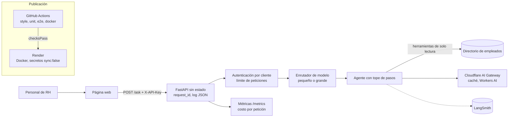

# Reto 4: Sistema Multi-Agente en Producción (HR Assistant)

Participante: Alberto Martínez (`albertomtzu23`).

El HR Assistant responde preguntas sobre empleados desde una página web. Lo construyó la fábrica de agentes de
la sesión 4 (`/factory`): un orquestador de Claude Code con subagentes especialistas en planeación, código,
seguridad, pruebas y QA, y compuertas que se verifican por código de salida. El sistema se publicó en Render
con el modelo real de Cloudflare Workers AI, a través de AI Gateway, y con trazas en LangSmith.

- Producción: <https://hr-assistant-alb.onrender.com> (health check en `/health`, OpenAPI en `/docs`).
- Código del producto: [`hr-assistant/`](hr-assistant/).
- Fábrica que lo construyó: [`../sesion04/`](../sesion04/), con el `.claude/` y las verificaciones.
- Video de demostración: ver la sección [Video](#video).

## Arquitectura



Cómo fluye una petición:

1. La página manda la pregunta con la clave del cliente en `X-API-Key`. El middleware le asigna un `request_id`.
2. `auth.py` valida la clave con `hmac.compare_digest` y aplica el límite por minuto para ese cliente.
3. `router.py` elige el modelo pequeño o el grande con una regla explicable.
4. El agente corre un bucle con tope (`AGENT_MAX_STEPS`). Consulta el directorio con dos herramientas de solo
   lectura y registra cada llamada en un evento `audit`.
5. La respuesta regresa con su `request_id`, los tokens y `cost_usd`. Las métricas del proceso se acumulan y,
   con LangSmith activo, la ejecución completa queda como traza.

Por qué está diseñado así:

- **API sin estado** (ADR 0001): cualquier instancia atiende cualquier petición y escala de forma horizontal.
  El historial lo lleva el cliente.
- **Interfaz única `complete(messages)`** (ADR 0002 y 0006): el mismo agente corre con un modelo simulado en
  las pruebas y con el modelo real en producción.
- **Bucle con tope** (ADR 0003): una ejecución nunca se queda en ciclo y su costo está acotado.
- **Falla rápida** (ADR 0004 y 0011): con `ENVIRONMENT=production`, el producto no arranca si la configuración
  incumple compliance.
- **Publicación con compuertas**: una persona aprueba, el CI debe pasar y Render solo publica con
  `checksPass`. Al final corre una prueba de humo.

El detalle está en [`hr-assistant/doc/architecture.md`](hr-assistant/doc/architecture.md) y en los 11 ADR de
[`hr-assistant/doc/adr/`](hr-assistant/doc/adr/).

## Evidencia por criterio de la rúbrica

| Criterio | Qué hay | Documento |
| --- | --- | --- |
| Arquitectura y despliegue | Docker con usuario no root, Blueprint de Render, CI por etapas, `/health`, `/docs`, prueba de humo 3/3 en producción | [arquitectura](hr-assistant/doc/architecture.md) |
| Observabilidad | LangSmith, log JSON con `request_id` y `client`, eventos `request`, `agent_run`, `audit` y `error`, `/metrics` con latencia, errores, tokens y costo | [observability.md](doc/observability.md) |
| Costos | Enrutador de modelo, ventana de historial, tope de tokens y caché del gateway; 87 % menos frente a la línea base | [cost-analysis.md](doc/cost-analysis.md) |
| Seguridad | Clave por cliente, límite de peticiones, validación de entradas y salidas, secretos fuera del código, auditoría, detección y enmascarado de PII, trazas sin datos, compliance al arrancar, mínimo privilegio | [security.md](doc/security.md) |

## Instalación y ejecución

### Requisitos

- Python 3.12 y [uv](https://docs.astral.sh/uv/).
- Docker, opcional, para probar la imagen.
- Para el modelo real: una cuenta de Cloudflare con un AI Gateway y un token con permiso de Workers AI.
- Para las trazas: una clave de LangSmith.

### Local con el modelo simulado (sin costo)

```bash
git clone https://github.com/albertomtzu23/NextGenCode-M4-Agentes.git
cd NextGenCode-M4-Agentes/reto4/hr-assistant
uv venv && uv pip install -r requirements.txt
cp .env.example .env        # MODEL_PROVIDER=fake por omisión; define API_KEYS=cliente:clave
uv run uvicorn app.main:app --reload
```

Después abre <http://localhost:8000> para la página y <http://localhost:8000/docs> para la documentación OpenAPI.

### Variables de entorno

| Variable | Para qué | Secreto |
| --- | --- | --- |
| `ENVIRONMENT` | `development` o `production`; en producción se exige compliance | no |
| `API_KEYS` | `cliente:clave,cliente2:clave2`; en producción cada clave tiene 16 caracteres o más | sí |
| `MODEL_PROVIDER` | `fake` o `gateway` | no |
| `CF_ACCOUNT_ID`, `CF_GATEWAY_ID`, `CF_API_TOKEN` | Cloudflare AI Gateway | el token sí |
| `MODEL_SMALL`, `MODEL_LARGE`, `ROUTING`, `HISTORY_WINDOW`, `MODEL_MAX_TOKENS`, `CACHE_TTL_SECONDS` | Palancas de costo | no |
| `RATE_LIMIT_PER_MINUTE` | Límite por cliente | no |
| `LANGSMITH_TRACING`, `LANGSMITH_API_KEY`, `HIDE_INPUTS`, `HIDE_OUTPUTS` | Trazas | la clave sí |

La lista completa está en [`hr-assistant/.env.example`](hr-assistant/.env.example). Los secretos nunca van en el
repositorio: en local van en `.env`, que está en `.gitignore`, y en Render se capturan en Environment, porque el
Blueprint los declara con `sync: false`.

### Pruebas

```bash
uv run pytest                    # unitarias, contrato y BDD
uv run python -m verification evaluate   # desde ../sesion04: costo y calidad, línea base contra palancas
```

### Despliegue en Render

1. En Render, crea un Blueprint desde el repositorio. Toma `render.yaml`: runtime Docker, plan Free,
   health check `/health` y `autoDeployTrigger: checksPass`.
2. Captura en Environment los valores de `API_KEYS`, `CF_ACCOUNT_ID`, `CF_API_TOKEN` y `LANGSMITH_API_KEY`.
3. Corre la prueba de humo:
   `SMOKE_API_KEY=<clave> uv run python -m verification production https://<servicio>.onrender.com`.

Resultado en producción (2026-11-19):

```
[OK] GET /health -> 200 (esperado 200)
[OK] POST /ask sin clave -> 401 (esperado 401)
[OK] POST /ask con clave -> 200 (esperado 200)
```

## Video

Enlace: _pendiente, se agrega en un comentario del PR_.

El video recorre la página en producción en Render, una pregunta respondida por el modelo real, el rechazo sin
clave, `/docs`, `/metrics` con su costo y la traza de la misma petición en LangSmith, que se ubica por su
`request_id`.

## Limitaciones conocidas y mejoras

Estas son las limitaciones actuales y la mejora planeada para cada una:

- **Límite de peticiones y métricas en memoria.** Cada proceso lleva las suyas (ADR 0010), así que con varias
  instancias el límite es por instancia. La mejora es moverlos a Redis.
- **La PII se detecta por expresión regular.** Cubre correo, CURP, RFC, tarjeta, NSS y teléfono, pero no los
  nombres propios. Para eso haría falta un detector por modelo, como Presidio.
- **Sin reintento ni modelo de respaldo.** Si el gateway falla, la API responde 502 "model unavailable" y lo
  registra. Falta agregar reintento con backoff y caer al modelo pequeño.
- **Dependencias de desarrollo en la imagen.** La imagen instala también pytest y playwright. La mejora es
  separar `requirements.txt` de `requirements-dev.txt`.
- **Render Free se duerme sin uso.** La primera petición tarda cerca de un minuto. Un plan de pago lo evita.
