# Pipeline de la fábrica

```mermaid
flowchart LR
  s0["architect<br/>123 s"]:::ok
  s1["qa-unit<br/>186 s"]:::ok
  s2["verify unit<br/>27 s"]:::ok
  s3["security<br/>97 s"]:::ok
  s4["deploy<br/>49 s"]:::ok
  s5["qa-e2e<br/>44 s"]:::ok
  s6["verify unit<br/>16 s"]:::ok
  s7["verify contract<br/>19 s"]:::ok
  s8["verify qa<br/>34 s"]:::fail
  s9["qa-unit<br/>85 s"]:::ok
  s10["verify unit<br/>26 s"]:::ok
  s11["verify contract<br/>21 s"]:::ok
  s12["verify qa<br/>35 s"]:::ok
  s13["verify e2e<br/>18 s"]:::ok
  s14["verify evaluate<br/>11 s"]:::ok
  s15["qa-style<br/>156 s"]:::ok
  s16["architect<br/>148 s"]:::ok
  s17["security<br/>81 s"]:::ok
  s18["qa-unit<br/>131 s"]:::ok
  s19["security<br/>214 s"]:::ok
  s20["verify unit<br/>24 s"]:::ok
  s21["verify contract<br/>20 s"]:::ok
  s22["verify qa<br/>20 s"]:::ok
  s23["verify e2e<br/>14 s"]:::ok
  s24["verify evaluate<br/>13 s"]:::ok
  s25["verify evaluate<br/>15 s"]:::ok
  s26["qa-style<br/>80 s"]:::ok
  s27["verify production<br/>99 s"]:::ok
  s0 --> s1
  s1 --> s2
  s2 --> s3
  s2 --> s4
  s2 --> s5
  s3 --> s6
  s4 --> s6
  s5 --> s6
  s6 --> s7
  s7 --> s8
  s8 --> s9
  s9 --> s10
  s10 --> s11
  s11 --> s12
  s12 --> s13
  s13 --> s14
  s14 --> s15
  s15 --> s16
  s15 --> s17
  s15 --> s18
  s16 --> s19
  s17 --> s19
  s18 --> s19
  s19 --> s20
  s20 --> s21
  s21 --> s22
  s22 --> s23
  s23 --> s24
  s24 --> s25
  s25 --> s26
  s26 --> s27
  classDef ok fill:#d4f4dd,stroke:#1e7b3a
  classDef fail fill:#fde2e2,stroke:#a12a2a
```

| # | Paso | Resultado | Segundos |
| --- | --- | --- | --- |
| 1 | architect | pasó | 123 |
| 2 | qa-unit | pasó | 186 |
| 3 | verify unit | pasó | 27 |
| 4 | security | pasó | 97 |
| 5 | deploy | pasó | 49 |
| 6 | qa-e2e | pasó | 44 |
| 7 | verify unit | pasó | 16 |
| 8 | verify contract | pasó | 19 |
| 9 | verify qa | falló | 34 |
| 10 | qa-unit | pasó | 85 |
| 11 | verify unit | pasó | 26 |
| 12 | verify contract | pasó | 21 |
| 13 | verify qa | pasó | 35 |
| 14 | verify e2e | pasó | 18 |
| 15 | verify evaluate | pasó | 11 |
| 16 | qa-style | pasó | 156 |
| 17 | architect | pasó | 148 |
| 18 | security | pasó | 81 |
| 19 | qa-unit | pasó | 131 |
| 20 | security | pasó | 214 |
| 21 | verify unit | pasó | 24 |
| 22 | verify contract | pasó | 20 |
| 23 | verify qa | pasó | 20 |
| 24 | verify e2e | pasó | 14 |
| 25 | verify evaluate | pasó | 13 |
| 26 | verify evaluate | pasó | 15 |
| 27 | qa-style | pasó | 80 |
| 28 | verify production | pasó | 99 |
