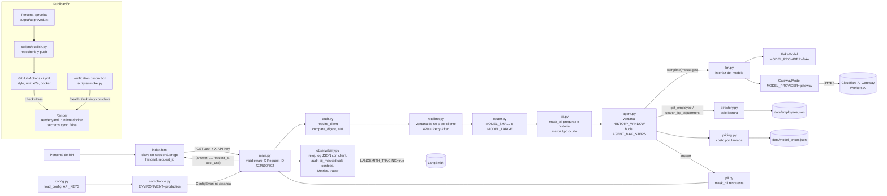

# Arquitectura del HR Assistant

Asistente de Recursos Humanos que responde preguntas sobre empleados desde una página web. Una API FastAPI
sin estado delega cada pregunta a un único agente con bucle con tope. Un enrutador por regla elige el modelo
(pequeño o grande), el agente lo usa detrás de la interfaz `complete(messages)` y dos herramientas de solo
lectura consultan `data/employees.json`. Cada petición lleva un `request_id`, deja eventos JSON en el log,
suma tokens y costo a las métricas del proceso y, si se enciende, deja trazas en LangSmith.

Desde la sesión 4, `/ask` y `/metrics` exigen una clave por cliente (`X-API-Key`) y un límite de peticiones por
minuto. Con `ENVIRONMENT=production` el producto se niega a arrancar si la configuración incumple las reglas de
compliance. Se empaqueta en un contenedor, el CI de GitHub Actions lo prueba por etapas y Render lo publica solo
si el CI pasa. La publicación empieza con la aprobación de una persona y termina con la prueba de humo.

También en la sesión 4, por decisión de la persona, `main.py` enmascara la PII (email, CURP, RFC, tarjeta, NSS y
teléfono) de la pregunta y el historial antes de llamar al agente, y la de la respuesta antes de devolverla
(ADR 0012).

`pii.py` aparece dos veces en el diagrama porque `main.py` lo llama dos veces por petición: antes del agente y
después. El enrutador recibe la pregunta original, que no sale del proceso.

## Componentes

- `config.py`: configuración validada al arrancar; `ENVIRONMENT`, `API_KEYS` (sin `repr`) y
  `RATE_LIMIT_PER_MINUTE`; exige `CF_*` con `gateway`; los secretos no se imprimen.
- `auth.py`: lectura de `API_KEYS`, `KeyRing` con `hmac.compare_digest` y la dependencia `require_client`.
- `ratelimit.py`: `RateLimiter` por cliente con ventana deslizante y reloj inyectado.
- `compliance.py`: reglas de producción; devuelve las incumplidas sin mostrar claves.
- `directory.py`: datos de empleados, las dos herramientas y `departments()`.
- `llm.py`: interfaz `complete(messages)`, `FakeModel`, `GatewayModel` y `build_models`.
- `router.py`: regla que elige el modelo por pregunta y devuelve el motivo.
- `pricing.py`: tabla de precios en USD por millón de tokens y costo por llamada.
- `pii.py`: `mask_pii(text)` reemplaza email, CURP, RFC, tarjeta, NSS y teléfono por `[<tipo> oculto]` con
  expresiones regulares en orden fijo (`PII_PATTERNS`) y devuelve los conteos por tipo; no enmascara la salida de
  las herramientas.
- `agent.py`: ventana de historial, bucle con tope y protocolo JSON; pasa `client` a las trazas.
- `observability.py`: reloj inyectable, log JSON por evento, métricas del proceso y tracer opcional.
- `main.py`: rutas `GET /`, `GET /health`, `POST /ask` y `GET /metrics` (estas dos con clave);
  `create_app()` recibe sus dependencias; en `/ask` enmascara entrada y respuesta con `pii.py` y `_log_pii` emite
  `audit` con `action: "pii_masked"` y solo conteos.
- `static/index.html`: interfaz web; campo de clave tipo contraseña, pinta con `textContent`.
- Fuera de `app/`: `Dockerfile` (`python:3.12-slim`, usuario no root), `.dockerignore`,
  `.github/workflows/ci.yml`, `render.yaml` y `scripts/smoke.py`. `render.yaml` y `ci.yml` deben quedar en la raíz
  del repositorio publicado.

## Decisiones

- [0001 API sin estado](adr/0001-stateless-api.md)
- [0002 Modelo detrás de una interfaz](adr/0002-model-interface.md)
- [0003 Bucle con tope y protocolo JSON](adr/0003-bounded-agent-loop.md)
- [0004 Configuración validada al arrancar e inyección de dependencias](adr/0004-fail-fast-config.md)
- [0005 Id por petición, log JSON y métricas por proceso](adr/0005-request-id-json-logs-metrics.md)
  (actualizado por 0012: `audit` admite `action: "pii_masked"`)
- [0006 Modelo real a través de Cloudflare AI Gateway](adr/0006-gateway-model-provider.md)
  (reemplaza la restricción de 0004 que solo admitía `fake`)
- [0007 Palancas de costo medibles](adr/0007-cost-levers.md)
- [0008 Palabras clave del enrutador al inicio de una palabra](adr/0008-router-keyword-word-start.md)
  (precisa la regla de coincidencia de 0007)
- [0009 Una clave por cliente con una dependencia de FastAPI](adr/0009-api-key-per-client.md)
- [0010 Límite de peticiones por cliente en memoria del proceso](adr/0010-in-process-rate-limit.md)
  (excepción acotada a 0001)
- [0011 Compliance como código al arrancar y publicación solo con CI verde](adr/0011-compliance-as-code-and-gated-deploy.md)
- [0012 Enmascarado de PII en la pregunta, el historial y la respuesta](adr/0012-pii-masking.md)
  (amplía el evento `audit` de 0005)
